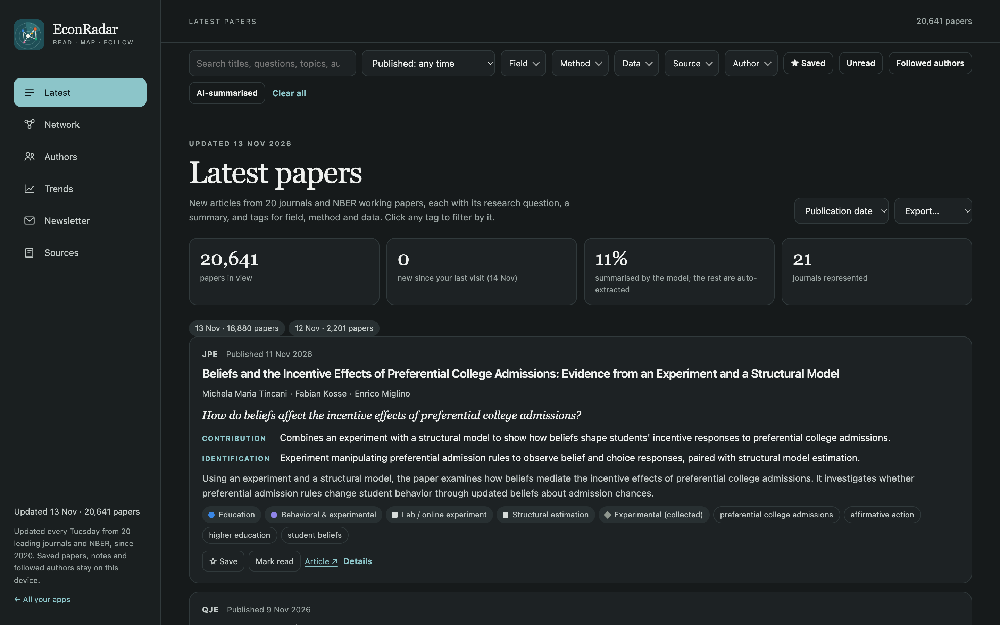
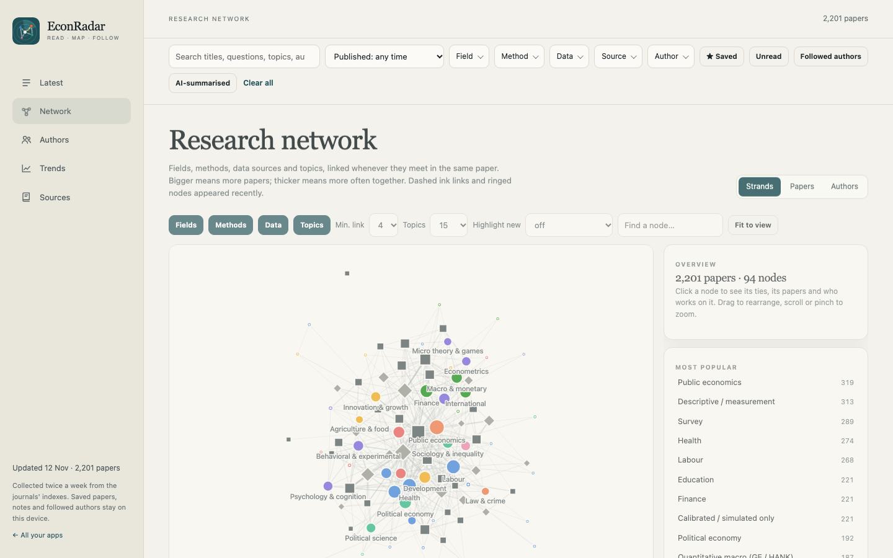
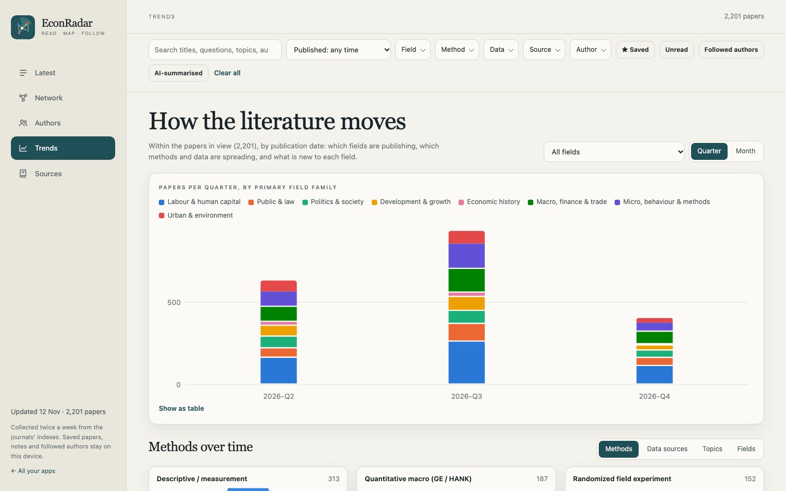

[Open EconRadar ↗](https://rfernex.github.io/Apps/radar/){.btn-cta}

Let's be honest, keeping track with all that is coming out is not always easy (especially if like me you tend to shun twitter..), let alone keeping a bird view of how all those new papers might relate to (or differ from) one another. That's exactly why this little app is here to help ! Now, here are the three things the App does and which could genuinely save you time or help you look differently at the current research landscape in your preffered field : 
- **What's out there ? :** the number one goal of the app is obviously to reference as many publications as possible with new ones added every week so you don't miss your next life-changing paper that's going to make you rethink your whole career. For now I set up the app to scrap data from NBER as well as the top 20 econ journals but I might expand the pool in a near future (especially when it comes to domains of economics that are a bit more niche like econ history, where smaller journals definitely have interesting things to show)
- **How does it fit in the great scheme of things ?** : Knowing a paper exists is nice yes, but, unless you are already very well informed about a literature or your brain nevers runs out of memory, it might be hard to identify on the spot how it distinguishes itself from prior works on a related subject or, conversely, what it takes from them. This is what the network tab is for ! By providing a synthetic view of the full database available on EconRadar, you can quickly dive into a paper, topic or research method of your choice and get a good feel of where it fits with the rest. This is especially useful to try and pin down one of those annoying research gap which keep evading you. 
- **Who does what ?** : As in any line of work, if you want to work on something it's always better to know who wrote about it first. The author page essentially gives you a detailed list of all recent contributors in your field of interest and let's you create your own list of top authors based on their contributions, research interests and so on.. 

{fig-alt="EconRadar's list of latest papers, each with its journal, publication date, research question, contribution, identification strategy and tags."}

### What you will find on the site (in Short-)

- **Latest:** every new paper with its question, contribution and identification, filterable by field, method, data, journal, author and publication date, and exportable to BibTeX, RIS or CSV.
- **Network:** fields, methods, data sources and topics linked whenever they meet in a paper, so that new combinations stand out, such as a method entering a field or a new kind of data. Other views link papers to their nearest neighbours and authors to the fields they publish in and to their co-authors. A replay rebuilds the map week by week.
- **Trends:** what each field publishes over time, which methods and data are spreading or fading, and a log of "firsts", the first time a method or a data source appears in a field.
- **Authors:** who publishes on what, with profiles, co-authors, and a flag on new papers by the authors I follow.

{fig-alt="A force-directed network of economics fields, methods, data sources and topics, coloured by field family."}

{fig-alt="A stacked bar chart of papers per quarter by field family, above small multiples of methods over time."}

### How it is built
EconRadar is hosted directly on github and its database is maintained via weekly LLM extracts which retrieve new papers and summarizes them based on a predefined list of instructions. While I am currently relying on a very simple infrastructure with barebone Claude API calls right now that are run from my Claude Pro account, I plan on setting up a proper instruction-based  open-weight LLM model (probably Qwen of Gemma) on a Linux VM to handle most processing steps currently performed by Claude. This should ensure the app is self-reliant and does not depend on pricey API-based commercial LLMs to stay relevant.

