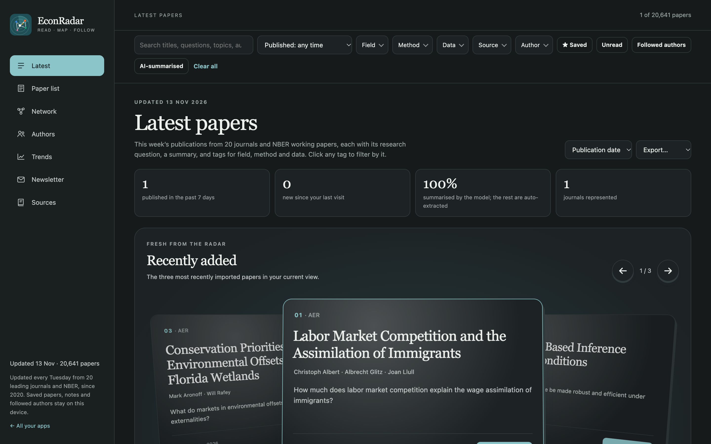
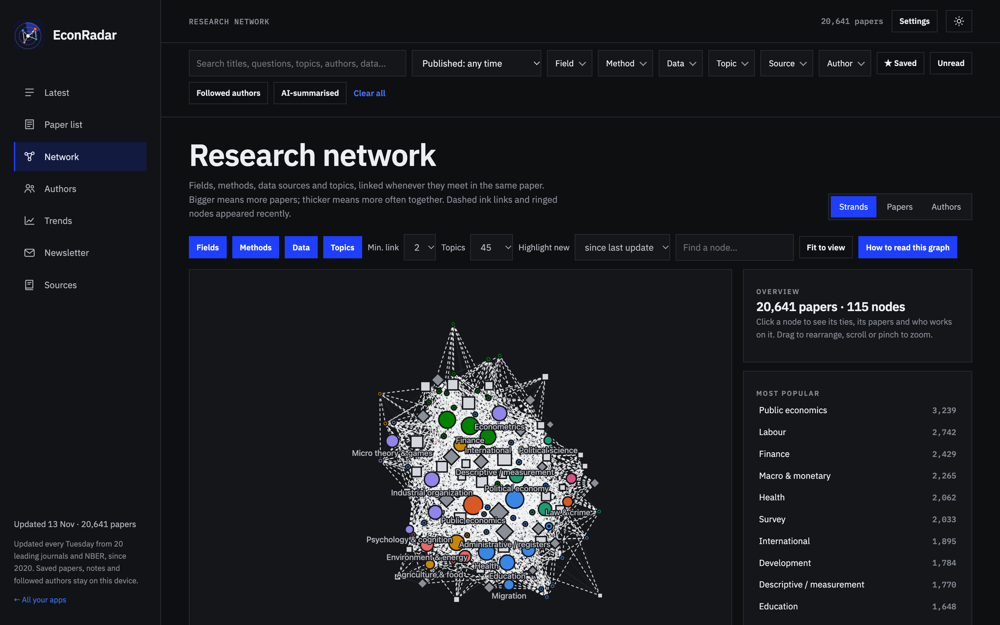
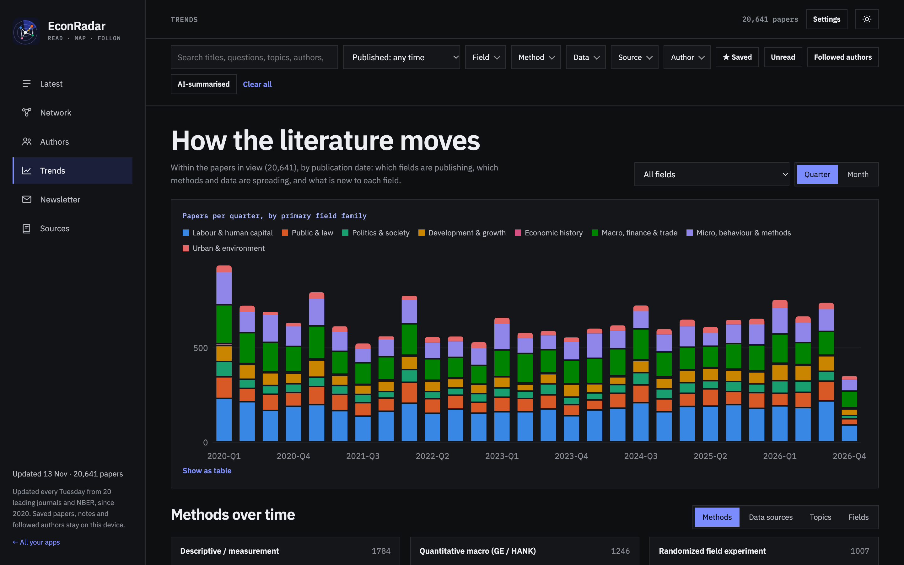
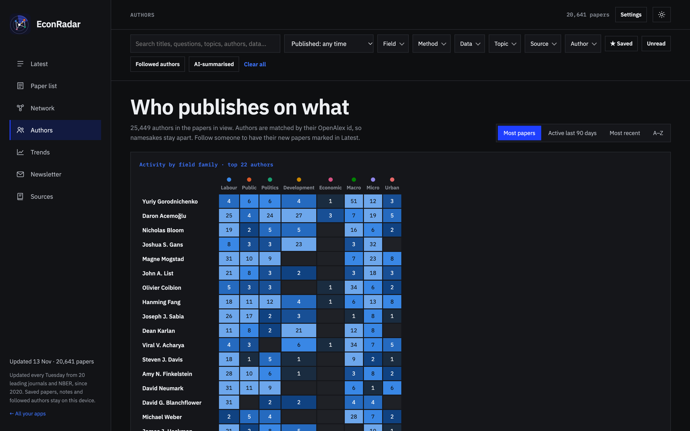

::: {.column-screen .radar-hero}
```{=html}
<link rel="stylesheet" href="assets/econradar/hero.css?v=8">
<canvas class="hero-field" data-dot="176,180,188" data-hot="123,140,255" data-sweep=".rh-sweep" aria-hidden="true"></canvas>
<div class="rh-art" aria-hidden="true">
  <div class="rh-bg"></div>
  <div class="rh-beam"></div>
  <div class="rh-reveal"></div>
  <div class="rh-sweep"></div>
</div>
<div class="rh-flash" aria-hidden="true"></div>
<div class="rh-inner">
  <div class="rh-title" role="heading" aria-level="1">EconRadar</div>
  <p class="rh-sub">My little app to keep up with the literature weekly, and now it's yours too!</p>
  <a class="radar-launch" href="https://rfernex.github.io/Apps/radar/">
    <span class="rl-ping" aria-hidden="true"></span>
    <span class="rl-label">Open EconRadar</span>
    <span class="rl-arrow" aria-hidden="true">↗</span>
  </a>
  <p class="rh-stats"><span data-radar-total>20,000+</span> papers · 20 journals and NBER · <span data-radar-updated>updated every week</span></p>
</div>
<script src="assets/econradar/hero.js?v=6" defer></script>
```
:::

::: {.rx-lead .rx-reveal}
Let's be honest, keeping track of all that is coming out is not always easy (especially if, like me, you tend to shun Twitter...), let alone keeping a bird's-eye view of how all those new papers might relate to (or differ from) one another. That's exactly why this little app is here to help! Now, here are the three things the app does that could genuinely save you time or help you look differently at the current research landscape in your preferred field:
:::

:::: {.rx-features .column-page}
::: {.rx-feature .rx-reveal}
[01]{.rx-num}

#### What's out there? {.unnumbered}

The number one goal of the app is obviously to reference as many publications as possible, with new ones added every week, so you don't miss your next life-changing paper that's going to make you rethink your whole career. For now, I set up the app to scrape data from NBER as well as the top 20 econ journals, but I might expand the pool in the near future (especially when it comes to fields of economics that are a bit more niche, like econ history, where smaller journals definitely have interesting things to show).
:::

::: {.rx-feature .rx-reveal}
[02]{.rx-num}

#### How does it fit in the grand scheme of things? {.unnumbered}

Knowing a paper exists is nice, yes, but unless you are already very well informed about a literature or your brain never runs out of memory, it might be hard to identify on the spot how it distinguishes itself from prior work on a related subject or, conversely, what it takes from them. This is what the network tab is for! By providing a synthetic view of the full database available on EconRadar, you can quickly dive into a paper, topic or research method of your choice and get a good feel for where it fits with the rest. This is especially useful to try and pin down one of those annoying research gaps that keep evading you.
:::

::: {.rx-feature .rx-reveal}
[03]{.rx-num}

#### Who does what? {.unnumbered}

As in any line of work, if you want to work on something, it's always better to know who wrote about it first. The author page essentially gives you a detailed list of all recent contributors in your field of interest and lets you create your own list of top authors based on their contributions, research interests and so on.
:::
::::

### What you will find on the site (in short)

:::: {.rx-showcase .column-page .rx-reveal}
::: {.rx-tab}
#### Latest {.unnumbered}

Every new paper with its question, contribution and identification, filterable by field, method, data, journal, author and publication date, and exportable to BibTeX, RIS or CSV.

{fig-alt="EconRadar's list of latest papers, each with its journal, publication date, research question, contribution, identification strategy and tags." group="econradar"}
:::

::: {.rx-tab}
#### Network {.unnumbered}

Fields, methods, data sources and topics linked whenever they meet in a paper, so that new combinations stand out, such as a method entering a field or a new kind of data. Other views link papers to their nearest neighbours and authors to the fields they publish in and to their co-authors. A replay rebuilds the map week by week.

{fig-alt="A force-directed network of economics fields, methods, data sources and topics, coloured by field family." group="econradar"}
:::

::: {.rx-tab}
#### Trends {.unnumbered}

What each field publishes over time, which methods and data are spreading or fading, and a log of "firsts", the first time a method or a data source appears in a field.

{fig-alt="A stacked bar chart of papers per quarter by field family, above small multiples of methods over time." group="econradar"}
:::

::: {.rx-tab}
#### Authors {.unnumbered}

Who publishes on what, with profiles, co-authors, and a flag on new papers by the authors I follow.

{fig-alt="A table of the most active authors with their number of papers in each field family." group="econradar"}
:::
::::

### How it is built

EconRadar is hosted directly on GitHub, and its database is maintained via weekly LLM extracts which retrieve new papers and summarize them based on a predefined list of instructions. While I am currently relying on a very simple infrastructure with barebones Claude API calls that are run from my Claude Pro account, I plan on setting up a proper instruction-based open-weight LLM (probably Qwen or Gemma) on a Linux VM to handle most processing steps currently performed by Claude. This should ensure the app is self-reliant and does not depend on pricey API-based commercial LLMs to stay relevant.

```{=html}
<div class="rx-pipeline rx-reveal" aria-label="How EconRadar is updated">
  <div class="rx-step"><span class="rx-num">01</span><b>Collect</b><span>New papers from NBER and 20 journals, every week</span></div>
  <div class="rx-step"><span class="rx-num">02</span><b>Summarise</b><span>An LLM extracts each paper's question, contribution, identification and tags</span></div>
  <div class="rx-step"><span class="rx-num">03</span><b>Publish</b><span>The database and the app are updated on GitHub</span></div>
  <i class="rx-pulse" aria-hidden="true"></i>
</div>
```
