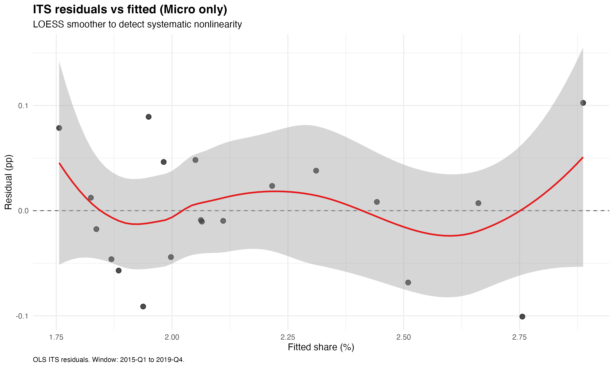
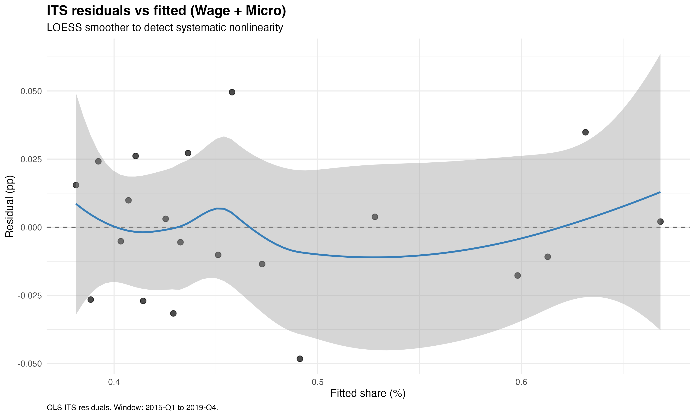
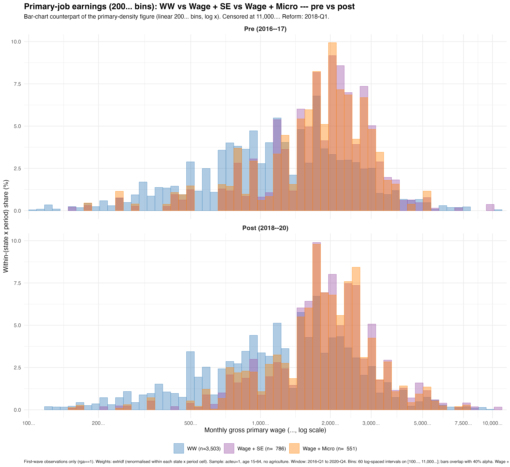
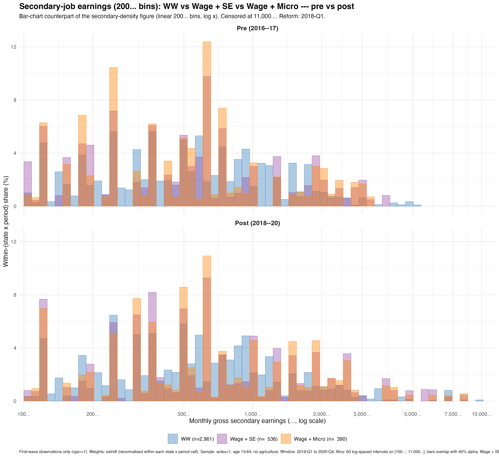

This page reproduces the appendix of my master thesis, [Self-employment and dual jobholding](thesis.qmd), written at Sciences Po under the supervision of Pierre Cahuc. It documents how occupational states are built from the French Labour Force Survey, the robustness checks of the interrupted time series, the full coefficient tables of the individual-level models, the socio-professional profile of hybrid microentrepreneurs, the earnings distributions of dual jobholders, the derivations of both versions of the structural model, and the grids of calibrated parameters. Section letters follow those of the [full thesis (PDF)](Resources/sciences-po-thesis.pdf).

::: {.btn-row}
[← Back to the thesis overview](thesis.qmd){.btn-ghost} [Full thesis (PDF)](Resources/sciences-po-thesis.pdf){.btn-ghost}
:::

## A. Classification Rules for `indep_type` and `micro_type` {#app-classification_rules}

I define two main different categorical variables : indep_type and micro_type. The former is used to classify individuals based on whether they are salaried on non salaried and is meant as a broader categorization, which incorporates microentrepreneurs as well as other independents and distinguishes them from the wage-employed.

To this end, I rely on the following variables from the Enquête Emploi en Continu.

<table>
<thead>
<tr>
<th style="text-align: left;"><strong>Variable</strong></th>
<th style="text-align: left;"><strong>Definition (EEC documentation, summarised)</strong></th>
</tr>
</thead>
<tbody>
<tr>
<td style="text-align: left;"><code>stc</code></td>
<td style="text-align: left;">Status declared in the main job: <code>1</code> self-employed, <code>2</code> salaried CEO / corporate officer, <code>3</code> salaried (non-CEO), <code>4</code> family worker without pay.</td>
</tr>
<tr>
<td style="text-align: left;"><code>plract</code></td>
<td style="text-align: left;">Multiple-activity flag: <code>1</code> yes, <code>2</code> no.</td>
</tr>
<tr>
<td style="text-align: left;"><code>uneprof</code></td>
<td style="text-align: left;">Several different professions: <code>1</code> one, <code>2</code> several.</td>
</tr>
<tr>
<td style="text-align: left;"><code>nbtemp</code></td>
<td style="text-align: left;">Number of employers in the main profession: <code>1</code> single, <code>2</code> several with a main one, <code>3</code> several without a main one.</td>
</tr>
<tr>
<td style="text-align: left;"><code>autoent</code></td>
<td style="text-align: left;">Main activity is an auto-entreprise: <code>1</code> yes, <code>2</code> no.</td>
</tr>
<tr>
<td style="text-align: left;"><code>autoenta</code></td>
<td style="text-align: left;">Second-profession activity is an auto-entreprise: <code>1</code> yes, <code>2</code> no.</td>
</tr>
<tr>
<td style="text-align: left;"><code>autoentb</code>,<code>autoentc</code></td>
<td style="text-align: left;">Same flag for third / fourth professions.</td>
</tr>
<tr>
<td style="text-align: left;"><code>statuts2</code></td>
<td style="text-align: left;">Status in the second profession (same coding as <code>stc</code>).</td>
</tr>
<tr>
<td style="text-align: left;"><code>statuts3</code>,<code>statuts4</code></td>
<td style="text-align: left;">Status in the third / fourth profession.</td>
</tr>
</tbody>
</table>

In both classifications, I exclude workers who are family workers without pay or who are salaried CEOs as they do not correspond to the definitions of both wage and self-employment I adopt throughout this paper. Similarly, as mentioned earlier, I exclude people with more than two different occupations to avoid wrongfully classifying individuals for whom it can be argued that they fit in more categories than one (for instance people with two wage jobs as well as a side business). Both exclusions are fairly minor in size but I do not exclude them from the working population, only from the two primary classifications. This explains why the sum of the shares of people in all categories of indep_type or micro_type in the working active population does not necessarily sum to one.

### Micro_type classification {#micro_type-classification .unnumbered}

##### Categories :

`Wage only`, `Micro only`, `Wage + Wage`, `Wage + Micro`, `Micro + Wage`, `Micro + Micro`.

**Rule table :**

<table>
<thead>
<tr>
<th style="text-align: center;"><strong>#</strong></th>
<th style="text-align: left;"><strong>Condition</strong></th>
<th style="text-align: left;"><strong>Assigned value</strong></th>
</tr>
</thead>
<tbody>
<tr>
<td style="text-align: center;">1</td>
<td style="text-align: left;"><code>!is.na(autoentb) | !is.na(autoentc)</code></td>
<td style="text-align: left;"><code>NA</code> <em>(3rd/4th auto-entreprise slot used)</em></td>
</tr>
<tr>
<td style="text-align: center;">2</td>
<td style="text-align: left;"><code>!is.na(statuts3) | !is.na(statuts4)</code></td>
<td style="text-align: left;"><code>NA</code> <em>(3rd/4th profession declared)</em></td>
</tr>
<tr>
<td style="text-align: center;">3</td>
<td style="text-align: left;"><code>stc == 3 &amp; plract == 2</code></td>
<td style="text-align: left;"><code>Wage only</code></td>
</tr>
<tr>
<td style="text-align: center;">4</td>
<td style="text-align: left;"><code>autoent == 1 &amp; plract == 2</code></td>
<td style="text-align: left;"><code>Micro only</code></td>
</tr>
<tr>
<td style="text-align: center;">5</td>
<td style="text-align: left;"><code>plract == 1 &amp; stc == 3 &amp; autoenta == 1</code></td>
<td style="text-align: left;"><code>Wage + Micro</code></td>
</tr>
<tr>
<td style="text-align: center;">6</td>
<td style="text-align: left;"><code>plract == 1 &amp; stc == 3 &amp; uneprof == 2 &amp; statuts2 == 3</code></td>
<td style="text-align: left;"><code>Wage + Wage</code></td>
</tr>
<tr>
<td style="text-align: center;">7</td>
<td style="text-align: left;"><code>plract == 1 &amp; stc == 3 &amp; uneprof == 1 &amp; nbtemp </code>∈<code> {2,3}</code></td>
<td style="text-align: left;"><code>Wage + Wage</code></td>
</tr>
<tr>
<td style="text-align: center;">8</td>
<td style="text-align: left;"><code>plract == 1 &amp; autoent == 1 &amp; autoenta == 1</code></td>
<td style="text-align: left;"><code>Micro + Micro</code></td>
</tr>
<tr>
<td style="text-align: center;">9</td>
<td style="text-align: left;"><code>plract == 1 &amp; autoent == 1 &amp; statuts2 == 3</code></td>
<td style="text-align: left;"><code>Micro + Wage</code></td>
</tr>
<tr>
<td style="text-align: center;">10</td>
<td style="text-align: left;">otherwise</td>
<td style="text-align: left;"><code>NA</code></td>
</tr>
</tbody>
</table>

From a coding perspective, rules are evaluated top-to-bottom via `dplyr::case_when`. The fall-through (`TRUE`) assigns `NA`.

In line with the INSEE definition of multiple jobholding I consider both people with several professional activities or with several employers but a single professional activity as dual jobholders. As the number of employers is necessarily relevant for the wage-employed only, I classify people in this category who report having more than one employer as dual-wage jobholders.

### Indep_type classification {#indep_type-classification .unnumbered}

##### Categories : 

`Wage only`, `Independent only`, `Wage + Wage`, `Wage + Independent`, `Independent + Wage`, `Independent + Independent`.

**Rule table :**

<table>
<thead>
<tr>
<th style="text-align: center;"><strong>#</strong></th>
<th style="text-align: left;"><strong>Condition</strong></th>
<th style="text-align: left;"><strong>Assigned value</strong></th>
</tr>
</thead>
<tbody>
<tr>
<td style="text-align: center;">1</td>
<td style="text-align: left;"><code>stc </code>∈<code> {2,4}</code></td>
<td style="text-align: left;"><code>NA</code> <em>(salaried CEO or family worker)</em></td>
</tr>
<tr>
<td style="text-align: center;">2</td>
<td style="text-align: left;"><code>!is.na(statuts2) &amp; statuts2 </code>∈<code> {2,4}</code></td>
<td style="text-align: left;"><code>NA</code> <em>(secondary slot is salaried CEO/family)</em></td>
</tr>
<tr>
<td style="text-align: center;">3</td>
<td style="text-align: left;"><code>!is.na(statuts3) | !is.na(statuts4)</code></td>
<td style="text-align: left;"><code>NA</code> <em>(3rd/4th profession declared)</em></td>
</tr>
<tr>
<td style="text-align: center;">4</td>
<td style="text-align: left;"><code>stc == 3 &amp; plract == 2</code></td>
<td style="text-align: left;"><code>Wage only</code></td>
</tr>
<tr>
<td style="text-align: center;">5</td>
<td style="text-align: left;"><code>stc == 1 &amp; plract == 2</code></td>
<td style="text-align: left;"><code>Independent only</code></td>
</tr>
<tr>
<td style="text-align: center;">6</td>
<td style="text-align: left;"><code>plract == 1 &amp; stc == 3 &amp; uneprof == 2 &amp; statuts2 == 1</code></td>
<td style="text-align: left;"><code>Wage + Independent</code></td>
</tr>
<tr>
<td style="text-align: center;">7</td>
<td style="text-align: left;"><code>plract == 1 &amp; stc == 3 &amp; uneprof == 2 &amp; statuts2 == 3</code></td>
<td style="text-align: left;"><code>Wage + Wage</code></td>
</tr>
<tr>
<td style="text-align: center;">8</td>
<td style="text-align: left;"><code>plract == 1 &amp; stc == 3 &amp; uneprof == 1 &amp; nbtemp </code>∈<code> {2,3}</code></td>
<td style="text-align: left;"><code>Wage + Wage</code></td>
</tr>
<tr>
<td style="text-align: center;">9</td>
<td style="text-align: left;"><code>plract == 1 &amp; stc == 1 &amp; uneprof == 2 &amp; statuts2 == 1</code></td>
<td style="text-align: left;"><code>Independent + Independent</code></td>
</tr>
<tr>
<td style="text-align: center;">10</td>
<td style="text-align: left;"><code>plract == 1 &amp; stc == 1 &amp; uneprof == 2 &amp; statuts2 == 3</code></td>
<td style="text-align: left;"><code>Independent + Wage</code></td>
</tr>
<tr>
<td style="text-align: center;">11</td>
<td style="text-align: left;">otherwise</td>
<td style="text-align: left;"><code>NA</code></td>
</tr>
</tbody>
</table>

This classification follows the same overall logic, but I distinguish people who are self-employed from the wage employed instead of adopting the previous narrower definition which restricts self-employment to microentrepreneurs. As stated above, salaried CEOs are explicitly removed by rules 1--2 because they are not self-employed in the sense relevant for this analysis.

## B. Robustness Checks for the Aggregate and Individual-Level ITS Designs {#app-robustness}

### Aggregate ITS robustness {#aggregate-its-robustness .unnumbered}

#### Reduced estimation window {#reduced-estimation-window .unnumbered}

The baseline aggregate ITS is estimated on the full 2015-Q1 to 2019-Q4 window, yielding 12 pre-reform and 8 post-reform quarters. To verify that the results are not driven by the earliest pre-reform quarters, which are furthest from the reform and therefore most susceptible to confounding by earlier policy changes (notably the progressive implementation of the Loi Pinel between 2014 and 2016), I re-estimate the specification on the shorter 2016-Q1 to 2019-Q4 window (8 pre, 8 post). If the estimated coefficients change substantially, this would suggest that the pre-reform trend is sensitive to the inclusion of the 2015 observations and may not be well captured by a linear specification over the full window.

::: {#tab:reduced_me}
<table>
<caption>Aggregate ITS: reduced window (2016-Q1 to 2019-Q4), Micro only and Wage only</caption>
<thead>
<tr>
<th style="text-align: left;"></th>
<th style="text-align: center;">Wage only</th>
<th style="text-align: center;">Micro only</th>
</tr>
</thead>
<tbody>
<tr>
<td style="text-align: left;">Intercept (<i>α</i>)</td>
<td style="text-align: center;">85.473***</td>
<td style="text-align: center;">1.799***</td>
</tr>
<tr>
<td style="text-align: left;"></td>
<td style="text-align: center;">(0.036)</td>
<td style="text-align: center;">(0.022)</td>
</tr>
<tr>
<td style="text-align: left;">Pre-reform trend (<i>β̂</i>1)</td>
<td style="text-align: center;">−0.004</td>
<td style="text-align: center;">0.034***</td>
</tr>
<tr>
<td style="text-align: left;"></td>
<td style="text-align: center;">(0.009)</td>
<td style="text-align: center;">(0.006)</td>
</tr>
<tr>
<td style="text-align: left;">Level shift (<i>β̂</i>2)</td>
<td style="text-align: center;">−0.203***</td>
<td style="text-align: center;">−0.120*</td>
</tr>
<tr>
<td style="text-align: left;"></td>
<td style="text-align: center;">(0.035)</td>
<td style="text-align: center;">(0.041)</td>
</tr>
<tr>
<td style="text-align: left;">Post-reform slope (<i>β̂</i>3)</td>
<td style="text-align: center;">−0.100***</td>
<td style="text-align: center;">0.076***</td>
</tr>
<tr>
<td style="text-align: left;"></td>
<td style="text-align: center;">(0.012)</td>
<td style="text-align: center;">(0.007)</td>
</tr>
<tr>
<td style="text-align: left;">Seasonal controls</td>
<td style="text-align: center;">Yes</td>
<td style="text-align: center;">Yes</td>
</tr>
<tr>
<td style="text-align: left;">Observations</td>
<td style="text-align: center;">16</td>
<td style="text-align: center;">16</td>
</tr>
<tr>
<td style="text-align: left;"><i>R</i>2</td>
<td style="text-align: center;">0.961</td>
<td style="text-align: center;">0.970</td>
</tr>
<tr>
<td style="text-align: left;">HAC lag <i>L</i></td>
<td style="text-align: center;">5</td>
<td style="text-align: center;">5</td>
</tr>
</tbody>
</table>
:::

*Notes:* OLS with Newey--West HAC standard errors (Bartlett kernel, fixed bandwidth $L=5$), quarter FE. Classification: `micro_type`. Sample: `acteu` $=1$, age $\geq 15$, 2016-Q1 to 2019-Q4.\
$^{***}p < 0.001$, $^{**}p < 0.01$, $^{*}p < 0.05$, $^{\dagger}p < 0.1$.

::: {#tab:reduced_wm}
<table>
<caption>Aggregate ITS: reduced window (2016-Q1 to 2019-Q4), Wage + Wage and Wage + Micro</caption>
<thead>
<tr>
<th style="text-align: left;"></th>
<th style="text-align: center;">Wage + Wage</th>
<th style="text-align: center;">Wage + Micro</th>
</tr>
</thead>
<tbody>
<tr>
<td style="text-align: left;">Intercept (<i>α</i>)</td>
<td style="text-align: center;">3.312***</td>
<td style="text-align: center;">0.403***</td>
</tr>
<tr>
<td style="text-align: left;"></td>
<td style="text-align: center;">(0.017)</td>
<td style="text-align: center;">(0.014)</td>
</tr>
<tr>
<td style="text-align: left;">Pre-reform trend (<i>β̂</i>1)</td>
<td style="text-align: center;">−0.008*</td>
<td style="text-align: center;">0.010***</td>
</tr>
<tr>
<td style="text-align: left;"></td>
<td style="text-align: center;">(0.004)</td>
<td style="text-align: center;">(0.002)</td>
</tr>
<tr>
<td style="text-align: left;">Level shift (<i>β̂</i>2)</td>
<td style="text-align: center;">0.359***</td>
<td style="text-align: center;">−0.057*</td>
</tr>
<tr>
<td style="text-align: left;"></td>
<td style="text-align: center;">(0.056)</td>
<td style="text-align: center;">(0.020)</td>
</tr>
<tr>
<td style="text-align: left;">Post-reform slope (<i>β̂</i>3)</td>
<td style="text-align: center;">−0.052***</td>
<td style="text-align: center;">0.025***</td>
</tr>
<tr>
<td style="text-align: left;"></td>
<td style="text-align: center;">(0.010)</td>
<td style="text-align: center;">(0.004)</td>
</tr>
<tr>
<td style="text-align: left;">Seasonal controls</td>
<td style="text-align: center;">Yes</td>
<td style="text-align: center;">Yes</td>
</tr>
<tr>
<td style="text-align: left;">Observations</td>
<td style="text-align: center;">16</td>
<td style="text-align: center;">16</td>
</tr>
<tr>
<td style="text-align: left;"><i>R</i>2</td>
<td style="text-align: center;">0.797</td>
<td style="text-align: center;">0.933</td>
</tr>
<tr>
<td style="text-align: left;">HAC lag <i>L</i></td>
<td style="text-align: center;">5</td>
<td style="text-align: center;">5</td>
</tr>
</tbody>
</table>
:::

*Notes:* OLS with Newey--West HAC standard errors (Bartlett kernel, fixed bandwidth $L=5$), quarter FE. Classification: `micro_type`. Sample: `acteu` $=1$, age $\geq 15$, 2016-Q1 to 2019-Q4.\
$^{***}p < 0.001$, $^{**}p < 0.01$, $^{*}p < 0.05$, $^{\dagger}p < 0.1$.

The reduced-window estimates are very close to the baseline. For Micro only, the post-reform slope change is 0.076^\*\*\*^ on the shorter window compared to 0.083^\*\*\*^ on the full window, and the pre-reform trend rises from 0.028 to 0.034 pp/quarter, consistent with the Loi Pinel having slightly depressed growth in the earliest quarters of the full sample. For Wage + Micro, $\hat\beta_3$ is 0.025^\*\*\*^ versus 0.030^\*\*\*^ on the full window, a difference well within the confidence interval. The level shifts and seasonal controls are likewise stable. These results confirm that the main findings are not an artifact of the choice of pre-reform window length.

#### Placebo reform date {#placebo-reform-date .unnumbered}

I re-estimate the ITS specification using 2016-Q1 as a placebo reform date, restricting the sample to pre-treatment data only (2014-Q2 to 2017-Q4, 7 pre and 8 post quarters) to avoid contamination by the true reform. If the ITS design is valid, the placebo should produce no significant slope change for Micro only or Wage + Micro workers, while the true reform date should yield the significant effects documented in the main text. I report both the placebo and the true-reform estimates side by side, where the true-reform column uses a symmetric 8-pre/8-post window (2016-Q1 to 2019-Q4).

::: {#tab:placebo_me}
<table>
<caption>Placebo test: Wage only vs Micro only (classification: <code>micro_type</code>)</caption>
<tbody>
<tr>
<td style="text-align: left;"></td>
<td colspan="2" style="text-align: center;">2016-Q1 (placebo)</td>
<td colspan="2" style="text-align: center;">2018-Q1 (true)</td>
</tr>
<tr>
<td style="text-align: left;"></td>
<td style="text-align: center;">Wage only</td>
<td style="text-align: center;">Micro only</td>
<td style="text-align: center;">Wage only</td>
<td style="text-align: center;">Micro only</td>
</tr>
<tr>
<td style="text-align: left;">Level shift (<i>β̂</i>2)</td>
<td style="text-align: center;">−0.020</td>
<td style="text-align: center;">−0.073†</td>
<td style="text-align: center;">−0.203***</td>
<td style="text-align: center;">−0.120*</td>
</tr>
<tr>
<td style="text-align: left;"></td>
<td style="text-align: center;">(0.059)</td>
<td style="text-align: center;">(0.034)</td>
<td style="text-align: center;">(0.035)</td>
<td style="text-align: center;">(0.041)</td>
</tr>
<tr>
<td style="text-align: left;">Post-reform slope (<i>β̂</i>3)</td>
<td style="text-align: center;">−0.049*</td>
<td style="text-align: center;">0.002</td>
<td style="text-align: center;">−0.100***</td>
<td style="text-align: center;">0.076***</td>
</tr>
<tr>
<td style="text-align: left;"></td>
<td style="text-align: center;">(0.021)</td>
<td style="text-align: center;">(0.011)</td>
<td style="text-align: center;">(0.012)</td>
<td style="text-align: center;">(0.007)</td>
</tr>
</tbody>
</table>
:::

*Notes:* OLS with Newey--West HAC SEs (Bartlett, $L=5$) and quarter FE. Placebo uses 2014-Q2 to 2017-Q4 (7 pre / 8 post quarters), true reform uses 2016-Q1 to 2019-Q4 (8 pre / 8 post). Classification: `micro_type`.\
$^{***}p < 0.001$, $^{**}p < 0.01$, $^{*}p < 0.05$, $^{\dagger}p < 0.1$.

::: {#tab:placebo_wm}
<table>
<caption>Placebo test: Wage + Wage vs Wage + Micro (classification: <code>micro_type</code>)</caption>
<tbody>
<tr>
<td style="text-align: left;"></td>
<td colspan="2" style="text-align: center;">2016-Q1 (placebo)</td>
<td colspan="2" style="text-align: center;">2018-Q1 (true)</td>
</tr>
<tr>
<td style="text-align: left;"></td>
<td style="text-align: center;">W+W</td>
<td style="text-align: center;">W+Micro</td>
<td style="text-align: center;">W+W</td>
<td style="text-align: center;">W+Micro</td>
</tr>
<tr>
<td style="text-align: left;">Level shift (<i>β̂</i>2)</td>
<td style="text-align: center;">−0.180**</td>
<td style="text-align: center;">−0.000</td>
<td style="text-align: center;">0.359***</td>
<td style="text-align: center;">−0.057*</td>
</tr>
<tr>
<td style="text-align: left;"></td>
<td style="text-align: center;">(0.039)</td>
<td style="text-align: center;">(0.010)</td>
<td style="text-align: center;">(0.056)</td>
<td style="text-align: center;">(0.020)</td>
</tr>
<tr>
<td style="text-align: left;">Post-reform slope (<i>β̂</i>3)</td>
<td style="text-align: center;">0.006</td>
<td style="text-align: center;">0.019***</td>
<td style="text-align: center;">−0.052***</td>
<td style="text-align: center;">0.025***</td>
</tr>
<tr>
<td style="text-align: left;"></td>
<td style="text-align: center;">(0.007)</td>
<td style="text-align: center;">(0.003)</td>
<td style="text-align: center;">(0.010)</td>
<td style="text-align: center;">(0.004)</td>
</tr>
</tbody>
</table>
:::

*Notes:* OLS with Newey--West HAC SEs (Bartlett, $L=5$) and quarter FE. Placebo uses 2014-Q2 to 2017-Q4 (7 pre / 8 post quarters), true reform uses 2016-Q1 to 2019-Q4 (8 pre / 8 post). Classification: `micro_type`.\
$^{***}p < 0.001$, $^{**}p < 0.01$, $^{*}p < 0.05$, $^{\dagger}p < 0.1$.

For Micro only, the placebo slope change is essentially zero (0.002, $p > 0.8$), while the true reform yields a highly significant 0.076^\*\*\*^. The level shift under the placebo is marginally significant at the 10% level (−0.073^†^), which is plausibly attributable to residual effects of the Loi Pinel's implementation in late 2015 and early 2016. For Wage + Micro, the placebo slope change is significant (0.019^\*\*\*^), indicating that hybrid micro-entrepreneurship was already on an accelerating trend prior to the 2018 reform. However, the true-reform slope change (0.025^\*\*\*^) is 30% larger in magnitude and estimated on a sample that includes the reform period, so the additional acceleration attributable to the 2018 threshold doubling remains economically meaningful. The placebo level shift for Wage + Micro is essentially zero, confirming no discrete jump at the placebo date.

#### HAC bandwidth sensitivity {#hac-bandwidth-sensitivity .unnumbered}

The primary specification uses Newey--West HAC standard errors with a Bartlett kernel and a fixed truncation lag of $L = 5$, chosen because the Enquête Emploi en Continu operates as a 6-quarter rotating panel with up to 5 overlapping cohorts contributing to each quarterly aggregate. If the lag is set too short, residual serial correlation is not fully absorbed and standard errors are downward-biased. Conversely, if it is too long, the finite-sample correction inflates standard errors unnecessarily. To assess the sensitivity of my results to the choice of bandwidth, I re-estimate both the baseline (2015-Q1 to 2019-Q4) and reduced (2016-Q1 to 2019-Q4) specifications under three different configurations: $L \in \{3, 5, 7\}$.

::: {#tab:hac_me}
<table>
<caption>HAC bandwidth sensitivity, Micro only</caption>
<tbody>
<tr>
<td style="text-align: left;"></td>
<td colspan="2" style="text-align: center;">Reduced (2016-Q1–2019-Q4)</td>
<td colspan="2" style="text-align: center;">Baseline (2015-Q1–2019-Q4)</td>
</tr>
<tr>
<td style="text-align: left;"></td>
<td style="text-align: center;"><i>β̂</i>2</td>
<td style="text-align: center;"><i>β̂</i>3</td>
<td style="text-align: center;"><i>β̂</i>2</td>
<td style="text-align: center;"><i>β̂</i>3</td>
</tr>
<tr>
<td style="text-align: left;">Point estimate</td>
<td style="text-align: center;">−0.120</td>
<td style="text-align: center;">0.076</td>
<td style="text-align: center;">−0.113</td>
<td style="text-align: center;">0.083</td>
</tr>
<tr>
<td style="text-align: left;">HAC <i>L</i> = 3</td>
<td style="text-align: center;">(0.042)*</td>
<td style="text-align: center;">(0.007)***</td>
<td style="text-align: center;">(0.038)*</td>
<td style="text-align: center;">(0.008)***</td>
</tr>
<tr>
<td style="text-align: left;">HAC <i>L</i> = 5</td>
<td style="text-align: center;">(0.041)*</td>
<td style="text-align: center;">(0.007)***</td>
<td style="text-align: center;">(0.036)**</td>
<td style="text-align: center;">(0.007)***</td>
</tr>
<tr>
<td style="text-align: left;">HAC <i>L</i> = 7</td>
<td style="text-align: center;">(0.038)*</td>
<td style="text-align: center;">(0.005)***</td>
<td style="text-align: center;">(0.031)**</td>
<td style="text-align: center;">(0.006)***</td>
</tr>
<tr>
<td style="text-align: left;"><i>N</i> (quarters)</td>
<td colspan="2" style="text-align: center;">16</td>
<td colspan="2" style="text-align: center;">20</td>
</tr>
</tbody>
</table>
:::

*Notes:* HAC $L=k$: Newey--West with Bartlett kernel and fixed truncation lag $k$. $L=5$ is the primary specification. Point estimates are identical across SE flavors (OLS).\
$^{***}p < 0.001$, $^{**}p < 0.01$, $^{*}p < 0.05$, $^{\dagger}p < 0.1$.

::: {#tab:hac_wm}
<table>
<caption>HAC bandwidth sensitivity, Wage + Micro</caption>
<tbody>
<tr>
<td style="text-align: left;"></td>
<td colspan="2" style="text-align: center;">Reduced (2016-Q1–2019-Q4)</td>
<td colspan="2" style="text-align: center;">Baseline (2015-Q1–2019-Q4)</td>
</tr>
<tr>
<td style="text-align: left;"></td>
<td style="text-align: center;"><i>β̂</i>2</td>
<td style="text-align: center;"><i>β̂</i>3</td>
<td style="text-align: center;"><i>β̂</i>2</td>
<td style="text-align: center;"><i>β̂</i>3</td>
</tr>
<tr>
<td style="text-align: left;">Point estimate</td>
<td style="text-align: center;">−0.057</td>
<td style="text-align: center;">0.025</td>
<td style="text-align: center;">−0.045</td>
<td style="text-align: center;">0.030</td>
</tr>
<tr>
<td style="text-align: left;">HAC <i>L</i> = 3</td>
<td style="text-align: center;">(0.020)*</td>
<td style="text-align: center;">(0.003)***</td>
<td style="text-align: center;">(0.019)*</td>
<td style="text-align: center;">(0.004)***</td>
</tr>
<tr>
<td style="text-align: left;">HAC <i>L</i> = 5</td>
<td style="text-align: center;">(0.020)*</td>
<td style="text-align: center;">(0.004)***</td>
<td style="text-align: center;">(0.017)*</td>
<td style="text-align: center;">(0.004)***</td>
</tr>
<tr>
<td style="text-align: left;">HAC <i>L</i> = 7</td>
<td style="text-align: center;">(0.018)*</td>
<td style="text-align: center;">(0.003)***</td>
<td style="text-align: center;">(0.016)*</td>
<td style="text-align: center;">(0.004)***</td>
</tr>
<tr>
<td style="text-align: left;"><i>N</i> (quarters)</td>
<td colspan="2" style="text-align: center;">16</td>
<td colspan="2" style="text-align: center;">20</td>
</tr>
</tbody>
</table>
:::

*Notes:* HAC $L=k$: Newey--West with Bartlett kernel and fixed truncation lag $k$. $L=5$ is the primary specification. Point estimates are identical across SE flavors (OLS).\
$^{***}p < 0.001$, $^{**}p < 0.01$, $^{*}p < 0.05$, $^{\dagger}p < 0.1$.

For both categories, the post-reform slope change $\hat\beta_3$ is significant at the 0.1% level under every bandwidth and every window length. The level shift $\hat\beta_2$ is significant at the 5% level throughout, with standard errors varying only modestly across bandwidths. Varying $L$ from 3 to 7 produces only minor fluctuations in standard errors, confirming that the choice of $L = 5$ does not artificially drive significance.

#### RESET test for nonlinearity {#reset-test-for-nonlinearity .unnumbered}

A key assumption of the ITS design is that the pre-reform and post-reform trends are adequately captured by linear functions of time. If the true data-generating process involves a nonlinear trend, the linear ITS specification could attribute curvature to a spurious level shift or slope change at the reform date. I report below the results of a Ramsey RESET (Regression Equation Specification Error Test) test which provides a formal diagnostic for this type of misspecification. The test augments the original regression with powers of the fitted values (here, the second and third powers $\hat{Y}^2$ and $\hat{Y}^3$) and tests whether these additional regressors are jointly significant. Under the null hypothesis that the linear specification is correct, the augmented regressors should have no explanatory power and the $F$-statistic should be small.

::: {#tab:reset}
<table>
<caption>Ramsey RESET test for nonlinearity in the aggregate ITS</caption>
<thead>
<tr>
<th style="text-align: left;"></th>
<th style="text-align: center;">Micro only</th>
<th style="text-align: center;">Wage + Micro</th>
</tr>
</thead>
<tbody>
<tr>
<td style="text-align: left;">RESET <i>F</i>-statistic</td>
<td style="text-align: center;">1.078</td>
<td style="text-align: center;">1.026</td>
</tr>
<tr>
<td style="text-align: left;">Degrees of freedom</td>
<td style="text-align: center;">(2, 11)</td>
<td style="text-align: center;">(2, 11)</td>
</tr>
<tr>
<td style="text-align: left;"><i>p</i>-value</td>
<td style="text-align: center;">0.374</td>
<td style="text-align: center;">0.390</td>
</tr>
<tr>
<td style="text-align: left;">Observations</td>
<td style="text-align: center;">20</td>
<td style="text-align: center;">20</td>
</tr>
</tbody>
</table>
:::

*Notes:* RESET test with powers 2 and 3 of the OLS fitted values. Null hypothesis: the linear specification is correct. Sample: 2015-Q1 to 2019-Q4.

The RESET test fails to reject the null of correct linear specification for both Micro only ($F = 1.078$, $p = 0.374$) and Wage + Micro ($F = 1.026$, $p = 0.390$) which indicates that non-linearities are unlikely to be playing a significant role here.

#### Residual diagnostics {#residual-diagnostics .unnumbered}

As a complementary visual diagnostic, I plot the OLS residuals against fitted values for both target categories and overlay a LOESS smoother to detect any systematic pattern that would indicate nonlinearity missed by the parametric RESET test.

{width="75%"}

{width="75%"}

For both categories, the LOESS smoother remains close to zero across the full range of fitted values, and the 95% confidence band comfortably contains the zero line throughout. Together with the RESET test results, these plots confirm that the linear ITS specification provides an adequate fit for both target categories.

### Individual-level ITS robustness {#individual-level-its-robustness .unnumbered}

#### Rolling placebo analysis {#rolling-placebo-analysis .unnumbered}

To assess whether the individual-level ITS captures a genuine structural break at 2018-Q1 rather than a spurious pattern, I conduct a rolling placebo analysis. For each candidate reform date from 2015-Q3 to 2017-Q2, I re-estimate the individual-level logit specification (M3, with full controls) on the pre-reform window only (2014-Q2 to 2017-Q4), treating the candidate date as if it were the true reform. This produces a sequence of placebo $\hat\beta_3$ estimates, each measuring the slope change at a date where no reform occurred. I then compare these to the headline $\hat\beta_3$ obtained from the true reform specification (2015-Q1 to 2019-Q4, break at 2018-Q1).

![Rolling placebo: individual-level ITS $\hat\beta_3$ (post-reform slope change, log-odds scale) across four outcomes. Panel A (circles) shows placebo estimates for candidate reform dates from 2015-Q3 to 2017-Q2, estimated on the pre-reform window (2014-Q2 to 2017-Q4). Panel B (triangle) shows the true-reform estimate (2015-Q1 to 2019-Q4, break at 2018-Q1). Whiskers represent 95% confidence intervals based on cluster-robust sandwich SEs. Classification: `micro_type` for Micro only and Wage + Micro, `indep_type` for Independent only and Wage + Independent.](assets/thesis-appendix/rolling_placebo_combined.png){width="95%"}

The results are reassuring across all four outcomes. For Micro only, the placebo $\hat\beta_3$ estimates fluctuate in a narrow band around zero, with confidence intervals consistently covering zero, while the true-reform estimate stands clearly above the placebo range. The same pattern holds for Independent only, confirming that the acceleration in solo self-employment is specific to the 2018 reform date. For Wage + Micro, the placebo estimates are again centered near zero with wide confidence intervals reflecting the smaller cell size, and the true-reform estimate is the only one to reach significance. For Wage + Independent, the true-reform estimate is positive and clearly separated from the cluster of placebo values, which hover near zero throughout the pre-reform window.

All of this confirms that the individual-level results documented in the main text are not an artifact of pre-existing trend breaks or specification sensitivity, and that the 2018 threshold reform represents a genuine structural change in the trajectory of micro-entrepreneurship in the French labor market.

## C. Individual-Level Interaction Terms and Covariate Coefficients {#app-indiv_interactions}

This appendix section reports the full set of covariate coefficients and post-reform slope interaction terms for the individual-level ITS models. All coefficients in the logit models are on the log-odds scale.

::: {#tab:logit_me_full}
<table>
<caption>Individual ITS (Logit): Micro Only, Full Coefficients</caption>
<thead>
<tr>
<th style="text-align: left;"></th>
<th style="text-align: center;">&#40;1) No controls</th>
<th style="text-align: center;">&#40;2) Demographics</th>
<th style="text-align: center;">&#40;3) Full controls</th>
<th style="text-align: center;">&#40;4) Full + interactions</th>
</tr>
</thead>
<tbody>
<tr>
<td style="text-align: left;">Intercept</td>
<td style="text-align: center;">−4.036***</td>
<td style="text-align: center;">−4.886***</td>
<td style="text-align: center;">−5.184***</td>
<td style="text-align: center;">−5.295***</td>
</tr>
<tr>
<td style="text-align: left;"></td>
<td style="text-align: center;">(0.044)</td>
<td style="text-align: center;">(0.220)</td>
<td style="text-align: center;">(0.222)</td>
<td style="text-align: center;">(0.275)</td>
</tr>
<tr>
<td style="text-align: left;"><i>T</i><i>t</i></td>
<td style="text-align: center;">0.015**</td>
<td style="text-align: center;">0.015**</td>
<td style="text-align: center;">0.016**</td>
<td style="text-align: center;">0.016**</td>
</tr>
<tr>
<td style="text-align: left;"></td>
<td style="text-align: center;">(0.006)</td>
<td style="text-align: center;">(0.006)</td>
<td style="text-align: center;">(0.006)</td>
<td style="text-align: center;">(0.006)</td>
</tr>
<tr>
<td style="text-align: left;"><i>D</i><i>t</i></td>
<td style="text-align: center;">−0.009</td>
<td style="text-align: center;">−0.008</td>
<td style="text-align: center;">−0.015</td>
<td style="text-align: center;">−0.014</td>
</tr>
<tr>
<td style="text-align: left;"></td>
<td style="text-align: center;">(0.050)</td>
<td style="text-align: center;">(0.050)</td>
<td style="text-align: center;">(0.050)</td>
<td style="text-align: center;">(0.050)</td>
</tr>
<tr>
<td style="text-align: left;"><i>P</i><i>t</i></td>
<td style="text-align: center;">0.031**</td>
<td style="text-align: center;">0.031**</td>
<td style="text-align: center;">0.034**</td>
<td style="text-align: center;">0.095</td>
</tr>
<tr>
<td style="text-align: left;"></td>
<td style="text-align: center;">(0.011)</td>
<td style="text-align: center;">(0.011)</td>
<td style="text-align: center;">(0.011)</td>
<td style="text-align: center;">(0.078)</td>
</tr>
<tr>
<td colspan="5" style="text-align: left;"><em>Demographics</em></td>
</tr>
<tr>
<td style="text-align: left;">Upper-intermediate (bac+2)</td>
<td style="text-align: center;"></td>
<td style="text-align: center;">−0.057</td>
<td style="text-align: center;">−0.073</td>
<td style="text-align: center;">−0.054</td>
</tr>
<tr>
<td style="text-align: left;"></td>
<td style="text-align: center;"></td>
<td style="text-align: center;">(0.057)</td>
<td style="text-align: center;">(0.058)</td>
<td style="text-align: center;">(0.072)</td>
</tr>
<tr>
<td style="text-align: left;">Upper-secondary (bac)</td>
<td style="text-align: center;"></td>
<td style="text-align: center;">−0.015</td>
<td style="text-align: center;">−0.123*</td>
<td style="text-align: center;">−0.136*</td>
</tr>
<tr>
<td style="text-align: left;"></td>
<td style="text-align: center;"></td>
<td style="text-align: center;">(0.050)</td>
<td style="text-align: center;">(0.052)</td>
<td style="text-align: center;">(0.065)</td>
</tr>
<tr>
<td style="text-align: left;">Lower-secondary or below</td>
<td style="text-align: center;"></td>
<td style="text-align: center;">−0.011</td>
<td style="text-align: center;">−0.172***</td>
<td style="text-align: center;">−0.167**</td>
</tr>
<tr>
<td style="text-align: left;"></td>
<td style="text-align: center;"></td>
<td style="text-align: center;">(0.044)</td>
<td style="text-align: center;">(0.046)</td>
<td style="text-align: center;">(0.056)</td>
</tr>
<tr>
<td style="text-align: left;">Children</td>
<td style="text-align: center;"></td>
<td style="text-align: center;">−0.076***</td>
<td style="text-align: center;">−0.074***</td>
<td style="text-align: center;">−0.079***</td>
</tr>
<tr>
<td style="text-align: left;"></td>
<td style="text-align: center;"></td>
<td style="text-align: center;">(0.019)</td>
<td style="text-align: center;">(0.019)</td>
<td style="text-align: center;">(0.024)</td>
</tr>
<tr>
<td style="text-align: left;">Female</td>
<td style="text-align: center;"></td>
<td style="text-align: center;">−0.270***</td>
<td style="text-align: center;">−0.404***</td>
<td style="text-align: center;">−0.432***</td>
</tr>
<tr>
<td style="text-align: left;"></td>
<td style="text-align: center;"></td>
<td style="text-align: center;">(0.034)</td>
<td style="text-align: center;">(0.037)</td>
<td style="text-align: center;">(0.046)</td>
</tr>
<tr>
<td style="text-align: left;">Age</td>
<td style="text-align: center;"></td>
<td style="text-align: center;">0.049***</td>
<td style="text-align: center;">0.061***</td>
<td style="text-align: center;">0.066***</td>
</tr>
<tr>
<td style="text-align: left;"></td>
<td style="text-align: center;"></td>
<td style="text-align: center;">(0.012)</td>
<td style="text-align: center;">(0.012)</td>
<td style="text-align: center;">(0.014)</td>
</tr>
<tr>
<td style="text-align: left;">Age2</td>
<td style="text-align: center;"></td>
<td style="text-align: center;">−0.001***</td>
<td style="text-align: center;">−0.001***</td>
<td style="text-align: center;">−0.001***</td>
</tr>
<tr>
<td style="text-align: left;"></td>
<td style="text-align: center;"></td>
<td style="text-align: center;">(0.000)</td>
<td style="text-align: center;">(0.000)</td>
<td style="text-align: center;">(0.000)</td>
</tr>
<tr>
<td colspan="5" style="text-align: left;"><em>Professional controls</em></td>
</tr>
<tr>
<td style="text-align: left;">Underemployed</td>
<td style="text-align: center;"></td>
<td style="text-align: center;"></td>
<td style="text-align: center;">1.615***</td>
<td style="text-align: center;">1.667***</td>
</tr>
<tr>
<td style="text-align: left;"></td>
<td style="text-align: center;"></td>
<td style="text-align: center;"></td>
<td style="text-align: center;">(0.040)</td>
<td style="text-align: center;">(0.049)</td>
</tr>
<tr>
<td style="text-align: left;">Sector B (services)</td>
<td style="text-align: center;"></td>
<td style="text-align: center;"></td>
<td style="text-align: center;">−0.169***</td>
<td style="text-align: center;">−0.167***</td>
</tr>
<tr>
<td style="text-align: left;"></td>
<td style="text-align: center;"></td>
<td style="text-align: center;"></td>
<td style="text-align: center;">(0.037)</td>
<td style="text-align: center;">(0.045)</td>
</tr>
<tr>
<td colspan="5" style="text-align: left;"><em><i>P</i><i>t</i> × covariate interactions</em></td>
</tr>
<tr>
<td style="text-align: left;"><i>P</i><i>t</i> × Upper-intermediate</td>
<td style="text-align: center;"></td>
<td style="text-align: center;"></td>
<td style="text-align: center;"></td>
<td style="text-align: center;">−0.011</td>
</tr>
<tr>
<td style="text-align: left;"></td>
<td style="text-align: center;"></td>
<td style="text-align: center;"></td>
<td style="text-align: center;"></td>
<td style="text-align: center;">(0.021)</td>
</tr>
<tr>
<td style="text-align: left;"><i>P</i><i>t</i> × Upper-secondary</td>
<td style="text-align: center;"></td>
<td style="text-align: center;"></td>
<td style="text-align: center;"></td>
<td style="text-align: center;">0.008</td>
</tr>
<tr>
<td style="text-align: left;"></td>
<td style="text-align: center;"></td>
<td style="text-align: center;"></td>
<td style="text-align: center;"></td>
<td style="text-align: center;">(0.018)</td>
</tr>
<tr>
<td style="text-align: left;"><i>P</i><i>t</i> × Lower-secondary</td>
<td style="text-align: center;"></td>
<td style="text-align: center;"></td>
<td style="text-align: center;"></td>
<td style="text-align: center;">−0.003</td>
</tr>
<tr>
<td style="text-align: left;"></td>
<td style="text-align: center;"></td>
<td style="text-align: center;"></td>
<td style="text-align: center;"></td>
<td style="text-align: center;">(0.016)</td>
</tr>
<tr>
<td style="text-align: left;"><i>P</i><i>t</i> × Children</td>
<td style="text-align: center;"></td>
<td style="text-align: center;"></td>
<td style="text-align: center;"></td>
<td style="text-align: center;">0.003</td>
</tr>
<tr>
<td style="text-align: left;"></td>
<td style="text-align: center;"></td>
<td style="text-align: center;"></td>
<td style="text-align: center;"></td>
<td style="text-align: center;">(0.007)</td>
</tr>
<tr>
<td style="text-align: left;"><i>P</i><i>t</i> × Female</td>
<td style="text-align: center;"></td>
<td style="text-align: center;"></td>
<td style="text-align: center;"></td>
<td style="text-align: center;">0.016</td>
</tr>
<tr>
<td style="text-align: left;"></td>
<td style="text-align: center;"></td>
<td style="text-align: center;"></td>
<td style="text-align: center;"></td>
<td style="text-align: center;">(0.013)</td>
</tr>
<tr>
<td style="text-align: left;"><i>P</i><i>t</i> × Age</td>
<td style="text-align: center;"></td>
<td style="text-align: center;"></td>
<td style="text-align: center;"></td>
<td style="text-align: center;">−0.003</td>
</tr>
<tr>
<td style="text-align: left;"></td>
<td style="text-align: center;"></td>
<td style="text-align: center;"></td>
<td style="text-align: center;"></td>
<td style="text-align: center;">(0.004)</td>
</tr>
<tr>
<td style="text-align: left;"><i>P</i><i>t</i> × Age2</td>
<td style="text-align: center;"></td>
<td style="text-align: center;"></td>
<td style="text-align: center;"></td>
<td style="text-align: center;">0.000</td>
</tr>
<tr>
<td style="text-align: left;"></td>
<td style="text-align: center;"></td>
<td style="text-align: center;"></td>
<td style="text-align: center;"></td>
<td style="text-align: center;">(0.000)</td>
</tr>
<tr>
<td style="text-align: left;"><i>P</i><i>t</i> × Underemployed</td>
<td style="text-align: center;"></td>
<td style="text-align: center;"></td>
<td style="text-align: center;"></td>
<td style="text-align: center;">−0.032*</td>
</tr>
<tr>
<td style="text-align: left;"></td>
<td style="text-align: center;"></td>
<td style="text-align: center;"></td>
<td style="text-align: center;"></td>
<td style="text-align: center;">(0.015)</td>
</tr>
<tr>
<td style="text-align: left;"><i>P</i><i>t</i> × Sector B</td>
<td style="text-align: center;"></td>
<td style="text-align: center;"></td>
<td style="text-align: center;"></td>
<td style="text-align: center;">−0.001</td>
</tr>
<tr>
<td style="text-align: left;"></td>
<td style="text-align: center;"></td>
<td style="text-align: center;"></td>
<td style="text-align: center;"></td>
<td style="text-align: center;">(0.013)</td>
</tr>
<tr>
<td style="text-align: left;">Observations</td>
<td style="text-align: center;">894,374</td>
<td style="text-align: center;">894,374</td>
<td style="text-align: center;">884,013</td>
<td style="text-align: center;">884,013</td>
</tr>
</tbody>
</table>
:::

*Notes:* Weighted logit with cluster-robust sandwich SEs on `individual_id`. All coefficients on the log-odds scale. Reference category for education: Tertiary (bac+3 or above). $^{***}p < 0.001$, $^{**}p < 0.01$, $^{*}p < 0.05$.

::: {#tab:logit_wm_full}
<table>
<caption>Individual ITS (Logit): Wage + Micro, Full Coefficients</caption>
<thead>
<tr>
<th style="text-align: left;"></th>
<th style="text-align: center;">&#40;1) No controls</th>
<th style="text-align: center;">&#40;2) Demographics</th>
<th style="text-align: center;">&#40;3) Full controls</th>
<th style="text-align: center;">&#40;4) Full + interactions</th>
</tr>
</thead>
<tbody>
<tr>
<td style="text-align: left;">Intercept</td>
<td style="text-align: center;">−5.518***</td>
<td style="text-align: center;">−8.828***</td>
<td style="text-align: center;">−9.122***</td>
<td style="text-align: center;">−8.829***</td>
</tr>
<tr>
<td style="text-align: left;"></td>
<td style="text-align: center;">(0.084)</td>
<td style="text-align: center;">(0.536)</td>
<td style="text-align: center;">(0.534)</td>
<td style="text-align: center;">(0.649)</td>
</tr>
<tr>
<td style="text-align: left;"><i>T</i><i>t</i></td>
<td style="text-align: center;">0.013</td>
<td style="text-align: center;">0.012</td>
<td style="text-align: center;">0.013</td>
<td style="text-align: center;">0.013</td>
</tr>
<tr>
<td style="text-align: left;"></td>
<td style="text-align: center;">(0.011)</td>
<td style="text-align: center;">(0.011)</td>
<td style="text-align: center;">(0.011)</td>
<td style="text-align: center;">(0.011)</td>
</tr>
<tr>
<td style="text-align: left;"><i>D</i><i>t</i></td>
<td style="text-align: center;">−0.021</td>
<td style="text-align: center;">−0.019</td>
<td style="text-align: center;">−0.018</td>
<td style="text-align: center;">−0.015</td>
</tr>
<tr>
<td style="text-align: left;"></td>
<td style="text-align: center;">(0.101)</td>
<td style="text-align: center;">(0.101)</td>
<td style="text-align: center;">(0.101)</td>
<td style="text-align: center;">(0.101)</td>
</tr>
<tr>
<td style="text-align: left;"><i>P</i><i>t</i></td>
<td style="text-align: center;">0.052*</td>
<td style="text-align: center;">0.051*</td>
<td style="text-align: center;">0.051*</td>
<td style="text-align: center;">−0.108</td>
</tr>
<tr>
<td style="text-align: left;"></td>
<td style="text-align: center;">(0.022)</td>
<td style="text-align: center;">(0.022)</td>
<td style="text-align: center;">(0.022)</td>
<td style="text-align: center;">(0.197)</td>
</tr>
<tr>
<td colspan="5" style="text-align: left;"><em>Demographics</em></td>
</tr>
<tr>
<td style="text-align: left;">Upper-intermediate (bac+2)</td>
<td style="text-align: center;"></td>
<td style="text-align: center;">−0.151</td>
<td style="text-align: center;">−0.126</td>
<td style="text-align: center;">−0.105</td>
</tr>
<tr>
<td style="text-align: left;"></td>
<td style="text-align: center;"></td>
<td style="text-align: center;">(0.094)</td>
<td style="text-align: center;">(0.095)</td>
<td style="text-align: center;">(0.117)</td>
</tr>
<tr>
<td style="text-align: left;">Upper-secondary (bac)</td>
<td style="text-align: center;"></td>
<td style="text-align: center;">−0.387***</td>
<td style="text-align: center;">−0.374***</td>
<td style="text-align: center;">−0.318**</td>
</tr>
<tr>
<td style="text-align: left;"></td>
<td style="text-align: center;"></td>
<td style="text-align: center;">(0.096)</td>
<td style="text-align: center;">(0.099)</td>
<td style="text-align: center;">(0.120)</td>
</tr>
<tr>
<td style="text-align: left;">Lower-secondary or below</td>
<td style="text-align: center;"></td>
<td style="text-align: center;">−0.761***</td>
<td style="text-align: center;">−0.765***</td>
<td style="text-align: center;">−0.755***</td>
</tr>
<tr>
<td style="text-align: left;"></td>
<td style="text-align: center;"></td>
<td style="text-align: center;">(0.094)</td>
<td style="text-align: center;">(0.095)</td>
<td style="text-align: center;">(0.115)</td>
</tr>
<tr>
<td style="text-align: left;">Children</td>
<td style="text-align: center;"></td>
<td style="text-align: center;">−0.111**</td>
<td style="text-align: center;">−0.109**</td>
<td style="text-align: center;">−0.095*</td>
</tr>
<tr>
<td style="text-align: left;"></td>
<td style="text-align: center;"></td>
<td style="text-align: center;">(0.036)</td>
<td style="text-align: center;">(0.036)</td>
<td style="text-align: center;">(0.044)</td>
</tr>
<tr>
<td style="text-align: left;">Female</td>
<td style="text-align: center;"></td>
<td style="text-align: center;">−0.272***</td>
<td style="text-align: center;">−0.391***</td>
<td style="text-align: center;">−0.436***</td>
</tr>
<tr>
<td style="text-align: left;"></td>
<td style="text-align: center;"></td>
<td style="text-align: center;">(0.069)</td>
<td style="text-align: center;">(0.072)</td>
<td style="text-align: center;">(0.088)</td>
</tr>
<tr>
<td style="text-align: left;">Age</td>
<td style="text-align: center;"></td>
<td style="text-align: center;">0.210***</td>
<td style="text-align: center;">0.215***</td>
<td style="text-align: center;">0.197***</td>
</tr>
<tr>
<td style="text-align: left;"></td>
<td style="text-align: center;"></td>
<td style="text-align: center;">(0.027)</td>
<td style="text-align: center;">(0.027)</td>
<td style="text-align: center;">(0.033)</td>
</tr>
<tr>
<td style="text-align: left;">Age2</td>
<td style="text-align: center;"></td>
<td style="text-align: center;">−0.003***</td>
<td style="text-align: center;">−0.003***</td>
<td style="text-align: center;">−0.002***</td>
</tr>
<tr>
<td style="text-align: left;"></td>
<td style="text-align: center;"></td>
<td style="text-align: center;">(0.000)</td>
<td style="text-align: center;">(0.000)</td>
<td style="text-align: center;">(0.000)</td>
</tr>
<tr>
<td colspan="5" style="text-align: left;"><em>Professional controls</em></td>
</tr>
<tr>
<td style="text-align: left;">Underemployed</td>
<td style="text-align: center;"></td>
<td style="text-align: center;"></td>
<td style="text-align: center;">0.949***</td>
<td style="text-align: center;">0.847***</td>
</tr>
<tr>
<td style="text-align: left;"></td>
<td style="text-align: center;"></td>
<td style="text-align: center;"></td>
<td style="text-align: center;">(0.088)</td>
<td style="text-align: center;">(0.104)</td>
</tr>
<tr>
<td style="text-align: left;">Sector B (services)</td>
<td style="text-align: center;"></td>
<td style="text-align: center;"></td>
<td style="text-align: center;">0.238**</td>
<td style="text-align: center;">0.277**</td>
</tr>
<tr>
<td style="text-align: left;"></td>
<td style="text-align: center;"></td>
<td style="text-align: center;"></td>
<td style="text-align: center;">(0.074)</td>
<td style="text-align: center;">(0.090)</td>
</tr>
<tr>
<td colspan="5" style="text-align: left;"><em><i>P</i><i>t</i> × covariate interactions</em></td>
</tr>
<tr>
<td style="text-align: left;"><i>P</i><i>t</i> × Upper-intermediate</td>
<td style="text-align: center;"></td>
<td style="text-align: center;"></td>
<td style="text-align: center;"></td>
<td style="text-align: center;">−0.010</td>
</tr>
<tr>
<td style="text-align: left;"></td>
<td style="text-align: center;"></td>
<td style="text-align: center;"></td>
<td style="text-align: center;"></td>
<td style="text-align: center;">(0.035)</td>
</tr>
<tr>
<td style="text-align: left;"><i>P</i><i>t</i> × Upper-secondary</td>
<td style="text-align: center;"></td>
<td style="text-align: center;"></td>
<td style="text-align: center;"></td>
<td style="text-align: center;">−0.030</td>
</tr>
<tr>
<td style="text-align: left;"></td>
<td style="text-align: center;"></td>
<td style="text-align: center;"></td>
<td style="text-align: center;"></td>
<td style="text-align: center;">(0.035)</td>
</tr>
<tr>
<td style="text-align: left;"><i>P</i><i>t</i> × Lower-secondary</td>
<td style="text-align: center;"></td>
<td style="text-align: center;"></td>
<td style="text-align: center;"></td>
<td style="text-align: center;">−0.004</td>
</tr>
<tr>
<td style="text-align: left;"></td>
<td style="text-align: center;"></td>
<td style="text-align: center;"></td>
<td style="text-align: center;"></td>
<td style="text-align: center;">(0.036)</td>
</tr>
<tr>
<td style="text-align: left;"><i>P</i><i>t</i> × Children</td>
<td style="text-align: center;"></td>
<td style="text-align: center;"></td>
<td style="text-align: center;"></td>
<td style="text-align: center;">−0.007</td>
</tr>
<tr>
<td style="text-align: left;"></td>
<td style="text-align: center;"></td>
<td style="text-align: center;"></td>
<td style="text-align: center;"></td>
<td style="text-align: center;">(0.013)</td>
</tr>
<tr>
<td style="text-align: left;"><i>P</i><i>t</i> × Female</td>
<td style="text-align: center;"></td>
<td style="text-align: center;"></td>
<td style="text-align: center;"></td>
<td style="text-align: center;">0.024</td>
</tr>
<tr>
<td style="text-align: left;"></td>
<td style="text-align: center;"></td>
<td style="text-align: center;"></td>
<td style="text-align: center;"></td>
<td style="text-align: center;">(0.026)</td>
</tr>
<tr>
<td style="text-align: left;"><i>P</i><i>t</i> × Age</td>
<td style="text-align: center;"></td>
<td style="text-align: center;"></td>
<td style="text-align: center;"></td>
<td style="text-align: center;">0.010</td>
</tr>
<tr>
<td style="text-align: left;"></td>
<td style="text-align: center;"></td>
<td style="text-align: center;"></td>
<td style="text-align: center;"></td>
<td style="text-align: center;">(0.010)</td>
</tr>
<tr>
<td style="text-align: left;"><i>P</i><i>t</i> × Age2</td>
<td style="text-align: center;"></td>
<td style="text-align: center;"></td>
<td style="text-align: center;"></td>
<td style="text-align: center;">0.000</td>
</tr>
<tr>
<td style="text-align: left;"></td>
<td style="text-align: center;"></td>
<td style="text-align: center;"></td>
<td style="text-align: center;"></td>
<td style="text-align: center;">(0.000)</td>
</tr>
<tr>
<td style="text-align: left;"><i>P</i><i>t</i> × Underemployed</td>
<td style="text-align: center;"></td>
<td style="text-align: center;"></td>
<td style="text-align: center;"></td>
<td style="text-align: center;">0.056</td>
</tr>
<tr>
<td style="text-align: left;"></td>
<td style="text-align: center;"></td>
<td style="text-align: center;"></td>
<td style="text-align: center;"></td>
<td style="text-align: center;">(0.032)</td>
</tr>
<tr>
<td style="text-align: left;"><i>P</i><i>t</i> × Sector B</td>
<td style="text-align: center;"></td>
<td style="text-align: center;"></td>
<td style="text-align: center;"></td>
<td style="text-align: center;">−0.022</td>
</tr>
<tr>
<td style="text-align: left;"></td>
<td style="text-align: center;"></td>
<td style="text-align: center;"></td>
<td style="text-align: center;"></td>
<td style="text-align: center;">(0.027)</td>
</tr>
<tr>
<td style="text-align: left;">Observations</td>
<td style="text-align: center;">894,374</td>
<td style="text-align: center;">894,374</td>
<td style="text-align: center;">884,013</td>
<td style="text-align: center;">884,013</td>
</tr>
</tbody>
</table>
:::

*Notes:* Weighted logit with cluster-robust sandwich SEs on `individual_id`. All coefficients on the log-odds scale. Reference category for education: Tertiary (bac+3 or above). $^{***}p < 0.001$, $^{**}p < 0.01$, $^{*}p < 0.05$.

::: {#tab:linear_wm_sec_full}
<table>
<caption>Individual ITS (Linear): Secondary Hours (nbtot − hhc), Full Coefficients, Wage + Micro</caption>
<thead>
<tr>
<th style="text-align: left;"></th>
<th style="text-align: center;">&#40;1) No controls</th>
<th style="text-align: center;">&#40;2) Demographics</th>
<th style="text-align: center;">&#40;3) Full controls</th>
<th style="text-align: center;">&#40;4) Full + interactions</th>
</tr>
</thead>
<tbody>
<tr>
<td style="text-align: left;">Intercept</td>
<td style="text-align: center;">9.854***</td>
<td style="text-align: center;">16.608***</td>
<td style="text-align: center;">15.315**</td>
<td style="text-align: center;">13.673*</td>
</tr>
<tr>
<td style="text-align: left;"></td>
<td style="text-align: center;">(0.760)</td>
<td style="text-align: center;">(4.682)</td>
<td style="text-align: center;">(4.993)</td>
<td style="text-align: center;">(5.950)</td>
</tr>
<tr>
<td style="text-align: left;"><i>T</i><i>t</i></td>
<td style="text-align: center;">−0.069</td>
<td style="text-align: center;">−0.054</td>
<td style="text-align: center;">−0.058</td>
<td style="text-align: center;">−0.070</td>
</tr>
<tr>
<td style="text-align: left;"></td>
<td style="text-align: center;">(0.082)</td>
<td style="text-align: center;">(0.079)</td>
<td style="text-align: center;">(0.079)</td>
<td style="text-align: center;">(0.078)</td>
</tr>
<tr>
<td style="text-align: left;"><i>D</i><i>t</i></td>
<td style="text-align: center;">0.657</td>
<td style="text-align: center;">0.606</td>
<td style="text-align: center;">0.696</td>
<td style="text-align: center;">0.772</td>
</tr>
<tr>
<td style="text-align: left;"></td>
<td style="text-align: center;">(0.979)</td>
<td style="text-align: center;">(0.937)</td>
<td style="text-align: center;">(0.934)</td>
<td style="text-align: center;">(0.927)</td>
</tr>
<tr>
<td style="text-align: left;"><i>P</i><i>t</i></td>
<td style="text-align: center;">0.075</td>
<td style="text-align: center;">0.051</td>
<td style="text-align: center;">0.042</td>
<td style="text-align: center;">0.940</td>
</tr>
<tr>
<td style="text-align: left;"></td>
<td style="text-align: center;">(0.187)</td>
<td style="text-align: center;">(0.181)</td>
<td style="text-align: center;">(0.180)</td>
<td style="text-align: center;">(1.723)</td>
</tr>
<tr>
<td colspan="5" style="text-align: left;"><em>Demographics</em></td>
</tr>
<tr>
<td style="text-align: left;">Upper-intermediate (bac+2)</td>
<td style="text-align: center;"></td>
<td style="text-align: center;">−0.410</td>
<td style="text-align: center;">−0.296</td>
<td style="text-align: center;">0.038</td>
</tr>
<tr>
<td style="text-align: left;"></td>
<td style="text-align: center;"></td>
<td style="text-align: center;">(0.722)</td>
<td style="text-align: center;">(0.716)</td>
<td style="text-align: center;">(0.861)</td>
</tr>
<tr>
<td style="text-align: left;">Upper-secondary (bac)</td>
<td style="text-align: center;"></td>
<td style="text-align: center;">−0.232</td>
<td style="text-align: center;">−0.095</td>
<td style="text-align: center;">−0.480</td>
</tr>
<tr>
<td style="text-align: left;"></td>
<td style="text-align: center;"></td>
<td style="text-align: center;">(0.766)</td>
<td style="text-align: center;">(0.755)</td>
<td style="text-align: center;">(0.943)</td>
</tr>
<tr>
<td style="text-align: left;">Lower-secondary or below</td>
<td style="text-align: center;"></td>
<td style="text-align: center;">−1.134</td>
<td style="text-align: center;">−0.883</td>
<td style="text-align: center;">−0.424</td>
</tr>
<tr>
<td style="text-align: left;"></td>
<td style="text-align: center;"></td>
<td style="text-align: center;">(0.744)</td>
<td style="text-align: center;">(0.720)</td>
<td style="text-align: center;">(0.901)</td>
</tr>
<tr>
<td style="text-align: left;">Female</td>
<td style="text-align: center;"></td>
<td style="text-align: center;">−0.873</td>
<td style="text-align: center;">−0.925</td>
<td style="text-align: center;">−1.840**</td>
</tr>
<tr>
<td style="text-align: left;"></td>
<td style="text-align: center;"></td>
<td style="text-align: center;">(0.535)</td>
<td style="text-align: center;">(0.559)</td>
<td style="text-align: center;">(0.683)</td>
</tr>
<tr>
<td style="text-align: left;">Age</td>
<td style="text-align: center;"></td>
<td style="text-align: center;">−0.268</td>
<td style="text-align: center;">−0.217</td>
<td style="text-align: center;">−0.118</td>
</tr>
<tr>
<td style="text-align: left;"></td>
<td style="text-align: center;"></td>
<td style="text-align: center;">(0.221)</td>
<td style="text-align: center;">(0.245)</td>
<td style="text-align: center;">(0.294)</td>
</tr>
<tr>
<td style="text-align: left;">Age2</td>
<td style="text-align: center;"></td>
<td style="text-align: center;">0.003</td>
<td style="text-align: center;">0.002</td>
<td style="text-align: center;">0.001</td>
</tr>
<tr>
<td style="text-align: left;"></td>
<td style="text-align: center;"></td>
<td style="text-align: center;">(0.003)</td>
<td style="text-align: center;">(0.003)</td>
<td style="text-align: center;">(0.003)</td>
</tr>
<tr>
<td colspan="5" style="text-align: left;"><em>Professional controls</em></td>
</tr>
<tr>
<td style="text-align: left;">Children</td>
<td style="text-align: center;"></td>
<td style="text-align: center;"></td>
<td style="text-align: center;">−0.182</td>
<td style="text-align: center;">−0.393</td>
</tr>
<tr>
<td style="text-align: left;"></td>
<td style="text-align: center;"></td>
<td style="text-align: center;"></td>
<td style="text-align: center;">(0.273)</td>
<td style="text-align: center;">(0.326)</td>
</tr>
<tr>
<td style="text-align: left;">Underemployed</td>
<td style="text-align: center;"></td>
<td style="text-align: center;"></td>
<td style="text-align: center;">−0.656</td>
<td style="text-align: center;">−0.372</td>
</tr>
<tr>
<td style="text-align: left;"></td>
<td style="text-align: center;"></td>
<td style="text-align: center;"></td>
<td style="text-align: center;">(0.666)</td>
<td style="text-align: center;">(0.807)</td>
</tr>
<tr>
<td style="text-align: left;">Sector B (services)</td>
<td style="text-align: center;"></td>
<td style="text-align: center;"></td>
<td style="text-align: center;">0.739</td>
<td style="text-align: center;">1.390*</td>
</tr>
<tr>
<td style="text-align: left;"></td>
<td style="text-align: center;"></td>
<td style="text-align: center;"></td>
<td style="text-align: center;">(0.522)</td>
<td style="text-align: center;">(0.628)</td>
</tr>
<tr>
<td colspan="5" style="text-align: left;"><em><i>P</i><i>t</i> × covariate interactions</em></td>
</tr>
<tr>
<td style="text-align: left;"><i>P</i><i>t</i> × Upper-intermediate</td>
<td style="text-align: center;"></td>
<td style="text-align: center;"></td>
<td style="text-align: center;"></td>
<td style="text-align: center;">−0.206</td>
</tr>
<tr>
<td style="text-align: left;"></td>
<td style="text-align: center;"></td>
<td style="text-align: center;"></td>
<td style="text-align: center;"></td>
<td style="text-align: center;">(0.275)</td>
</tr>
<tr>
<td style="text-align: left;"><i>P</i><i>t</i> × Upper-secondary</td>
<td style="text-align: center;"></td>
<td style="text-align: center;"></td>
<td style="text-align: center;"></td>
<td style="text-align: center;">0.154</td>
</tr>
<tr>
<td style="text-align: left;"></td>
<td style="text-align: center;"></td>
<td style="text-align: center;"></td>
<td style="text-align: center;"></td>
<td style="text-align: center;">(0.272)</td>
</tr>
<tr>
<td style="text-align: left;"><i>P</i><i>t</i> × Lower-secondary</td>
<td style="text-align: center;"></td>
<td style="text-align: center;"></td>
<td style="text-align: center;"></td>
<td style="text-align: center;">−0.321</td>
</tr>
<tr>
<td style="text-align: left;"></td>
<td style="text-align: center;"></td>
<td style="text-align: center;"></td>
<td style="text-align: center;"></td>
<td style="text-align: center;">(0.253)</td>
</tr>
<tr>
<td style="text-align: left;"><i>P</i><i>t</i> × Children</td>
<td style="text-align: center;"></td>
<td style="text-align: center;"></td>
<td style="text-align: center;"></td>
<td style="text-align: center;">0.098</td>
</tr>
<tr>
<td style="text-align: left;"></td>
<td style="text-align: center;"></td>
<td style="text-align: center;"></td>
<td style="text-align: center;"></td>
<td style="text-align: center;">(0.107)</td>
</tr>
<tr>
<td style="text-align: left;"><i>P</i><i>t</i> × Female</td>
<td style="text-align: center;"></td>
<td style="text-align: center;"></td>
<td style="text-align: center;"></td>
<td style="text-align: center;">0.476*</td>
</tr>
<tr>
<td style="text-align: left;"></td>
<td style="text-align: center;"></td>
<td style="text-align: center;"></td>
<td style="text-align: center;"></td>
<td style="text-align: center;">(0.205)</td>
</tr>
<tr>
<td style="text-align: left;"><i>P</i><i>t</i> × Age</td>
<td style="text-align: center;"></td>
<td style="text-align: center;"></td>
<td style="text-align: center;"></td>
<td style="text-align: center;">−0.052</td>
</tr>
<tr>
<td style="text-align: left;"></td>
<td style="text-align: center;"></td>
<td style="text-align: center;"></td>
<td style="text-align: center;"></td>
<td style="text-align: center;">(0.084)</td>
</tr>
<tr>
<td style="text-align: left;"><i>P</i><i>t</i> × Age2</td>
<td style="text-align: center;"></td>
<td style="text-align: center;"></td>
<td style="text-align: center;"></td>
<td style="text-align: center;">0.001</td>
</tr>
<tr>
<td style="text-align: left;"></td>
<td style="text-align: center;"></td>
<td style="text-align: center;"></td>
<td style="text-align: center;"></td>
<td style="text-align: center;">(0.001)</td>
</tr>
<tr>
<td style="text-align: left;"><i>P</i><i>t</i> × Underemployed</td>
<td style="text-align: center;"></td>
<td style="text-align: center;"></td>
<td style="text-align: center;"></td>
<td style="text-align: center;">−0.141</td>
</tr>
<tr>
<td style="text-align: left;"></td>
<td style="text-align: center;"></td>
<td style="text-align: center;"></td>
<td style="text-align: center;"></td>
<td style="text-align: center;">(0.272)</td>
</tr>
<tr>
<td style="text-align: left;"><i>P</i><i>t</i> × Sector B</td>
<td style="text-align: center;"></td>
<td style="text-align: center;"></td>
<td style="text-align: center;"></td>
<td style="text-align: center;">−0.361</td>
</tr>
<tr>
<td style="text-align: left;"></td>
<td style="text-align: center;"></td>
<td style="text-align: center;"></td>
<td style="text-align: center;"></td>
<td style="text-align: center;">(0.200)</td>
</tr>
<tr>
<td style="text-align: left;">Observations</td>
<td style="text-align: center;">3,523</td>
<td style="text-align: center;">3,523</td>
<td style="text-align: center;">3,517</td>
<td style="text-align: center;">3,517</td>
</tr>
</tbody>
</table>
:::

*Notes:* Weighted OLS with cluster-robust sandwich SEs on `individual_id`. Reference category for education: Tertiary (bac+3 or above). $^{***}p < 0.001$, $^{**}p < 0.01$, $^{*}p < 0.05$.

::: {#tab:linear_wm_realloc_full}
<table>
<caption>Individual ITS (Linear): Primary Hours (hhc), Reallocation Check, Full Coefficients, Wage + Micro</caption>
<thead>
<tr>
<th style="text-align: left;"></th>
<th style="text-align: center;">&#40;1) No controls</th>
<th style="text-align: center;">&#40;2) Demographics</th>
<th style="text-align: center;">&#40;3) Full controls</th>
<th style="text-align: center;">&#40;4) Full + interactions</th>
</tr>
</thead>
<tbody>
<tr>
<td style="text-align: left;">Intercept</td>
<td style="text-align: center;">32.707***</td>
<td style="text-align: center;">23.574***</td>
<td style="text-align: center;">22.990***</td>
<td style="text-align: center;">22.979***</td>
</tr>
<tr>
<td style="text-align: left;"></td>
<td style="text-align: center;">(0.798)</td>
<td style="text-align: center;">(5.142)</td>
<td style="text-align: center;">(4.728)</td>
<td style="text-align: center;">(5.651)</td>
</tr>
<tr>
<td style="text-align: left;"><i>T</i><i>t</i></td>
<td style="text-align: center;">0.009</td>
<td style="text-align: center;">0.023</td>
<td style="text-align: center;">0.017</td>
<td style="text-align: center;">0.015</td>
</tr>
<tr>
<td style="text-align: left;"></td>
<td style="text-align: center;">(0.109)</td>
<td style="text-align: center;">(0.101)</td>
<td style="text-align: center;">(0.091)</td>
<td style="text-align: center;">(0.090)</td>
</tr>
<tr>
<td style="text-align: left;"><i>D</i><i>t</i></td>
<td style="text-align: center;">0.250</td>
<td style="text-align: center;">0.087</td>
<td style="text-align: center;">0.541</td>
<td style="text-align: center;">0.546</td>
</tr>
<tr>
<td style="text-align: left;"></td>
<td style="text-align: center;">(1.063)</td>
<td style="text-align: center;">(1.023)</td>
<td style="text-align: center;">(0.847)</td>
<td style="text-align: center;">(0.843)</td>
</tr>
<tr>
<td style="text-align: left;"><i>P</i><i>t</i></td>
<td style="text-align: center;">−0.022</td>
<td style="text-align: center;">0.013</td>
<td style="text-align: center;">−0.012</td>
<td style="text-align: center;">−0.026</td>
</tr>
<tr>
<td style="text-align: left;"></td>
<td style="text-align: center;">(0.213)</td>
<td style="text-align: center;">(0.198)</td>
<td style="text-align: center;">(0.174)</td>
<td style="text-align: center;">(1.762)</td>
</tr>
<tr>
<td colspan="5" style="text-align: left;"><em>Demographics</em></td>
</tr>
<tr>
<td style="text-align: left;">Upper-intermediate (bac+2)</td>
<td style="text-align: center;"></td>
<td style="text-align: center;">1.492</td>
<td style="text-align: center;">0.570</td>
<td style="text-align: center;">0.453</td>
</tr>
<tr>
<td style="text-align: left;"></td>
<td style="text-align: center;"></td>
<td style="text-align: center;">(0.862)</td>
<td style="text-align: center;">(0.751)</td>
<td style="text-align: center;">(0.954)</td>
</tr>
<tr>
<td style="text-align: left;">Upper-secondary (bac)</td>
<td style="text-align: center;"></td>
<td style="text-align: center;">−0.111</td>
<td style="text-align: center;">−0.180</td>
<td style="text-align: center;">−0.345</td>
</tr>
<tr>
<td style="text-align: left;"></td>
<td style="text-align: center;"></td>
<td style="text-align: center;">(0.950)</td>
<td style="text-align: center;">(0.824)</td>
<td style="text-align: center;">(1.035)</td>
</tr>
<tr>
<td style="text-align: left;">Lower-secondary or below</td>
<td style="text-align: center;"></td>
<td style="text-align: center;">1.759*</td>
<td style="text-align: center;">1.007</td>
<td style="text-align: center;">0.794</td>
</tr>
<tr>
<td style="text-align: left;"></td>
<td style="text-align: center;"></td>
<td style="text-align: center;">(0.885)</td>
<td style="text-align: center;">(0.799)</td>
<td style="text-align: center;">(0.923)</td>
</tr>
<tr>
<td style="text-align: left;">Female</td>
<td style="text-align: center;"></td>
<td style="text-align: center;">−5.779***</td>
<td style="text-align: center;">−4.306***</td>
<td style="text-align: center;">−4.674***</td>
</tr>
<tr>
<td style="text-align: left;"></td>
<td style="text-align: center;"></td>
<td style="text-align: center;">(0.690)</td>
<td style="text-align: center;">(0.610)</td>
<td style="text-align: center;">(0.733)</td>
</tr>
<tr>
<td style="text-align: left;">Age</td>
<td style="text-align: center;"></td>
<td style="text-align: center;">0.625*</td>
<td style="text-align: center;">0.748**</td>
<td style="text-align: center;">0.755**</td>
</tr>
<tr>
<td style="text-align: left;"></td>
<td style="text-align: center;"></td>
<td style="text-align: center;">(0.257)</td>
<td style="text-align: center;">(0.238)</td>
<td style="text-align: center;">(0.288)</td>
</tr>
<tr>
<td style="text-align: left;">Age2</td>
<td style="text-align: center;"></td>
<td style="text-align: center;">−0.008**</td>
<td style="text-align: center;">−0.009**</td>
<td style="text-align: center;">−0.009**</td>
</tr>
<tr>
<td style="text-align: left;"></td>
<td style="text-align: center;"></td>
<td style="text-align: center;">(0.003)</td>
<td style="text-align: center;">(0.003)</td>
<td style="text-align: center;">(0.004)</td>
</tr>
<tr>
<td colspan="5" style="text-align: left;"><em>Professional controls</em></td>
</tr>
<tr>
<td style="text-align: left;">Children</td>
<td style="text-align: center;"></td>
<td style="text-align: center;"></td>
<td style="text-align: center;">−0.485</td>
<td style="text-align: center;">−0.424</td>
</tr>
<tr>
<td style="text-align: left;"></td>
<td style="text-align: center;"></td>
<td style="text-align: center;"></td>
<td style="text-align: center;">(0.280)</td>
<td style="text-align: center;">(0.354)</td>
</tr>
<tr>
<td style="text-align: left;">Underemployed</td>
<td style="text-align: center;"></td>
<td style="text-align: center;"></td>
<td style="text-align: center;">−13.746***</td>
<td style="text-align: center;">−13.234***</td>
</tr>
<tr>
<td style="text-align: left;"></td>
<td style="text-align: center;"></td>
<td style="text-align: center;"></td>
<td style="text-align: center;">(0.711)</td>
<td style="text-align: center;">(0.794)</td>
</tr>
<tr>
<td style="text-align: left;">Sector B (services)</td>
<td style="text-align: center;"></td>
<td style="text-align: center;"></td>
<td style="text-align: center;">−1.109*</td>
<td style="text-align: center;">−1.218</td>
</tr>
<tr>
<td style="text-align: left;"></td>
<td style="text-align: center;"></td>
<td style="text-align: center;"></td>
<td style="text-align: center;">(0.560)</td>
<td style="text-align: center;">(0.686)</td>
</tr>
<tr>
<td colspan="5" style="text-align: left;"><em><i>P</i><i>t</i> × covariate interactions</em></td>
</tr>
<tr>
<td style="text-align: left;"><i>P</i><i>t</i> × Upper-intermediate</td>
<td style="text-align: center;"></td>
<td style="text-align: center;"></td>
<td style="text-align: center;"></td>
<td style="text-align: center;">0.038</td>
</tr>
<tr>
<td style="text-align: left;"></td>
<td style="text-align: center;"></td>
<td style="text-align: center;"></td>
<td style="text-align: center;"></td>
<td style="text-align: center;">(0.278)</td>
</tr>
<tr>
<td style="text-align: left;"><i>P</i><i>t</i> × Upper-secondary</td>
<td style="text-align: center;"></td>
<td style="text-align: center;"></td>
<td style="text-align: center;"></td>
<td style="text-align: center;">0.077</td>
</tr>
<tr>
<td style="text-align: left;"></td>
<td style="text-align: center;"></td>
<td style="text-align: center;"></td>
<td style="text-align: center;"></td>
<td style="text-align: center;">(0.287)</td>
</tr>
<tr>
<td style="text-align: left;"><i>P</i><i>t</i> × Lower-secondary</td>
<td style="text-align: center;"></td>
<td style="text-align: center;"></td>
<td style="text-align: center;"></td>
<td style="text-align: center;">0.115</td>
</tr>
<tr>
<td style="text-align: left;"></td>
<td style="text-align: center;"></td>
<td style="text-align: center;"></td>
<td style="text-align: center;"></td>
<td style="text-align: center;">(0.294)</td>
</tr>
<tr>
<td style="text-align: left;"><i>P</i><i>t</i> × Children</td>
<td style="text-align: center;"></td>
<td style="text-align: center;"></td>
<td style="text-align: center;"></td>
<td style="text-align: center;">−0.040</td>
</tr>
<tr>
<td style="text-align: left;"></td>
<td style="text-align: center;"></td>
<td style="text-align: center;"></td>
<td style="text-align: center;"></td>
<td style="text-align: center;">(0.107)</td>
</tr>
<tr>
<td style="text-align: left;"><i>P</i><i>t</i> × Female</td>
<td style="text-align: center;"></td>
<td style="text-align: center;"></td>
<td style="text-align: center;"></td>
<td style="text-align: center;">0.195</td>
</tr>
<tr>
<td style="text-align: left;"></td>
<td style="text-align: center;"></td>
<td style="text-align: center;"></td>
<td style="text-align: center;"></td>
<td style="text-align: center;">(0.225)</td>
</tr>
<tr>
<td style="text-align: left;"><i>P</i><i>t</i> × Age</td>
<td style="text-align: center;"></td>
<td style="text-align: center;"></td>
<td style="text-align: center;"></td>
<td style="text-align: center;">−0.002</td>
</tr>
<tr>
<td style="text-align: left;"></td>
<td style="text-align: center;"></td>
<td style="text-align: center;"></td>
<td style="text-align: center;"></td>
<td style="text-align: center;">(0.088)</td>
</tr>
<tr>
<td style="text-align: left;"><i>P</i><i>t</i> × Age2</td>
<td style="text-align: center;"></td>
<td style="text-align: center;"></td>
<td style="text-align: center;"></td>
<td style="text-align: center;">0.000</td>
</tr>
<tr>
<td style="text-align: left;"></td>
<td style="text-align: center;"></td>
<td style="text-align: center;"></td>
<td style="text-align: center;"></td>
<td style="text-align: center;">(0.001)</td>
</tr>
<tr>
<td style="text-align: left;"><i>P</i><i>t</i> × Underemployed</td>
<td style="text-align: center;"></td>
<td style="text-align: center;"></td>
<td style="text-align: center;"></td>
<td style="text-align: center;">−0.248</td>
</tr>
<tr>
<td style="text-align: left;"></td>
<td style="text-align: center;"></td>
<td style="text-align: center;"></td>
<td style="text-align: center;"></td>
<td style="text-align: center;">(0.266)</td>
</tr>
<tr>
<td style="text-align: left;"><i>P</i><i>t</i> × Sector B</td>
<td style="text-align: center;"></td>
<td style="text-align: center;"></td>
<td style="text-align: center;"></td>
<td style="text-align: center;">0.056</td>
</tr>
<tr>
<td style="text-align: left;"></td>
<td style="text-align: center;"></td>
<td style="text-align: center;"></td>
<td style="text-align: center;"></td>
<td style="text-align: center;">(0.205)</td>
</tr>
<tr>
<td style="text-align: left;">Observations</td>
<td style="text-align: center;">4,122</td>
<td style="text-align: center;">4,122</td>
<td style="text-align: center;">4,115</td>
<td style="text-align: center;">4,115</td>
</tr>
</tbody>
</table>
:::

*Notes:* Weighted OLS with cluster-robust sandwich SEs on `individual_id`. Reference category for education: Tertiary (bac+3 or above). $^{***}p < 0.001$, $^{**}p < 0.01$, $^{*}p < 0.05$.

## D. Socio Professional Categories of Hybrid Microentrepreneurs {#app-sector_csp}

::: {#tab:wm_csp_pre}
<table>
<caption>Wage + Micro, CSP (PCS 2-digit) ranking, Pre-reform</caption>
<tbody>
<tr>
<td style="text-align: right;"></td>
<td colspan="3" style="text-align: center;">Primary job (<i>n</i> = 2, 751)</td>
<td colspan="3" style="text-align: center;">Secondary job (<i>n</i> = 2, 751)</td>
</tr>
<tr>
<td style="text-align: right;">Rank</td>
<td style="text-align: left;">Category</td>
<td style="text-align: right;"><i>n</i></td>
<td style="text-align: right;">%</td>
<td style="text-align: left;">Category</td>
<td style="text-align: right;"><i>n</i></td>
<td style="text-align: right;">%</td>
</tr>
<tr>
<td style="text-align: right;">1</td>
<td style="text-align: left;">42 Prof. des écoles, instituteurs</td>
<td style="text-align: right;">232</td>
<td style="text-align: right;">8.4</td>
<td style="text-align: left;">22 Commerçants</td>
<td style="text-align: right;">599</td>
<td style="text-align: right;">21.8</td>
</tr>
<tr>
<td style="text-align: right;">2</td>
<td style="text-align: left;">46 Prof. interm. admin/comm. d’entr.</td>
<td style="text-align: right;">212</td>
<td style="text-align: right;">7.7</td>
<td style="text-align: left;">21 Artisans</td>
<td style="text-align: right;">533</td>
<td style="text-align: right;">19.4</td>
</tr>
<tr>
<td style="text-align: right;">3</td>
<td style="text-align: left;">52 Employés civils fonction publique</td>
<td style="text-align: right;">207</td>
<td style="text-align: right;">7.5</td>
<td style="text-align: left;">46 Prof. interm. admin/comm. d’entr.</td>
<td style="text-align: right;">335</td>
<td style="text-align: right;">12.2</td>
</tr>
<tr>
<td style="text-align: right;">4</td>
<td style="text-align: left;">43 Prof. interm. santé et social</td>
<td style="text-align: right;">194</td>
<td style="text-align: right;">7.1</td>
<td style="text-align: left;">31 Professions libérales</td>
<td style="text-align: right;">307</td>
<td style="text-align: right;">11.2</td>
</tr>
<tr>
<td style="text-align: right;">5</td>
<td style="text-align: left;">47 Techniciens</td>
<td style="text-align: right;">186</td>
<td style="text-align: right;">6.8</td>
<td style="text-align: left;">42 Prof. des écoles, instituteurs</td>
<td style="text-align: right;">302</td>
<td style="text-align: right;">11.0</td>
</tr>
<tr>
<td style="text-align: right;">6</td>
<td style="text-align: left;">56 Pers. services directs aux part.</td>
<td style="text-align: right;">178</td>
<td style="text-align: right;">6.5</td>
<td style="text-align: left;">43 Prof. interm. santé et social</td>
<td style="text-align: right;">173</td>
<td style="text-align: right;">6.3</td>
</tr>
<tr>
<td style="text-align: right;">7</td>
<td style="text-align: left;">34 Professeurs, prof. scientifiques</td>
<td style="text-align: right;">152</td>
<td style="text-align: right;">5.5</td>
<td style="text-align: left;">35 Prof. info / arts / spectacles</td>
<td style="text-align: right;">153</td>
<td style="text-align: right;">5.6</td>
</tr>
<tr>
<td style="text-align: right;">8</td>
<td style="text-align: left;">38 Ingénieurs et cadres techniques</td>
<td style="text-align: right;">138</td>
<td style="text-align: right;">5.0</td>
<td style="text-align: left;">54 Employés admin. d’entreprise</td>
<td style="text-align: right;">62</td>
<td style="text-align: right;">2.3</td>
</tr>
<tr>
<td style="text-align: right;">9</td>
<td style="text-align: left;">55 Employés de commerce</td>
<td style="text-align: right;">133</td>
<td style="text-align: right;">4.8</td>
<td style="text-align: left;">47 Techniciens</td>
<td style="text-align: right;">60</td>
<td style="text-align: right;">2.2</td>
</tr>
<tr>
<td style="text-align: right;">10</td>
<td style="text-align: left;">63 Ouvriers qualifiés (artisanal)</td>
<td style="text-align: right;">118</td>
<td style="text-align: right;">4.3</td>
<td style="text-align: left;">56 Pers. services directs aux part.</td>
<td style="text-align: right;">60</td>
<td style="text-align: right;">2.2</td>
</tr>
<tr>
<td style="text-align: right;">11</td>
<td style="text-align: left;">35 Prof. info / arts / spectacles</td>
<td style="text-align: right;">115</td>
<td style="text-align: right;">4.2</td>
<td style="text-align: left;">55 Employés de commerce</td>
<td style="text-align: right;">28</td>
<td style="text-align: right;">1.0</td>
</tr>
<tr>
<td style="text-align: right;">12</td>
<td style="text-align: left;">62 Ouvriers qualifiés (industriel)</td>
<td style="text-align: right;">113</td>
<td style="text-align: right;">4.1</td>
<td style="text-align: left;">63 Ouvriers qualifiés (artisanal)</td>
<td style="text-align: right;">27</td>
<td style="text-align: right;">1.0</td>
</tr>
<tr>
<td style="text-align: right;">13</td>
<td style="text-align: left;">54 Employés admin. d’entreprise</td>
<td style="text-align: right;">108</td>
<td style="text-align: right;">3.9</td>
<td style="text-align: left;">67 Ouvriers non qual. (industriel)</td>
<td style="text-align: right;">19</td>
<td style="text-align: right;">0.7</td>
</tr>
<tr>
<td style="text-align: right;">14</td>
<td style="text-align: left;">48 Contremaîtres, agents de maîtrise</td>
<td style="text-align: right;">85</td>
<td style="text-align: right;">3.1</td>
<td style="text-align: left;">34 Professeurs, prof. scientifiques</td>
<td style="text-align: right;">17</td>
<td style="text-align: right;">0.6</td>
</tr>
<tr>
<td style="text-align: right;">15</td>
<td style="text-align: left;">67 Ouvriers non qual. (industriel)</td>
<td style="text-align: right;">85</td>
<td style="text-align: right;">3.1</td>
<td style="text-align: left;">62 Ouvriers qualifiés (industriel)</td>
<td style="text-align: right;">15</td>
<td style="text-align: right;">0.5</td>
</tr>
<tr>
<td style="text-align: right;">16</td>
<td style="text-align: left;">31 Professions libérales</td>
<td style="text-align: right;">82</td>
<td style="text-align: right;">3.0</td>
<td style="text-align: left;">38 Ingénieurs et cadres techniques</td>
<td style="text-align: right;">13</td>
<td style="text-align: right;">0.5</td>
</tr>
<tr>
<td style="text-align: right;">17</td>
<td style="text-align: left;">37 Cadres admin. et commerciaux</td>
<td style="text-align: right;">77</td>
<td style="text-align: right;">2.8</td>
<td style="text-align: left;">68 Ouvriers non qual. (artisanal)</td>
<td style="text-align: right;">11</td>
<td style="text-align: right;">0.4</td>
</tr>
<tr>
<td style="text-align: right;">18</td>
<td style="text-align: left;">53 Policiers, militaires</td>
<td style="text-align: right;">66</td>
<td style="text-align: right;">2.4</td>
<td style="text-align: left;">52 Employés civils fonction publique</td>
<td style="text-align: right;">9</td>
<td style="text-align: right;">0.3</td>
</tr>
<tr>
<td style="text-align: right;">19</td>
<td style="text-align: left;">68 Ouvriers non qual. (artisanal)</td>
<td style="text-align: right;">65</td>
<td style="text-align: right;">2.4</td>
<td style="text-align: left;">0 Other / unspecified</td>
<td style="text-align: right;">7</td>
<td style="text-align: right;">0.3</td>
</tr>
<tr>
<td style="text-align: right;">20</td>
<td style="text-align: left;">45 Clergé, religieux</td>
<td style="text-align: right;">61</td>
<td style="text-align: right;">2.2</td>
<td style="text-align: left;">53 Policiers, militaires</td>
<td style="text-align: right;">6</td>
<td style="text-align: right;">0.2</td>
</tr>
<tr>
<td style="text-align: right;">21</td>
<td style="text-align: left;">64 Chauffeurs</td>
<td style="text-align: right;">58</td>
<td style="text-align: right;">2.1</td>
<td style="text-align: left;">64 Chauffeurs</td>
<td style="text-align: right;">4</td>
<td style="text-align: right;">0.1</td>
</tr>
<tr>
<td style="text-align: right;">22</td>
<td style="text-align: left;">33 Cadres de la fonction publique</td>
<td style="text-align: right;">44</td>
<td style="text-align: right;">1.6</td>
<td style="text-align: left;">11 Farmers (small)</td>
<td style="text-align: right;">3</td>
<td style="text-align: right;">0.1</td>
</tr>
<tr>
<td style="text-align: right;">23</td>
<td style="text-align: left;">65 Ouvriers qualifiés (manutention)</td>
<td style="text-align: right;">35</td>
<td style="text-align: right;">1.3</td>
<td style="text-align: left;">23 Chefs d’entreprise (≤10 sal.)</td>
<td style="text-align: right;">3</td>
<td style="text-align: right;">0.1</td>
</tr>
<tr>
<td style="text-align: right;">24</td>
<td style="text-align: left;">69 Ouvriers agricoles</td>
<td style="text-align: right;">5</td>
<td style="text-align: right;">0.2</td>
<td style="text-align: left;">45 Clergé, religieux</td>
<td style="text-align: right;">3</td>
<td style="text-align: right;">0.1</td>
</tr>
<tr>
<td style="text-align: right;">25</td>
<td style="text-align: left;">0 Other / unspecified</td>
<td style="text-align: right;">2</td>
<td style="text-align: right;">0.1</td>
<td style="text-align: left;">37 Cadres admin. et commerciaux</td>
<td style="text-align: right;">1</td>
<td style="text-align: right;">0.0</td>
</tr>
<tr>
<td style="text-align: right;">26</td>
<td style="text-align: left;">–</td>
<td style="text-align: right;">0</td>
<td style="text-align: right;">–</td>
<td style="text-align: left;">69 Ouvriers agricoles</td>
<td style="text-align: right;">1</td>
<td style="text-align: right;">0.0</td>
</tr>
</tbody>
</table>
:::

::: {#tab:wm_csp_post}
<table>
<caption>Wage + Micro, CSP (PCS 2-digit) ranking, Post-reform</caption>
<tbody>
<tr>
<td style="text-align: right;"></td>
<td colspan="3" style="text-align: center;">Primary job (<i>n</i> = 2, 798)</td>
<td colspan="3" style="text-align: center;">Secondary job (<i>n</i> = 2, 798)</td>
</tr>
<tr>
<td style="text-align: right;">Rank</td>
<td style="text-align: left;">Category</td>
<td style="text-align: right;"><i>n</i></td>
<td style="text-align: right;">%</td>
<td style="text-align: left;">Category</td>
<td style="text-align: right;"><i>n</i></td>
<td style="text-align: right;">%</td>
</tr>
<tr>
<td style="text-align: right;">1</td>
<td style="text-align: left;">46 Prof. interm. admin/comm. d’entr.</td>
<td style="text-align: right;">260</td>
<td style="text-align: right;">9.3</td>
<td style="text-align: left;">22 Commerçants</td>
<td style="text-align: right;">655</td>
<td style="text-align: right;">23.4</td>
</tr>
<tr>
<td style="text-align: right;">2</td>
<td style="text-align: left;">42 Prof. des écoles, instituteurs</td>
<td style="text-align: right;">214</td>
<td style="text-align: right;">7.6</td>
<td style="text-align: left;">21 Artisans</td>
<td style="text-align: right;">604</td>
<td style="text-align: right;">21.6</td>
</tr>
<tr>
<td style="text-align: right;">3</td>
<td style="text-align: left;">43 Prof. interm. santé et social</td>
<td style="text-align: right;">198</td>
<td style="text-align: right;">7.1</td>
<td style="text-align: left;">42 Prof. des écoles, instituteurs</td>
<td style="text-align: right;">303</td>
<td style="text-align: right;">10.8</td>
</tr>
<tr>
<td style="text-align: right;">4</td>
<td style="text-align: left;">47 Techniciens</td>
<td style="text-align: right;">175</td>
<td style="text-align: right;">6.3</td>
<td style="text-align: left;">31 Professions libérales</td>
<td style="text-align: right;">290</td>
<td style="text-align: right;">10.4</td>
</tr>
<tr>
<td style="text-align: right;">5</td>
<td style="text-align: left;">56 Pers. services directs aux part.</td>
<td style="text-align: right;">171</td>
<td style="text-align: right;">6.1</td>
<td style="text-align: left;">46 Prof. interm. admin/comm. d’entr.</td>
<td style="text-align: right;">288</td>
<td style="text-align: right;">10.3</td>
</tr>
<tr>
<td style="text-align: right;">6</td>
<td style="text-align: left;">52 Employés civils fonction publique</td>
<td style="text-align: right;">168</td>
<td style="text-align: right;">6.0</td>
<td style="text-align: left;">35 Prof. info / arts / spectacles</td>
<td style="text-align: right;">173</td>
<td style="text-align: right;">6.2</td>
</tr>
<tr>
<td style="text-align: right;">7</td>
<td style="text-align: left;">54 Employés admin. d’entreprise</td>
<td style="text-align: right;">167</td>
<td style="text-align: right;">6.0</td>
<td style="text-align: left;">43 Prof. interm. santé et social</td>
<td style="text-align: right;">112</td>
<td style="text-align: right;">4.0</td>
</tr>
<tr>
<td style="text-align: right;">8</td>
<td style="text-align: left;">37 Cadres admin. et commerciaux</td>
<td style="text-align: right;">152</td>
<td style="text-align: right;">5.4</td>
<td style="text-align: left;">54 Employés admin. d’entreprise</td>
<td style="text-align: right;">85</td>
<td style="text-align: right;">3.0</td>
</tr>
<tr>
<td style="text-align: right;">9</td>
<td style="text-align: left;">38 Ingénieurs et cadres techniques</td>
<td style="text-align: right;">152</td>
<td style="text-align: right;">5.4</td>
<td style="text-align: left;">56 Pers. services directs aux part.</td>
<td style="text-align: right;">68</td>
<td style="text-align: right;">2.4</td>
</tr>
<tr>
<td style="text-align: right;">10</td>
<td style="text-align: left;">63 Ouvriers qualifiés (artisanal)</td>
<td style="text-align: right;">138</td>
<td style="text-align: right;">4.9</td>
<td style="text-align: left;">47 Techniciens</td>
<td style="text-align: right;">48</td>
<td style="text-align: right;">1.7</td>
</tr>
<tr>
<td style="text-align: right;">11</td>
<td style="text-align: left;">55 Employés de commerce</td>
<td style="text-align: right;">129</td>
<td style="text-align: right;">4.6</td>
<td style="text-align: left;">68 Ouvriers non qual. (artisanal)</td>
<td style="text-align: right;">35</td>
<td style="text-align: right;">1.3</td>
</tr>
<tr>
<td style="text-align: right;">12</td>
<td style="text-align: left;">34 Professeurs, prof. scientifiques</td>
<td style="text-align: right;">118</td>
<td style="text-align: right;">4.2</td>
<td style="text-align: left;">67 Ouvriers non qual. (industriel)</td>
<td style="text-align: right;">19</td>
<td style="text-align: right;">0.7</td>
</tr>
<tr>
<td style="text-align: right;">13</td>
<td style="text-align: left;">62 Ouvriers qualifiés (industriel)</td>
<td style="text-align: right;">113</td>
<td style="text-align: right;">4.0</td>
<td style="text-align: left;">34 Professeurs, prof. scientifiques</td>
<td style="text-align: right;">17</td>
<td style="text-align: right;">0.6</td>
</tr>
<tr>
<td style="text-align: right;">14</td>
<td style="text-align: left;">35 Prof. info / arts / spectacles</td>
<td style="text-align: right;">98</td>
<td style="text-align: right;">3.5</td>
<td style="text-align: left;">63 Ouvriers qualifiés (artisanal)</td>
<td style="text-align: right;">16</td>
<td style="text-align: right;">0.6</td>
</tr>
<tr>
<td style="text-align: right;">15</td>
<td style="text-align: left;">64 Chauffeurs</td>
<td style="text-align: right;">98</td>
<td style="text-align: right;">3.5</td>
<td style="text-align: left;">52 Employés civils fonction publique</td>
<td style="text-align: right;">13</td>
<td style="text-align: right;">0.5</td>
</tr>
<tr>
<td style="text-align: right;">16</td>
<td style="text-align: left;">48 Contremaîtres, agents de maîtrise</td>
<td style="text-align: right;">79</td>
<td style="text-align: right;">2.8</td>
<td style="text-align: left;">37 Cadres admin. et commerciaux</td>
<td style="text-align: right;">11</td>
<td style="text-align: right;">0.4</td>
</tr>
<tr>
<td style="text-align: right;">17</td>
<td style="text-align: left;">31 Professions libérales</td>
<td style="text-align: right;">70</td>
<td style="text-align: right;">2.5</td>
<td style="text-align: left;">55 Employés de commerce</td>
<td style="text-align: right;">10</td>
<td style="text-align: right;">0.4</td>
</tr>
<tr>
<td style="text-align: right;">18</td>
<td style="text-align: left;">68 Ouvriers non qual. (artisanal)</td>
<td style="text-align: right;">67</td>
<td style="text-align: right;">2.4</td>
<td style="text-align: left;">11 Farmers (small)</td>
<td style="text-align: right;">8</td>
<td style="text-align: right;">0.3</td>
</tr>
<tr>
<td style="text-align: right;">19</td>
<td style="text-align: left;">53 Policiers, militaires</td>
<td style="text-align: right;">53</td>
<td style="text-align: right;">1.9</td>
<td style="text-align: left;">23 Chefs d’entreprise (≤10 sal.)</td>
<td style="text-align: right;">8</td>
<td style="text-align: right;">0.3</td>
</tr>
<tr>
<td style="text-align: right;">20</td>
<td style="text-align: left;">67 Ouvriers non qual. (industriel)</td>
<td style="text-align: right;">52</td>
<td style="text-align: right;">1.9</td>
<td style="text-align: left;">33 Cadres de la fonction publique</td>
<td style="text-align: right;">6</td>
<td style="text-align: right;">0.2</td>
</tr>
<tr>
<td style="text-align: right;">21</td>
<td style="text-align: left;">45 Clergé, religieux</td>
<td style="text-align: right;">49</td>
<td style="text-align: right;">1.8</td>
<td style="text-align: left;">38 Ingénieurs et cadres techniques</td>
<td style="text-align: right;">5</td>
<td style="text-align: right;">0.2</td>
</tr>
<tr>
<td style="text-align: right;">22</td>
<td style="text-align: left;">33 Cadres de la fonction publique</td>
<td style="text-align: right;">37</td>
<td style="text-align: right;">1.3</td>
<td style="text-align: left;">62 Ouvriers qualifiés (industriel)</td>
<td style="text-align: right;">5</td>
<td style="text-align: right;">0.2</td>
</tr>
<tr>
<td style="text-align: right;">23</td>
<td style="text-align: left;">65 Ouvriers qualifiés (manutention)</td>
<td style="text-align: right;">23</td>
<td style="text-align: right;">0.8</td>
<td style="text-align: left;">64 Chauffeurs</td>
<td style="text-align: right;">5</td>
<td style="text-align: right;">0.2</td>
</tr>
<tr>
<td style="text-align: right;">24</td>
<td style="text-align: left;">22 Commerçants</td>
<td style="text-align: right;">10</td>
<td style="text-align: right;">0.4</td>
<td style="text-align: left;">69 Ouvriers agricoles</td>
<td style="text-align: right;">4</td>
<td style="text-align: right;">0.1</td>
</tr>
<tr>
<td style="text-align: right;">25</td>
<td style="text-align: left;">23 Chefs d’entreprise (≤10 sal.)</td>
<td style="text-align: right;">6</td>
<td style="text-align: right;">0.2</td>
<td style="text-align: left;">12 Farmers (medium)</td>
<td style="text-align: right;">3</td>
<td style="text-align: right;">0.1</td>
</tr>
<tr>
<td style="text-align: right;">26</td>
<td style="text-align: left;">0 Other / unspecified</td>
<td style="text-align: right;">1</td>
<td style="text-align: right;">0.0</td>
<td style="text-align: left;">45 Clergé, religieux</td>
<td style="text-align: right;">3</td>
<td style="text-align: right;">0.1</td>
</tr>
<tr>
<td style="text-align: right;">27</td>
<td style="text-align: left;">–</td>
<td style="text-align: right;">0</td>
<td style="text-align: right;">–</td>
<td style="text-align: left;">48 Contremaîtres, agents de maîtrise</td>
<td style="text-align: right;">3</td>
<td style="text-align: right;">0.1</td>
</tr>
<tr>
<td style="text-align: right;">28</td>
<td style="text-align: left;">–</td>
<td style="text-align: right;">0</td>
<td style="text-align: right;">–</td>
<td style="text-align: left;">0 Other / unspecified</td>
<td style="text-align: right;">1</td>
<td style="text-align: right;">0.0</td>
</tr>
</tbody>
</table>
:::

## E. Earnings Distributions (Bar Charts) {#app-earnings_barcharts}

{width="70%"}

{width="70%"}

## F. Full Model Derivations of the Constrained Model {#app-constrained_derivations}

In the constrained model, primary wage hours are exogenously fixed at $\bar{h}_i$. I present the FOCs, existence and uniqueness results, and the derivations underlying the propositions stated in the main text.

### Dual wage employment ($WW$): FOC and concavity {#dual-wage-employment-ww-foc-and-concavity .unnumbered}

The dual jobholder solves $$V_i^{WW}
= \max_{h^{w,2}} \;
\frac{(w_1\bar{h} + w_2 h^{w,2})^{1-\sigma}}{1-\sigma}
- \chi\,\frac{\bar{h}^{1+\eta_{w_1}}}{1+\eta_{w_1}}
- \chi\,\frac{(h^{w,2})^{1+\eta_{w_2}}}{1+\eta_{w_2}}
- \gamma_{MH},
\quad
\underline{h} \leq h^{w,2} \leq T - \bar{h}.$$ The dual-jobholding cost $\gamma_{MH}$ is an additive constant, so it shifts the value without entering the hours problem. Denoting $c = w_1\bar{h} + w_2 h^{w,2}$, the interior FOC is $$w_2\,c^{-\sigma} = \chi\,(h^{w,2})^{\eta_{w_2}}.
\tag{FOC-WW}$$ The second derivative of the objective is $$\Phi''(h) = -\sigma w_2^2 c^{-\sigma-1} - \chi\,\eta_{w_2}\,h^{\eta_{w_2}-1} < 0
\quad\text{for all } h > 0,$$ so the objective is strictly concave and the interior optimum is unique.

### Pure self-employment ($SE$): FOC and concavity {#pure-self-employment-se-foc-and-concavity .unnumbered}

#### Microentrepreneur interval ($\mathbb{E}[\tilde{y}]\,h^{se} \leq M$) {#microentrepreneur-interval-mathbbetildeyhse-leq-m .unnumbered}

The objective function on this interval is $$\Phi(h) = \frac{\mathcal{R}^{m}\, h^{1-\sigma}}{1-\sigma} - \chi\gamma\,\frac{(h+S_L)^{1+\eta_{se}}}{1+\eta_{se}},$$ where $\mathcal{R}^{m}= \bigl[(1+\tau)\rho^{m}\bigr]^{1-\sigma}\,\mu_y^{1-\sigma}\,\exp\!\bigl(-\tfrac{1}{2}\sigma(1-\sigma)\sigma_y^2\bigr)$ is the micro effective return of [\[eq:effreturns\]](#eq:effreturns){reference-type="eqref" reference="eq:effreturns"}. The lognormal moment formula $\mathbb{E}[\tilde{y}^{1-\sigma}] = \mu_y^{1-\sigma}\exp(-\tfrac{1}{2}\sigma(1-\sigma)\sigma_y^2)$ makes this closed form the exact value of the expected-utility objective $\mathbb{E}_{\tilde{y}}[u((1+\tau)\rho^{m}\,\tilde{y}\,h)]$. The interior FOC is $$\mathcal{R}^{m}\,(h^*)^{-\sigma} = \chi\gamma\,(h^*+S_L)^{\eta_{se}}.
\tag{FOC-Micro}$$ The derivative $G(h) \equiv \mathcal{R}^{m}\,h^{-\sigma} - \chi\gamma(h+S_L)^{\eta_{se}}$ satisfies $G'(h) < 0$, so the FOC has at most one root and the interior solution is unique.

#### Standard entrepreneur interval ($\mathbb{E}[\tilde{y}]\,h^{se} > M$) {#standard-entrepreneur-interval-mathbbetildeyhse-m .unnumbered}

The objective becomes $$\Phi(h) = \frac{\mathcal{R}^{r}\, h^{1-\sigma}}{1-\sigma} - \chi\gamma\,\frac{(h+S_H)^{1+\eta_{se}}}{1+\eta_{se}},$$ where $\mathcal{R}^{r}= (\rho^{r})^{1-\sigma}\,\mu_y^{1-\sigma}\exp\!\bigl(-\tfrac{1}{2}\sigma(1-\sigma)\sigma_y^2\bigr)$ is the réel effective return, without the micro premium and with the réel net income share. The FOC is $$\mathcal{R}^{r}\,(h^*)^{-\sigma} = \chi\gamma\,(h^*+S_H)^{\eta_{se}}.
\tag{FOC-Standard}$$ Uniqueness follows from the same monotonicity argument.

### Hybrid entrepreneurship ($WSE$): FOC and concavity {#hybrid-entrepreneurship-wse-foc-and-concavity .unnumbered}

#### Microentrepreneur interval ($\mathbb{E}[\tilde{y}]\,h^{se} \leq M$) {#microentrepreneur-interval-mathbbetildeyhse-leq-m-1 .unnumbered}

The objective function, net of the additive constants $-\chi\,\bar{h}^{1+\eta_{w_1}}/(1+\eta_{w_1})$ and $-\gamma_{MH}$ which play no role in the hours problem, is $$\Psi(h) = \mathbb{E}_{\tilde{y}}\!\left[\frac{\bigl(w_1\bar{h}+(1+\tau)\rho^{m}\,\tilde{y}\,h\bigr)^{1-\sigma}}{1-\sigma}\right]
- \chi\gamma\phi\,\frac{(h+S_L)^{1+\eta_{se}}}{1+\eta_{se}}.$$ The interior FOC is $$\mathbb{E}\!\left[\tilde{y}(1+\tau)\rho^{m}\bigl(w_1\bar{h}+(1+\tau)\rho^{m}\,\tilde{y}\,h^*\bigr)^{-\sigma}\right]
= \chi\gamma\phi\,(h^*+S_L)^{\eta_{se}}.
\tag{FOC-WSE-Micro}$$ The second derivative is $$\Psi''(h) = -\sigma(1+\tau)^2(\rho^{m})^2\,\mathbb{E}\!\left[\tilde{y}^2\bigl(w_1\bar{h}+(1+\tau)\rho^{m}\,\tilde{y}\,h\bigr)^{-\sigma-1}\right]
- \chi\gamma\phi\,\eta_{se}\,(h+S_L)^{\eta_{se}-1} < 0,$$ so strict concavity and uniqueness hold.

#### Standard entrepreneur interval ($\mathbb{E}[\tilde{y}]\,h^{se} > M$) {#standard-entrepreneur-interval-mathbbetildeyhse-m-1 .unnumbered}

The FOC becomes $$\mathbb{E}\!\left[\tilde{y}\,\rho^{r}\bigl(w_1\bar{h}+\rho^{r}\,\tilde{y}\,h^*\bigr)^{-\sigma}\right]
= \chi\gamma\phi\,(h^*+S_H)^{\eta_{se}}.
\tag{FOC-WSE-Standard}$$ Concavity follows from the same argument with $(1+\tau)\rho^{m}$ replaced by $\rho^{r}$ and $S_H$ replacing $S_L$.

### Derivations for Proposition 1: reform favors entrepreneurship {#derivations-for-proposition-1-reform-favors-entrepreneurship .unnumbered}

The critical hours threshold below which the micro regime is accessible is $\bar{m} = M/\mu_y$, so $\partial\bar{m}/\partial M = 1/\mu_y > 0$. I say an agent bunches at the ceiling when her interior micro optimum exceeds $\bar{m}$, so that her effective optimum is $h^c = \bar{m}$.

##### SE state.

Substituting $h^c = \bar{m}$ into the objective and differentiating by the chain rule: $$\frac{\partial V^{SE}}{\partial M}
= \Phi'(\bar{m}) \cdot \frac{1}{\mu_y}.$$ At a bunching optimum, $\Phi'(\bar{m}) > 0$ (the objective is still increasing at the cap), so $$\frac{\partial V^{SE}}{\partial M}
= \frac{\mathcal{R}^{m}\,\bar{m}^{-\sigma} - \chi\gamma(\bar{m}+S_L)^{\eta_{se}}}{\mu_y} > 0.$$

##### WSE state.

The same logic gives $$\frac{\partial V^{WSE}}{\partial M}
= \frac{\Psi'(\bar{m})}{\mu_y}
= \frac{
    \mathbb{E}\!\left[\tilde{y}(1+\tau)\rho^{m}\bigl(w_1\bar{h}+(1+\tau)\rho^{m}\,\tilde{y}\,\bar{m}\bigr)^{-\sigma}\right]
    - \chi\gamma\phi\,(\bar{m}+S_L)^{\eta_{se}}
}{\mu_y} > 0.$$

Since $V^W$, $V^{WW}$, and the additive $\gamma_{MH}$ do not depend on $M$, the result $\partial\Delta^{j,k}/\partial M > 0$ for all frontiers $j \in \{SE, WSE\}$ against $k \in \{W, WW\}$ follows immediately.

### Derivations for Proposition 2: SE benefits more than WSE {#derivations-for-proposition-2-se-benefits-more-than-wse .unnumbered}

Both derivatives are evaluated at a common cap $\bar{m}$ and a common micro share $\rho^{m}$. Since $w_1\bar{h} > 0$, for every realization of $\tilde{y}$: $$\bigl(w_1\bar{h}+(1+\tau)\rho^{m}\,\tilde{y}\,\bar{m}\bigr)^{-\sigma}
< \bigl((1+\tau)\rho^{m}\,\tilde{y}\,\bar{m}\bigr)^{-\sigma}.$$ Multiplying both sides by $\tilde{y}(1+\tau)\rho^{m}> 0$ and taking expectations: $$\mathbb{E}\!\left[\tilde{y}(1+\tau)\rho^{m}\bigl(w_1\bar{h}+(1+\tau)\rho^{m}\,\tilde{y}\,\bar{m}\bigr)^{-\sigma}\right]
< \bigl[(1+\tau)\rho^{m}\bigr]^{1-\sigma}\bar{m}^{-\sigma}\,\mathbb{E}\!\left[\tilde{y}^{1-\sigma}\right]
= \mathcal{R}^{m}\,\bar{m}^{-\sigma},$$ using the lognormal moment formula. This establishes that the wage-buffer wedge of Proposition 2 is strictly positive: $$\mathcal{W} \equiv \mathcal{R}^{m}\,\bar{m}^{-\sigma} - \mathbb{E}\!\left[\tilde{y}(1+\tau)\rho^{m}\bigl(w_1\bar{h}+(1+\tau)\rho^{m}\,\tilde{y}\,\bar{m}\bigr)^{-\sigma}\right] > 0.$$ Differencing the two Proposition 1 derivatives then gives $$\frac{\partial V^{SE}}{\partial M} - \frac{\partial V^{WSE}}{\partial M}
= \frac{1}{\mu_y}\Bigl[\, \mathcal{W} - \chi\gamma(1-\phi)(\bar{m}+S_L)^{\eta_{se}} \,\Bigr],$$ since the disutility terms enter as $-\chi\gamma$ and $-\chi\gamma\phi$ respectively. For $\phi \le 1$ the second bracketed term is non-negative and works against the wedge, so $\partial\Delta^{WSE,SE}/\partial M < 0$ holds if and only if $\chi\gamma(1-\phi)(\bar{m}+S_L)^{\eta_{se}} < \mathcal{W}$, with the strict ranking guaranteed at $\phi = 1$. The additive $\gamma_{MH}$ cancels from the comparison.

### Derivations for Proposition 3: substitution dominates for $\sigma \leq 1$ {#derivations-for-proposition-3-substitution-dominates-for-sigma-leq-1 .unnumbered}

This proposition concerns the intensive margin response of entrepreneurial hours to $\tau$ and to the micro net income share, in both the solo and the hybrid state.

##### Solo $SE$.

The micro return satisfies $\mathcal{R}^{m}\propto \bigl[(1+\tau)\rho^{m}\bigr]^{1-\sigma}$, so $\partial\mathcal{R}^{m}/\partial\tau = (1-\sigma)\mathcal{R}^{m}/(1+\tau)$. Applying the implicit function theorem to $G(h,\tau) \equiv \mathcal{R}^{m}\,h^{-\sigma} - \chi\gamma(h+S_L)^{\eta_{se}} = 0$: $$G_\tau = \frac{(1-\sigma)}{1+\tau}\,\mathcal{R}^{m}\,h^{-\sigma} > 0 \quad (\sigma < 1),
\qquad
G_h < 0,
\qquad\text{hence}\qquad
\frac{\partial h^*_{se}}{\partial\tau} = -\frac{G_\tau}{G_h} > 0.$$ The response to $\rho^{m}$ is identical with the factor $(1-\sigma)/\rho^{m}$ in place of $(1-\sigma)/(1+\tau)$. This is the $s_e = 1$ limit of the hybrid argument below, since solo consumption is entirely entrepreneurial.

##### Hybrid $WSE$.

I apply the implicit function theorem to the FOC residual $$G(h^*,\theta) \equiv \mathbb{E}\!\left[\tilde{y}(1+\tau)\rho^{m}\bigl(w_1\bar{h}+(1+\tau)\rho^{m}\,\tilde{y}\,h^*\bigr)^{-\sigma}\right] - \chi\gamma\phi\,(h^*+S_L)^{\eta_{se}} = 0.$$ The denominator of the IFT is $G_h < 0$ (from the concavity of $\Psi$). Differentiating $G$ with respect to $\tau$ and factoring the integrand: $$G_\tau = \rho^{m}\,\mathbb{E}\!\left[\tilde{y}\,c^{-\sigma}\bigl(1 - \sigma\,s_e(\tilde{y})\bigr)\right],$$ where $c = w_1\bar{h}+(1+\tau)\rho^{m}\,\tilde{y}\,h^*$ and $s_e(\tilde{y}) = (1+\tau)\rho^{m}\,\tilde{y}\,h^{se}/c \in (0,1)$. For $\sigma < 1$: $\sigma\,s_e < 1$ pointwise (since both $\sigma < 1$ and $s_e < 1$), so the integrand is strictly positive for every realization and $G_\tau > 0$. By the IFT, $\partial h^*_{wse}/\partial\tau = -G_\tau/G_h > 0$. The response to $\rho^{m}$ has the same structure with the factor $(1+\tau)$ in place of $\rho^{m}$ in front of the expectation.

##### Response to $\mu_y$.

Using $\partial\tilde{y}/\partial\mu_y = \tilde{y}/\mu_y$ from the mean-preserving reparametrization: $$G_{\mu_y} = \frac{1}{\mu_y}\,\mathbb{E}\!\left[\tilde{y}(1+\tau)\rho^{m}\,c^{-\sigma}\bigl(1-\sigma\,s_e(\tilde{y})\bigr)\right].$$ This has the same structure as $G_\tau$ up to a factor of $(1+\tau)/\mu_y$. For $\sigma < 1$, the same pointwise argument gives $G_{\mu_y} > 0$, and therefore $\partial h^*_{wse}/\partial\mu_y > 0$.

For $\sigma > 1$ and sufficiently large draws of $\tilde{y}$, $\sigma\,s_e$ can exceed 1, making the sign of the integrand ambiguous and the overall response indeterminate. Note that at $\sigma = 1$ exactly the condition $\sigma\,s_e < 1$ still holds pointwise since $s_e < 1$ always, so the threshold for ambiguity is strictly above one.

### Derivations for Proposition 4: risk effects {#derivations-for-proposition-4-risk-effects .unnumbered}

##### Pure SE: extensive margin.

By the envelope theorem, and writing $\mathcal{R}^g$ for the effective return of the selected regime $g$ with fixed cost $S_g$: $$\frac{\partial V^{SE}}{\partial\sigma_y^2}
= \frac{(h^*)^{1-\sigma}}{1-\sigma}\cdot\frac{\partial\mathcal{R}^g}{\partial\sigma_y^2}
= \frac{(h^*)^{1-\sigma}}{1-\sigma}\cdot\bigl(-\tfrac{1}{2}\sigma(1-\sigma)\bigr)\mathcal{R}^g
= -\tfrac{1}{2}\sigma\,\mathcal{R}^g\,(h^*)^{1-\sigma}.$$ Substituting the FOC $\mathcal{R}^g\,(h^*)^{-\sigma} = \chi\gamma(h^*+S_g)^{\eta_{se}}$: $$\frac{\partial\Delta^{SE,W}}{\partial\sigma_y^2}
= -\tfrac{1}{2}\sigma\,\chi\gamma(h^*+S_g)^{\eta_{se}}\cdot h^* \leq 0 \quad\text{for all } \sigma > 0.$$ The sign is unambiguous because the reparametrization isolates the pure risk channel: a mean-preserving spread in $\tilde{y}$ reduces both $\mathcal{R}^{m}$ and $\mathcal{R}^{r}$ through the same multiplicative penalty, making entrepreneurship less attractive under either regime and leaving the regime comparison unchanged.

##### Hybrid WSE: extensive margin.

Under the mean-preserving reparametrization, using the envelope theorem with the chain-rule correction $\partial\tilde{y}/\partial\sigma_y^2 = \tilde{y}(\varepsilon/2\sqrt{\sigma_y^2} - 1/2)$: $$\frac{\partial\Delta^{WSE,W}}{\partial\sigma_y^2}
= \frac{h^*_{wse}}{2}\left[\frac{D}{\sqrt{\sigma_y^2}} - \chi\gamma\phi\,(h^*_{wse}+S_L)^{\eta_{se}}\right],$$ where $D \equiv \mathbb{E}\!\left[\varepsilon\,\tilde{y}(1+\tau)\rho^{m}\bigl(w_1\bar{h}+(1+\tau)\rho^{m}\,\tilde{y}\,h^*_{wse}\bigr)^{-\sigma}\right] > 0$. The second term uses the FOC substitution $\mathbb{E}[\tilde{y}(1+\tau)\rho^{m}\,c^{-\sigma}] = \chi\gamma\phi\,(h^*_{wse}+S_L)^{\eta_{se}}$. Total consumption $c = w_1\bar{h}+(1+\tau)\rho^{m}\,\tilde{y}\,h^*_{wse}$ is affine in $\tilde{y}$ and $u$ is strictly concave, so a mean-preserving spread in $\tilde{y}$ lowers expected utility by second-order stochastic dominance. Since $V^W$ does not depend on $\sigma_y^2$, the frontier derivative satisfies $\partial V^{WSE}/\partial\sigma_y^2 \leq 0$. The wage buffer $w_1\bar{h}$ dampens the magnitude relative to the SE case by raising the consumption level at which the dispersion term is evaluated, but the overall sign remains non-positive: the two bracketed terms do not produce a genuine ambiguity at the participation frontier. The expressions above are written for the micro branch and hold for the réel branch with $(1+\tau)\rho^{m}$ replaced by $\rho^{r}$ and $S_L$ by $S_H$.

### Derivations for Proposition 5: intensive margin response {#derivations-for-proposition-5-intensive-margin-response .unnumbered}

For a bunching agent ($h^{m\ast} > \bar{m}$), effective hours are $h^c = \bar{m} = M/\mu_y$. Differentiating: $$\frac{\partial h^c}{\partial M} = \frac{1}{\mu_y} > 0.$$ For a micro agent with a slack cap ($h^{m\ast} < \bar{m}$), $M$ does not appear in the FOC, hence $\partial h^*/\partial M = 0$, and the same holds for a réel agent whose FOC never involves $M$.

### Derivations for Proposition 8: non-pecuniary preferences {#derivations-for-proposition-8-non-pecuniary-preferences .unnumbered}

The WSE versus WW gap involves both states. By the envelope theorem, with $S_g$ the fixed cost of the regime selected in the $WSE$ state:

##### In $\gamma$.

Only $V^{WSE}$ depends on $\gamma$ (through the $\chi\gamma\phi$ coefficient of the entrepreneurial disutility): $$\frac{\partial\Delta^{WSE,WW}}{\partial\gamma}
= -\chi\,\phi\,\frac{(h^*_{wse}+S_g)^{1+\eta_{se}}}{1+\eta_{se}} < 0.$$

##### In $\phi$.

Only $V^{WSE}$ depends on $\phi$: $$\frac{\partial\Delta^{WSE,WW}}{\partial\phi}
= -\chi\,\gamma\,\frac{(h^*_{wse}+S_g)^{1+\eta_{se}}}{1+\eta_{se}} < 0.$$

##### In $\gamma_{MH}$.

The cost enters both dual states as the same additive constant, so $$\frac{\partial V^{WW}}{\partial\gamma_{MH}} = -1,
\qquad
\frac{\partial V^{WSE}}{\partial\gamma_{MH}} = -1,
\qquad\text{hence}\qquad
\frac{\partial\Delta^{WSE,WW}}{\partial\gamma_{MH}} = 0.$$ Against the single-job states, whose values do not involve $\gamma_{MH}$, the frontier derivatives are $\partial\Delta^{WW,W}/\partial\gamma_{MH} = \partial\Delta^{WSE,W}/\partial\gamma_{MH} = -1 < 0$. Thus $\gamma_{MH}$ shifts the level of dual employment while leaving its composition untouched, which is the separation stated in Proposition 8.

## G. Full Model Derivations of the Unconstrained Model {#app-unconstrained_derivations}

In the unconstrained model, primary wage hours $h^{w,1} \in [\underline{h},\, T]$ are optimized jointly with secondary hours. The SE program is identical to the constrained model (no primary wage job to adjust), so I refer to Appendix [Appendix F](#app-constrained_derivations) for the SE FOCs, concavity, and comparative statics. I present here the derivations for W, WW, and WSE that differ from the constrained case, and for the propositions that rely on the unconstrained specification.

### Wage employment ($W$): FOC and closed form {#wage-employment-w-foc-and-closed-form .unnumbered}

The worker solves $$V_i^W = \max_{h^{w,1} \in [\underline{h},\, T]} \left\{
\frac{(w_1\,h^{w,1})^{1-\sigma}}{1-\sigma}
- \chi\,\frac{(h^{w,1})^{1+\eta_{w_1}}}{1+\eta_{w_1}}
\right\}.$$ The interior FOC is $$w_1^{1-\sigma}\,(h^{w,1})^{-\sigma} = \chi\,(h^{w,1})^{\eta_{w_1}},
\tag{FOC-W}$$ which solves to $$h^{*,W} = \left(\frac{w_1^{1-\sigma}}{\chi}\right)^{1/(\eta_{w_1}+\sigma)}.$$ The second derivative is $\Phi''(h) = -\sigma w_1^2(w_1 h)^{-\sigma-1} - \chi\,\eta_{w_1}\,h^{\eta_{w_1}-1} < 0$, so the objective is strictly concave and the optimum is unique. This closed form is also what the calibration of $\chi$ inverts at the median wage-only worker (Section 9.3).

### Dual wage employment ($WW$): FOC and Hessian {#dual-wage-employment-ww-foc-and-hessian .unnumbered}

#### Program and FOCs {#program-and-focs .unnumbered}

The dual jobholder jointly optimizes primary and secondary wage hours: $$V_i^{WW} = \max_{h^{w,1},\, h^{w,2}} \left\{
\frac{(w_1 h^{w,1} + w_2 h^{w,2})^{1-\sigma}}{1-\sigma}
- \chi\,\frac{(h^{w,1})^{1+\eta_{w_1}}}{1+\eta_{w_1}}
- \chi\,\frac{(h^{w,2})^{1+\eta_{w_2}}}{1+\eta_{w_2}}
\right\} - \gamma_{MH},$$ subject to $\underline{h} \leq h^{w,1}$, $\underline{h} \leq h^{w,2}$, and $h^{w,1}+h^{w,2} \leq T$. The additive $\gamma_{MH}$ sits outside the maximisation. Denoting $c = w_1 h^{w,1} + w_2 h^{w,2}$, the interior FOCs are $$\begin{aligned}
w_1\,c^{-\sigma} &= \chi\,(h^{w,1})^{\eta_{w_1}}, \\
w_2\,c^{-\sigma} &= \chi\,(h^{w,2})^{\eta_{w_2}},
\end{aligned}
\tag{FOC-WW}$$ and a time-boundary corner with $h^{w,1}+h^{w,2} = T$ is solved when the interior solution is infeasible.

#### Negative definiteness of the Hessian {#negative-definiteness-of-the-hessian .unnumbered}

The Hessian with respect to $(h^{w,1}, h^{w,2})$ is $$H = \begin{pmatrix}
-(a+b) & -f \\
-f & -(d+e)
\end{pmatrix},$$ where $$a = \sigma w_1^2 c^{-\sigma-1},\quad
b = \chi\,\eta_{w_1}(h^{w,1})^{\eta_{w_1}-1},\quad
d = \sigma w_2^2 c^{-\sigma-1},\quad
e = \chi\,\eta_{w_2}(h^{w,2})^{\eta_{w_2}-1},$$ and $f = \sigma w_1 w_2\,c^{-\sigma-1}$. All five quantities are strictly positive. The off-diagonal term satisfies $f^2 = a\cdot d$ exactly (since both are products of $\sigma^2 w_1^2 w_2^2 c^{-2\sigma-2}$). Hence $$|H| = (a+b)(d+e) - f^2 = (a+b)(d+e) - ad = ae + bd + be > 0.$$ Since $H_{11} < 0$ and $|H| > 0$, the Hessian is negative definite by Sylvester's criterion. The optimum is unique.

### Hybrid entrepreneurship ($WSE$): FOC and Hessian {#hybrid-entrepreneurship-wse-foc-and-hessian .unnumbered}

#### Program and FOCs {#program-and-focs-1 .unnumbered}

The worker jointly optimizes primary wage hours and entrepreneurial hours: $$\begin{aligned}
\tilde{V}_i^{WSE} = \max_{h^{w,1},\, h^{se}} \biggl\{
\mathbb{E}_{\tilde{y}}\!\left[\frac{\bigl(w_1 h^{w,1}+(1+\tau)\rho^{m}\,\tilde{y}\,h^{se}\bigr)^{1-\sigma}}{1-\sigma}\right]
&- \chi\gamma\phi\,\frac{(h^{se}+S_L)^{1+\eta_{se}}}{1+\eta_{se}}\\
&- \chi\,\frac{(h^{w,1})^{1+\eta_{w_1}}}{1+\eta_{w_1}}
\biggr\} - \gamma_{MH},
\end{aligned}$$ subject to $\underline{h} \leq h^{w,1} \leq T$ and $0 < h^{se} \leq T - h^{w,1}$, with the additive $\gamma_{MH}$ outside the maximisation. I focus on the micro interval ($\mathbb{E}[\tilde{y}]\,h^{se} \leq M$). Denoting $c = w_1 h^{w,1}+(1+\tau)\rho^{m}\,\tilde{y}\,h^{se}$, the interior FOCs are $$\begin{aligned}
w_1\,\mathbb{E}\!\left[c^{-\sigma}\right] &= \chi\,(h^{w,1})^{\eta_{w_1}}, \\
\mathbb{E}\!\left[\tilde{y}(1+\tau)\rho^{m}\,c^{-\sigma}\right] &= \chi\gamma\phi\,(h^{se}+S_L)^{\eta_{se}}.
\end{aligned}
\tag{FOC-WSE}$$ The standard entrepreneur FOCs are obtained by replacing $(1+\tau)\rho^{m}$ with $\rho^{r}$ and $S_L$ with $S_H$.

#### Negative definiteness of the Hessian {#negative-definiteness-of-the-hessian-1 .unnumbered}

The Hessian with respect to $(h^{w,1}, h^{se})$ is $$H = \begin{pmatrix}
-(a+b) & -f \\
-f & -(d+e)
\end{pmatrix},$$ where now $$\begin{gathered}
a = \sigma w_1^2\,\mathbb{E}[c^{-\sigma-1}],\qquad
b = \chi\,\eta_{w_1}(h^{w,1})^{\eta_{w_1}-1},\\
d = \sigma(1+\tau)^2(\rho^{m})^2\,\mathbb{E}[\tilde{y}^2\,c^{-\sigma-1}],\qquad
e = \chi\gamma\phi\,\eta_{se}\,(h^{se}+S_L)^{\eta_{se}-1},
\end{gathered}$$ and $f = \sigma w_1(1+\tau)\rho^{m}\,\mathbb{E}[\tilde{y}\,c^{-\sigma-1}]$. Unlike the WW case, $f^2 \neq ad$ in general. By the Cauchy--Schwarz inequality applied to the expectations: $$\begin{aligned}
f^2 = \sigma^2 w_1^2(1+\tau)^2(\rho^{m})^2\,\bigl(\mathbb{E}[\tilde{y}\,c^{-\sigma-1}]\bigr)^2
&\leq \sigma^2 w_1^2(1+\tau)^2(\rho^{m})^2\,\mathbb{E}[c^{-\sigma-1}]\,\mathbb{E}[\tilde{y}^2\,c^{-\sigma-1}]\\
&= a\cdot d.
\end{aligned}$$ Hence $f^2 \leq ad$ and the same calculation gives $|H| = (a+b)(d+e) - f^2 \geq ae + bd + be > 0$. Since $H_{11} < 0$ and $|H| > 0$, the Hessian is negative definite and the optimum is unique.

### Derivations for Proposition 6: cross-wage substitution in $WW$ {#derivations-for-proposition-6-cross-wage-substitution-in-ww .unnumbered}

The two FOCs define $(h^{w,1}, h^{w,2})$ implicitly as functions of parameters. Totally differentiating with respect to a parameter $p$ and writing in matrix form: $$H \begin{pmatrix} dh^{w,1}/dp \\ dh^{w,2}/dp \end{pmatrix}
= \begin{pmatrix} -F^1_p \\ -F^2_p \end{pmatrix},$$ where $F^i_p \equiv \partial F^i/\partial p$ is the direct effect of $p$ on the $i$-th FOC (holding hours fixed). By Cramer's rule: $$\begin{aligned}
\frac{dh^{w,1}}{dp} &= \frac{-H_{22}\,F^1_p + H_{12}\,F^2_p}{|H|}, \qquad\text{(IFT-1)} \\
\frac{dh^{w,2}}{dp} &= \frac{H_{21}\,F^1_p - H_{11}\,F^2_p}{|H|}. \qquad\text{(IFT-2)}
\end{aligned}$$

##### Own-wage response $\partial h^{w,2}/\partial w_2$.

The direct effects are $F^1_{w_2} = -\sigma w_1 h^{w,2}\,c^{-\sigma-1}$ and $F^2_{w_2} = c^{-\sigma}(1-\sigma s_2)$, where $s_2 = w_2 h^{w,2}/c$ is the second-job income share. Substituting into (IFT-2) and simplifying (the $ad$ terms cancel using $f^2 = ad$): $$\frac{\partial h^{w,2}}{\partial w_2}
= \frac{c^{-\sigma}[a + b(1-\sigma s_2)]}{|H|}.$$ For $\sigma < 1$: since $s_2 < 1$, the factor $(1-\sigma s_2) > 0$ pointwise, so the numerator is strictly positive and $\partial h^{w,2}/\partial w_2 > 0$. The own-wage response of the first job, $\partial h^{w,1}/\partial w_1$, follows by the same argument, mutatis mutandis, with $s_1 = w_1 h^{w,1}/c$ and curvature $\eta_{w_1}$ in place of $\eta_{w_2}$: $$\frac{\partial h^{w,1}}{\partial w_1}
= \frac{c^{-\sigma}[d + e(1-\sigma s_1)]}{|H|} > 0 \quad (\sigma < 1).$$

##### Cross-wage response $\partial h^{w,1}/\partial w_2$.

Substituting into (IFT-1), expanding, and using the FOC $w_2\,c^{-\sigma} = \chi(h^{w,2})^{\eta_{w_2}}$ to simplify: $$\frac{\partial h^{w,1}}{\partial w_2}
= \frac{-\sigma w_1\,c^{-\sigma-1}\,\chi(1+\eta_{w_2})(h^{w,2})^{\eta_{w_2}}}{|H|} < 0 \quad (\text{all } \sigma > 0).$$ The key step is to substitute $w_2\,c^{-\sigma} = \chi(h^{w,2})^{\eta_{w_2}}$ from the second FOC into the $f\cdot c^{-\sigma}(1-\sigma s_2)$ term of the numerator. After expanding, the $(1-\sigma s_2)$ piece and the $e\cdot$ term combine into an expression proportional to $\chi(1+\eta_{w_2})(h^{w,2})^{\eta_{w_2}}$, leaving only products of positive quantities with an overall minus sign. By symmetry: $$\frac{\partial h^{w,2}}{\partial w_1}
= \frac{-\sigma w_2\,c^{-\sigma-1}\,\chi(1+\eta_{w_1})(h^{w,1})^{\eta_{w_1}}}{|H|} < 0 \quad (\text{all } \sigma > 0).$$ Cross-wage effects are unambiguously negative: the two wage jobs act as substitutes at the intensive margin. This is a pure income effect, as a higher wage on one job raises total consumption without making the other job more productive.

### Derivations for Proposition 7: reallocation channel in $WSE$ {#derivations-for-proposition-7-reallocation-channel-in-wse .unnumbered}

The two WSE FOCs define $(h^{w,1}, h^{se})$ as functions of parameters. I apply the same IFT approach as above: $$\begin{aligned}
\frac{\partial h^{*,1}_{wse}}{\partial p} &= \frac{-H_{22}\,G^1_p + H_{12}\,G^2_p}{|H|}, \qquad\text{(IFT-1')} \\
\frac{\partial h^*_{wse}}{\partial p} &= \frac{H_{21}\,G^1_p - H_{11}\,G^2_p}{|H|}. \qquad\text{(IFT-2')}
\end{aligned}$$

##### Response to $\tau$.

The direct effects on the two FOCs are: $$\begin{aligned}
G^1_\tau &= -\sigma w_1\rho^{m}\,\mathbb{E}\!\left[\tilde{y}\,h^{se}\,c^{-\sigma-1}\right] < 0, \\
G^2_\tau &= \rho^{m}\,\mathbb{E}\!\left[\tilde{y}\,c^{-\sigma}\bigl(1-\sigma\,s_e(\tilde{y})\bigr)\right],
\end{aligned}$$ where $s_e(\tilde{y}) = (1+\tau)\rho^{m}\,\tilde{y}\,h^{se}/c \in (0,1)$ is the realization-specific entrepreneurial income share. For $\sigma < 1$: $\sigma\,s_e < 1$ pointwise, so $G^2_\tau > 0$. The response to $\rho^{m}$ has the same structure with $(1+\tau)$ in place of $\rho^{m}$ in front of each expectation.

Substituting into (IFT-1$'$): the first term is $-H_{22}\,G^1_\tau = -(-(d+e))(-) < 0$. The second term is $H_{12}\,G^2_\tau = (-)(+) < 0$. Both terms are negative, so $$\frac{\partial h^{*,1}_{wse}}{\partial\tau} < 0 \quad (\sigma < 1).$$ Substituting into (IFT-2$'$): the first term is $H_{21}\,G^1_\tau = (-)(-) > 0$. The second term is $-H_{11}\,G^2_\tau = -(-(a+b))(+) > 0$. Both terms are positive, so $$\frac{\partial h^*_{wse}}{\partial\tau} > 0 \quad (\sigma < 1).$$ A more favorable micro regime induces the hybrid entrepreneur to shift hours from wage work to entrepreneurship.

##### Response to $\mu_y$.

Using $\partial\tilde{y}/\partial\mu_y = \tilde{y}/\mu_y$: $$G^1_{\mu_y} = \frac{-\sigma w_1(1+\tau)\rho^{m}}{\mu_y}\,\mathbb{E}\!\left[\tilde{y}\,h^{se}\,c^{-\sigma-1}\right] < 0,
\qquad
G^2_{\mu_y} = \frac{(1+\tau)\rho^{m}}{\mu_y}\,\mathbb{E}\!\left[\tilde{y}\,c^{-\sigma}\bigl(1-\sigma\,s_e(\tilde{y})\bigr)\right].$$ For $\sigma < 1$, $G^2_{\mu_y} > 0$ by the same pointwise argument. The sign analysis is identical to the $\tau$ case: $$\frac{\partial h^{*,1}_{wse}}{\partial\mu_y} < 0, \qquad
\frac{\partial h^*_{wse}}{\partial\mu_y} > 0 \quad (\sigma < 1).$$

##### Response to $\phi$.

Only the second FOC is affected: $G^1_\phi = 0$ and $G^2_\phi = -\chi\gamma(h^{se}+S_L)^{\eta_{se}} < 0$. Substituting into (IFT-1$'$) and (IFT-2$'$): $$\frac{\partial h^{*,1}_{wse}}{\partial\phi}
= \frac{H_{12}\,G^2_\phi}{|H|}
= \frac{(-)(-)}{(+)} > 0,
\qquad
\frac{\partial h^*_{wse}}{\partial\phi}
= \frac{-H_{11}\,G^2_\phi}{|H|}
= \frac{(+)(-)}{(+)} < 0.$$ A weaker taste for variety ($\phi$ closer to 1) reduces entrepreneurial hours and increases primary wage hours: the worker reallocates time back toward the wage job. These reallocation effects are mechanically absent in the constrained model where $\partial\bar{h}/\partial p = 0$ for all $p$.

For $\sigma > 1$ and sufficiently large draws of $\tilde{y}$, $G^2_\tau$ and $G^2_{\mu_y}$ become ambiguous (the income effect can dominate on the entrepreneurial side), and the signs of the reallocation effects can reverse. As in Proposition 3, the threshold for ambiguity is strictly above one: at $\sigma = 1$ exactly, $\sigma\,s_e < 1$ holds pointwise since $s_e < 1$ always.

## H. Calibrated Parameter Value Grids {#app-calibrated_grids}

::: {#tab:kappa_micro}
<table>
<caption>Micro-entrepreneur social contribution rates <i>κ</i><i>s</i><i>m</i> by sector (2018)</caption>
<thead>
<tr>
<th style="text-align: left;"><strong>Sector / Activity type</strong></th>
<th style="text-align: left;"><strong>Rate <i>κ</i><i>s</i><i>m</i></strong></th>
<th style="text-align: left;"><strong>Source</strong></th>
</tr>
</thead>
<tbody>
<tr>
<td style="text-align: left;">Sale of goods, food for consumption on or off premises (BIC vente)</td>
<td style="text-align: left;">12.8%</td>
<td style="text-align: left;">URSSAF 2018</td>
</tr>
<tr>
<td style="text-align: left;">Services (BIC prestation)</td>
<td style="text-align: left;">22.0%</td>
<td style="text-align: left;">URSSAF 2018</td>
</tr>
<tr>
<td style="text-align: left;">Liberal professions affiliated to CIPAV</td>
<td style="text-align: left;">22.2%</td>
<td style="text-align: left;">URSSAF 2018</td>
</tr>
<tr>
<td style="text-align: left;">Liberal professions affiliated to SSI (ex-RSI)</td>
<td style="text-align: left;">22.0%</td>
<td style="text-align: left;">URSSAF 2018</td>
</tr>
</tbody>
</table>
:::

*Note: rates include health, retirement, family, and CSG/CRDS contributions. Source: URSSAF, *Taux de cotisations applicables aux micro-entrepreneurs* (2018), <https://www.urssaf.fr/portail/home/taux-et-baremes/taux-de-cotisations/les-autoentrepreneurs.html>*

::: {#tab:abatement}
<table>
<caption>Fiscal abatement rates <i>a</i><i>s</i> under the micro regime (CGI Art. 50-0 and Art. 102 ter)</caption>
<thead>
<tr>
<th style="text-align: left;"><strong>Activity type</strong></th>
<th style="text-align: left;"><strong>Rate <i>a</i><i>s</i></strong></th>
<th style="text-align: left;"><strong>Tax category</strong></th>
<th style="text-align: left;"><strong>Legal basis</strong></th>
</tr>
</thead>
<tbody>
<tr>
<td style="text-align: left;">Sale of goods, raw materials, food on or off premises</td>
<td style="text-align: left;">71%</td>
<td style="text-align: left;">BIC vente</td>
<td style="text-align: left;">CGI Art. 50-0</td>
</tr>
<tr>
<td style="text-align: left;">Provision of services (commercial or craft)</td>
<td style="text-align: left;">50%</td>
<td style="text-align: left;">BIC prestation</td>
<td style="text-align: left;">CGI Art. 50-0</td>
</tr>
<tr>
<td style="text-align: left;">Non-commercial professions (liberal professions)</td>
<td style="text-align: left;">34%</td>
<td style="text-align: left;">BNC</td>
<td style="text-align: left;">CGI Art. 102 ter</td>
</tr>
</tbody>
</table>
:::

*Note: a minimum abatement floor of €305 applies regardless of turnover. Taxable income $=$ turnover $\times (1 - a_s)$, subject to the micro-regime turnover ceilings $M^{(1)}$.*

::: {#tab:cost_ratios}
<table>
<caption>Implied intermediate cost ratio <i>c</i><i>s</i> by broad sector, ESANE 2023 (reference year 2023)</caption>
<thead>
<tr>
<th style="text-align: left;"><strong>Sector</strong></th>
<th style="text-align: left;"><strong><i>c</i><i>s</i> = 1 − VA rate</strong></th>
<th style="text-align: left;"><strong>Source</strong></th>
</tr>
</thead>
<tbody>
<tr>
<td style="text-align: left;">Industry</td>
<td style="text-align: left;">0.761</td>
<td style="text-align: left;">INSEE, ESANE 2023</td>
</tr>
<tr>
<td style="text-align: left;">Construction</td>
<td style="text-align: left;">0.685</td>
<td style="text-align: left;">INSEE, ESANE 2023</td>
</tr>
<tr>
<td style="text-align: left;">Trade</td>
<td style="text-align: left;">0.843</td>
<td style="text-align: left;">INSEE, ESANE 2023</td>
</tr>
<tr>
<td style="text-align: left;">Transport and storage</td>
<td style="text-align: left;">0.618</td>
<td style="text-align: left;">INSEE, ESANE 2023</td>
</tr>
<tr>
<td style="text-align: left;">Accommodation and food service activities</td>
<td style="text-align: left;">0.585</td>
<td style="text-align: left;">INSEE, ESANE 2023</td>
</tr>
<tr>
<td style="text-align: left;">Information and communication</td>
<td style="text-align: left;">0.557</td>
<td style="text-align: left;">INSEE, ESANE 2023</td>
</tr>
<tr>
<td style="text-align: left;">Business services</td>
<td style="text-align: left;">0.480</td>
<td style="text-align: left;">INSEE, ESANE 2023</td>
</tr>
<tr>
<td style="text-align: left;">Personal services</td>
<td style="text-align: left;">0.537</td>
<td style="text-align: left;">INSEE, ESANE 2023</td>
</tr>
</tbody>
</table>
:::

*Note: $c_s = 1 -$ (value added / turnover), computed from sector-level aggregates\
source : INSEE, ESANE (2023)\
[insee.fr/fr/statistiques/6049362](https://insee.fr/fr/statistiques/6049362){.uri}.*

[← Back to the thesis overview](thesis.qmd)
