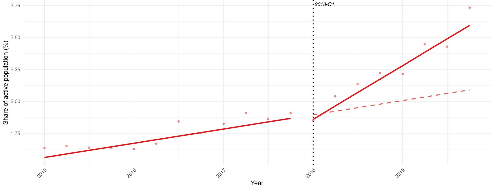
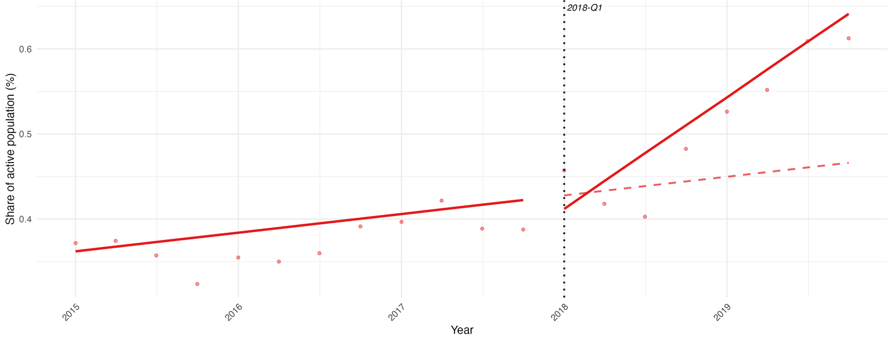

Master in Economics · Sciences Po · M2May 2026Supervisor: Pierre Cahuc17/20

::: {.btn-row}
[Read the full thesis (PDF)](Resources/sciences-po-thesis.pdf){.btn-cta} [Online appendix](thesis-appendix.qmd){.btn-ghost} [Replication package ↗](https://github.com/Rfernex/Personal-Projects/tree/main/Master%20thesis%20SciencesPo%20%28Ongoing%29){.btn-ghost}
:::

::: {.source-note}
Full title: *Self-Employment and Dual-Jobholding: Compositional Shifts in the French Labour Market in Response to the 2018 Microentrepreneurship Reform*.
:::

## Abstract

France's 2018 reform raised the turnover ceilings for micro-entrepreneurs. Using the French Labour Force Survey (*Enquête Emploi en Continu*) over 2015–2019, I study how the reform changed solo self-employment and entrepreneurship alongside a wage job. Interrupted time series estimates show a marked acceleration in both forms of microentrepreneurship. As an exploratory complement, I then estimate a static occupational choice model that combines tax treatment, administrative effort, preferences for varied work, and income risk. The model reproduces the direction and solo-over-hybrid ranking of the response but substantially understates its magnitude. Its counterfactual comparison suggests that raising the ceiling generates more revenue per induced entrepreneur than a matched increase in the micro premium, while drawing a much more concentrated group of high-turnover, high-ability entrepreneurs.

## The question behind the research

A worker can earn a living through one wage job, several wage jobs, a business, or a combination of wage work and self-employment. A simpler regime for small businesses can therefore change both **whether someone becomes an entrepreneur** and **how they combine different kinds of work**.

The 2018 reform, which doubled the turnover ceilings of the French micro-entrepreneur regime, offers a setting to study these choices. I describe the regime and the reform in more detail in the next section.

The central questions are who responds, which occupational states they leave, and whether a higher ceiling selects the same entrepreneurs as a broader increase in the regime's financial advantage.

## The French context

### How the micro regime came about

Before 2008, self-employment in France was already organised around two tiers. Under the *régime réel*, taxable income is net business income, and entrepreneurs must comply with full accounting and reporting obligations, which is the reason why most practitioners join an approved management centre (*centre de gestion agréé*) that helps with bookkeeping and vouches for them with the tax authority. The *régime micro-fiscal*, created in 1999, instead taxes revenue net of a flat abatement of 71% for retail sales, 50% for services, and 34% for liberal professions, so that entrepreneurs no longer need to itemise and justify their costs. Social contributions, however, still followed the standard rules for non-salaried workers, with provisional payments based on the previous year's income and a regularisation at the end of the year.

<strong>1999</strong><b>Régime micro-fiscal</b>Revenue is taxed net of a flat abatement, with light reporting obligations.

<strong>2008</strong><b>Auto-entrepreneur status</b>Contributions become a flat share of revenue actually received, and nothing is owed when nothing is earned.

<strong>2014 to 2016</strong><b>Loi Pinel</b>Registration, chamber dues, and the local business tax become compulsory, and the two micro regimes merge into a single mandatory regime.

<strong>2018</strong><b>Finance law for 2018</b>Turnover ceilings are doubled, exit requires two years above the ceiling, and VAT exemption is decoupled from the regime.

The *Loi de Modernisation de l'Économie* of 4 August 2008 added a third, super-simplified tier by creating the auto-entrepreneur status, with the stated goal of lowering the administrative cost of starting a business. Under the *régime micro-social simplifié* that came with it, social contributions are a flat percentage of the revenue actually received, paid monthly or quarterly, and nothing is owed when no revenue comes in. Subject to a household income ceiling, auto-entrepreneurs could also opt for the *versement libératoire*, which merges income tax and social contributions into a single periodic payment at a flat rate on gross revenue.

The appeal of the regime is therefore primarily one of simplicity and reduced risk rather than of guaranteed savings. For low-cost businesses in high-abatement sectors such as retail, the flat abatement both shrinks the tax base and removes the need for an accountant, which often makes the micro regime cheaper than the *régime réel*. For liberal professions, whose abatement is only 34%, the saving on accounting fees is the more likely motivation. Whether the micro-social rate is cheaper than the standard regime in absolute terms thus depends heavily on each entrepreneur's cost structure.

### A boom, then a correction

The new status triggered a sharp boom in business creation. In 2009, around 320,000 of the 575,000 newly created businesses were registered as auto-entrepreneurs, and microentrepreneurs accounted for about 34% of net job creation among the non-agricultural self-employed between 2009 and 2018. This expansion also came with precarity. Among early entrants, 49% came from unemployment and survival rates were low, which raised concerns about disguised unemployment and involuntary self-employment. Close to half of new auto-entrepreneurs reported no revenue in their first year, which is consistent with the under-reporting documented by [Aghion et al. (2025)](https://www.nber.org/papers/w24049), although genuine start-up delays offer an alternative explanation.

Registration growth slowed after 2011 and eventually reversed with the *Loi Pinel* of 18 June 2014, which substantially raised the administrative and financial cost of the status. Auto-entrepreneurs had to register with the trade or crafts registers and became liable for chamber of commerce and crafts dues and for the local business tax (*cotisation foncière des entreprises*), from which they had previously been exempt. Most importantly for this study, the micro-fiscal and micro-social regimes were merged into a single compulsory *régime microentrepreneur* from 1 January 2016, with no option left to remain under the standard rules below the ceiling. INSEE documents a fall of around 9% in micro-entrepreneur creations in 2015, while the creation of other firms rose at the same time, which points to substitution between regimes rather than to a pure loss of entrepreneurs. Registrations resumed afterwards, though at a more moderate pace than during the initial boom.

### The 2018 reform

The reform was voted within the finance law for 2018, with the explicit goal of widening access to the regime and of allowing existing microentrepreneurs to develop their activity without losing their status. It changed the regime in four ways.

- **Higher ceilings.** The eligibility ceilings were doubled, from €33,200 to €70,000 of annual revenue for services and liberal professions, and from €82,800 to €170,000 for sales activities. They applied retroactively to the 2017 fiscal year, so that entrepreneurs who had exceeded the old ceiling in 2017 kept their status. This is the component at the core of my structural model.
- **A softer exit rule.** Before the reform, exceeding the ceiling in a single year meant leaving the regime immediately. Entrepreneurs now lose their status only after exceeding it two years in a row.
- **VAT decoupling.** The VAT exemption threshold was not raised alongside the ceilings, which created a band between the old and new ceilings in which entrepreneurs qualify for the micro regime but are no longer automatically exempt from VAT.
- **The versement libératoire.** Its household income ceiling was left unchanged while the turnover ceiling doubled, so that among newly eligible entrepreneurs only those with modest household income can use it.

I do not model the exit rule, the VAT decoupling, or the *versement libératoire*, since the short panel does not allow me to identify their effects reliably, and each of them may bias my estimate of the financial value of self-employment before and after the reform. Since the reform widened access without lowering any rate, it was expected to weigh little on public finances. It was primarily seen as a way to attract, or retain, high-ability entrepreneurs through administrative simplification rather than through a tax cut, which is the reason why my approach focuses on the non-pecuniary channels of entrepreneurship rather than on tax optimisation.

### Who microentrepreneurs are

Microentrepreneurs are mostly active in services (48% in 2022), followed by health and commerce, and transport is the sector that grew fastest, by 53% between 2017 and 2021. Their revenues are very dispersed, strongly massed around zero, and lower on average than those of other independents, although the recent trend favours them: microentrepreneur revenues rose by 6.1% in 2019, while those of other independents fell by 2.1%.

Microentrepreneurship is also closely tied to multiple jobholding, or *pluriactivité*, which I define as INSEE most often does, namely holding more than one professional activity or more than one employer. When the auto-entrepreneur status was created, 57% of new entrants used it as a secondary activity, around 56% of them alongside a wage job and the rest to supplement a pension. I refer to those who combine a wage job and a micro-business as hybrid microentrepreneurs. In 2022, 30% of microentrepreneurs were pluriactive, against 10% of other non-salaried workers. Hybrids grow more slowly than solo microentrepreneurs, which can give the impression that the regime is moving away from them, although their absolute numbers keep rising. This category is at the centre of my model, which accounts for three motives for combining activities: constraints on hours in the main job, a preference for varied work, and the wish to diversify labour income risk.

## Data

I use **INSEE's French Labour Force Survey (*Enquête Emploi en Continu*, EEC)**. Its rotating panel follows respondents for six consecutive quarters, recording employment status, main and secondary jobs, hours, earnings, and demographic characteristics. This makes it possible to distinguish solo self-employment from entrepreneurship alongside a wage job.

The main analysis covers **2015-Q1 to 2019-Q4**. The wider data window begins in 2014-Q2, when the micro-entrepreneur identifier becomes usable, but I start the main estimates in 2015 to reduce the influence of the short-run effects of the Pinel law. I stop before 2020 to exclude the disruption caused by Covid-19.

| Main empirical sample | Coverage |
|:--|:--|
| Population | Employed respondents aged 15–64 |
| Observations after filtering | 878,828 person-quarters |
| Unique respondents | 244,591 |
| Weighting | INSEE survey weights |

I exclude agricultural activities, which are outside the micro-entrepreneur regime, as well as ambiguous occupational classifications and workers with more than one secondary job. Sample sizes vary with the availability of the variables needed for each estimate. The structural framework also includes a non-employment outside option, while the policy comparisons focus on the four working states.

**Hours and earnings provide different levels of precision.** Main-job hours are directly reported. Secondary hours are calculated from the difference between total and main-job hours. Entrepreneurial income is harder to measure: non-response is substantial, solo earnings are reported in brackets with an open top category, and income from a side business is not directly comparable to turnover. I harmonise reported net and gross earnings for the structural estimation. These limitations motivate the ITS design rather than a bunching analysis and make it difficult to identify precisely which businesses are constrained by the turnover ceiling.

The six-quarter observation window also limits what can be learned about longer-run occupational transitions, experimentation, and learning.

## Econometric strategy

### Detecting a break in 2018

I use an **interrupted time series (ITS)** design. For each occupational category, I compare the path of its survey-weighted share before and after 2018-Q1, allowing for both a one-off level change and a change in trend:

$$
Y_{c,t}=\alpha_c+\beta_{1,c}T_t+\beta_{2,c}D_t
+\beta_{3,c}D_t(T_t-T^*)+\sum_{q=2}^{4}\delta_{q,c}\mathbf 1\{Q_t=q\}+\varepsilon_{c,t}.
$$

Here, $D_t$ switches on at the reform, $\beta_2$ measures an immediate change, and $\beta_3$ measures a change in the quarterly trend. Seasonal indicators absorb regular within-year patterns. Aggregate estimates use Newey–West standard errors with a baseline bandwidth of five quarters.

Individual-level weighted logits add demographic and professional controls to assess changes in observable composition. Weighted OLS specifications study hours worked. Individual-level standard errors are clustered by respondent.

::: {.note}
**What identifies the effect?** The design assumes that no other contemporaneous shock would have generated the same break. The main candidates are the abolition of the RSI, which took effect on the same day, the PACTE law of 2019, and the conversion of the CICE into employer contribution cuts in 2019. I assess robustness through alternative windows, placebo exercises, HAC bandwidths, and trend diagnostics.
:::

### Estimating the model before the reform

I first recover earning-opportunity distributions from pre-reform data. Ten model parameters are then estimated by **two-step GMM**, matching thirteen pre-reform moments involving occupational shares, entrepreneurial earnings, hours, and micro-regime participation by sector and turnover. Other parameters, including risk aversion and within-sector cost dispersion, are calibrated. The actual ceiling reform is reserved for **out-of-sample validation**, with simulation draws held fixed across policy environments.

## Empirical results

I estimate the interrupted time series at two levels. The aggregate design uses the 20 quarterly survey-weighted shares, or mean hours, of each occupational category. The individual-level design uses the person-quarter observations, which makes it possible to control for observable characteristics and to check whether changes in the composition of the workforce drive the aggregate results. The tables below report the coefficients of interest, and the [online appendix](thesis-appendix.qmd) gives the full tables, the classification rules, and the robustness checks.

### Occupational shares

Before going into the tables, Figure 1 shows the break for the two groups the reform matters most for. In both cases, the share of the active population grows faster after 2018-Q1 than the pre-reform trend would predict, and the gap widens with every quarter. For hybrids, part of this acceleration predates the reform, as the robustness checks below show.

::: {#fig-its layout-ncol=1}
{fig-alt="Quarterly share of solo micro-entrepreneurs in the active population, 2015 to 2019, rising from about 1.6 to 2.7 percent, with a steeper fitted trend after 2018-Q1 than the extrapolated pre-reform trend."}

{fig-alt="Quarterly share of hybrid micro-entrepreneurs in the active population, 2015 to 2019, rising from about 0.37 to 0.61 percent, with a much steeper fitted trend after 2018-Q1 than the extrapolated pre-reform trend."}

Interrupted time series, share of the active population (%). Points are observed quarterly shares, solid lines are the fitted ITS trends, and the dashed line extends the pre-reform trend past 2018-Q1. The fitted lines are drawn for the first quarter, so they sit slightly off the points in other quarters.
:::

<table class="reg-table">
<caption>Table 1. Aggregate interrupted time series: share of the active population, in percentage points</caption>
<thead>
<tr><th></th><th>Wage only</th><th>Micro only</th><th>Wage + Wage</th><th>Wage + Micro</th></tr>
</thead>
<tbody>
<tr><td>Pre-reform trend $\hat\beta_1$</td><td>0.004 (0.006)</td><td>0.028&#42;&#42;&#42; (0.004)</td><td>−0.027&#42;&#42;&#42; (0.005)</td><td>0.006&#42;&#42;&#42; (0.001)</td></tr>
<tr><td>Level shift at the reform $\hat\beta_2$</td><td>−0.216&#42;&#42;&#42; (0.048)</td><td>−0.113&#42;&#42; (0.036)</td><td>0.410&#42;&#42;&#42; (0.072)</td><td>−0.045&#42; (0.017)</td></tr>
<tr><td>Post-reform slope change $\hat\beta_3$</td><td>−0.111&#42;&#42;&#42; (0.010)</td><td>0.083&#42;&#42;&#42; (0.007)</td><td>−0.033&#42;&#42; (0.010)</td><td>0.030&#42;&#42;&#42; (0.004)</td></tr>
<tr class="derived"><td>Post-reform trend $\hat\beta_1$ + $\hat\beta_3$</td><td>−0.107</td><td>0.111</td><td>−0.060</td><td>0.036</td></tr>
<tr class="stats"><td>R²</td><td>0.919</td><td>0.971</td><td>0.760</td><td>0.928</td></tr>
</tbody>
</table>

20 quarterly observations per column, 2015-Q1 to 2019-Q4. OLS with quarter fixed effects and Newey–West standard errors with a bandwidth of five quarters, in parentheses. &#42;&#42;&#42; p &lt; 0.001, &#42;&#42; p &lt; 0.01, &#42; p &lt; 0.05. The last row adds up the first and third rows.

Before the reform, the share of solo micro-entrepreneurs in the active population grew by 0.028 percentage points per quarter. After the reform, it grew by 0.111 points per quarter, about four times faster, which compensates within two quarters for the negative level shift of 0.113 points at the reform date. This negative jump is counterintuitive for a reform meant to expand the regime. A plausible explanation is an anticipation effect: since the law was passed in late December 2017 and applied retroactively to 2017, some workers may have shifted their registration or reporting, creating a dip in 2018-Q1 relative to the pre-reform trend. The level shift indeed becomes insignificant in the individual-level models below. At the same time, the share of wage-only workers, which was flat before the reform, starts declining by about 0.11 points per quarter, which suggests that some substitution away from wage work took place.

Hybrid micro-entrepreneurs, who combine a wage job and a micro-business, accelerate even more in relative terms, from 0.006 to 0.036 points per quarter, a sixfold increase, although their growth remains much smaller in absolute terms than that of solo micro-entrepreneurs. More puzzling is the large upward level shift of 0.410 points in dual wage employment at the reform date. Although a faster decline afterwards partly offsets it, it means that substitution between dual wage employment and hybrid entrepreneurship is likely to have been negligible. Lastly, the broader category of independents follows a very similar path (a post-reform slope change of 0.095 points per quarter for solo independents), which indicates that micro-entrepreneurs are the main, though not the only, driver of growth in self-employment over the period.

### Hours worked

<table class="reg-table">
<caption>Table 2. Aggregate interrupted time series: weekly hours worked</caption>
<thead>
<tr><th></th><th>Micro only main activity</th><th>Wage + Micro business</th><th>Wage + Micro wage job</th><th>Wage + Indep. independent activity</th></tr>
</thead>
<tbody>
<tr><td>Pre-reform trend $\hat\beta_1$</td><td>0.066&#42; (0.030)</td><td>−0.036 (0.035)</td><td>−0.002 (0.046)</td><td>−0.112&#42;&#42;&#42; (0.020)</td></tr>
<tr><td>Level shift at the reform $\hat\beta_2$</td><td>0.748&#42;&#42; (0.190)</td><td>0.300 (0.255)</td><td>0.313 (0.486)</td><td>1.184&#42;&#42;&#42; (0.201)</td></tr>
<tr><td>Post-reform slope change $\hat\beta_3$</td><td>−0.138&#42;&#42; (0.044)</td><td>0.043 (0.045)</td><td>−0.010 (0.068)</td><td>0.022 (0.036)</td></tr>
<tr class="stats"><td>R²</td><td>0.597</td><td>0.415</td><td>0.103</td><td>0.593</td></tr>
</tbody>
</table>

20 quarterly observations per column, 2015-Q1 to 2019-Q4. Outcomes are survey-weighted mean weekly hours in the activity indicated. The third column checks whether hybrid micro-entrepreneurs moved hours away from their wage job. Same estimator and significance levels as Table 1.

Solo micro-entrepreneurs work 0.748 more hours per week right after the reform, but the post-reform slope change of 0.138 hours per quarter in the opposite direction gradually erodes this gain, at a pace that would take more than ten quarters to offset it. In other words, the reform had a moderately positive effect on weekly hours, which the entry of new workers then progressively diluted. A possible explanation is that new entrants have a higher return to entrepreneurship and benefit from the reform even when they work fewer hours than the average incumbent. For hybrid micro-entrepreneurs, neither coefficient on the hours spent in the business is significant, and the hours spent in their wage job do not fall either, which goes against the idea that they moved time from their wage job toward their business.

### Individual-level estimates

<table class="reg-table">
<caption>Table 3. Individual-level logits: probability of being in each state, log-odds</caption>
<thead>
<tr><th></th><th colspan="3">Micro only</th><th colspan="3">Wage + Micro</th></tr>
<tr><th></th><th>&#40;1)</th><th>&#40;2)</th><th>&#40;3)</th><th>&#40;4)</th><th>&#40;5)</th><th>&#40;6)</th></tr>
</thead>
<tbody>
<tr><td>Pre-reform trend $\hat\beta_1$</td><td>0.015&#42;&#42; (0.006)</td><td>0.015&#42;&#42; (0.006)</td><td>0.016&#42;&#42; (0.006)</td><td>0.013 (0.011)</td><td>0.012 (0.011)</td><td>0.013 (0.011)</td></tr>
<tr><td>Level shift at the reform $\hat\beta_2$</td><td>−0.009 (0.050)</td><td>−0.008 (0.050)</td><td>−0.015 (0.050)</td><td>−0.021 (0.101)</td><td>−0.019 (0.101)</td><td>−0.018 (0.101)</td></tr>
<tr><td>Post-reform slope change $\hat\beta_3$</td><td>0.031&#42;&#42; (0.011)</td><td>0.031&#42;&#42; (0.011)</td><td>0.034&#42;&#42; (0.011)</td><td>0.052&#42; (0.022)</td><td>0.051&#42; (0.022)</td><td>0.051&#42; (0.022)</td></tr>
<tr class="stats"><td>Demographic controls</td><td>No</td><td>Yes</td><td>Yes</td><td>No</td><td>Yes</td><td>Yes</td></tr>
<tr class="stats"><td>Sector and underemployment</td><td>No</td><td>No</td><td>Yes</td><td>No</td><td>No</td><td>Yes</td></tr>
<tr class="stats"><td>Person-quarters</td><td>894,374</td><td>894,374</td><td>884,013</td><td>894,374</td><td>894,374</td><td>884,013</td></tr>
</tbody>
</table>

Weighted logits with survey weights normalised to a mean of one, seasonal controls in every column, and standard errors clustered by respondent, in parentheses. Demographic controls are education, number of children, gender, age, and age squared. &#42;&#42;&#42; p &lt; 0.001, &#42;&#42; p &lt; 0.01, &#42; p &lt; 0.05. Covariate coefficients and interactions are in <a href="thesis-appendix.html#app-indiv_interactions">Appendix C</a>.

The individual-level logits confirm the aggregate results. For solo micro-entrepreneurs, the post-reform slope change is positive and significant at the 1% level in all three specifications, and it even increases slightly as demographic and professional controls are added. This stability indicates that changes in the observable composition of the active population do not drive the acceleration. For hybrid micro-entrepreneurs, the slope change is also positive but only significant at the 5% level, which is most likely explained by the small size of this group, at about 0.5% of observations. The level shift is small and insignificant in every specification. Interacting the post-reform slope with each covariate yields almost no significant term, so I find no evidence that the reform affected specific demographic or professional groups differently.

None of the individual-level hours effects is significant, whether for solo or hybrid micro-entrepreneurs or for the wage job of hybrids. These regressions rely on far fewer observations (18,402 and 3,523 person-quarters, against nearly 900,000 for the logits), so the null results may reflect a lack of power rather than a true absence of effect. The only notable heterogeneity is that women show a stronger post-reform growth in hours spent on their side business, which is consistent with women who already ran one seizing the opportunity to work more on it.

### Robustness

Appendix B of the [online appendix](thesis-appendix.qmd#app-robustness) reports several checks. Re-estimating the aggregate model on a shorter window starting in 2016 barely changes the results, with a post-reform slope change of 0.076 instead of 0.083 for solo micro-entrepreneurs and 0.025 instead of 0.030 for hybrids. The slope changes remain significant at the 0.1% level for bandwidths of three, five, and seven quarters. A RESET test does not reject the linear specification (p = 0.37 for solo and 0.39 for hybrid micro-entrepreneurs), and the residuals show no systematic pattern. At the individual level, a rolling placebo over candidate reform dates from 2015-Q3 to 2017-Q2 gives estimates centred near zero for all four outcomes, while the estimate at the true reform date stands clearly apart.

One check is less reassuring. A placebo reform dated 2016-Q1 in the aggregate model produces no slope change for solo micro-entrepreneurs (0.002), but a significant one for hybrids (0.019), which means that hybrid micro-entrepreneurship was already accelerating before 2018. The slope change at the true reform date is about 30% larger, so part of the hybrid acceleration can be associated with the reform period, but the sixfold figure, which compares the post-reform trend with a single linear pre-reform trend, most likely overstates it.

## How the model works

The structural part of the thesis is exploratory. It is a first attempt at formalising the mechanisms behind the reduced-form results, and its calibration is poor, as the limitations below make clear. I present it for the trade-offs it makes explicit rather than for its numbers.

Each worker compares the value of four working arrangements: a single wage job ($W$), two wage jobs ($WW$), a wage job plus a business ($WSE$), and self-employment alone ($SE$). A non-employment outside option completes the theoretical model. The policy experiments condition on the four working states.

<strong>1 · Opportunities</strong>Wages, entrepreneurial ability, income risk, costs, and available time differ across workers.

<strong>2 · Best arrangement</strong>Within each state, choose hours and, where applicable, the better entrepreneurial regime.

<strong>3 · Occupational choice</strong>Compare the resulting values, allowing for unobserved preferences.

In the **constrained** version, hours in the primary wage job are fixed. In the **unconstrained** version, those hours are chosen jointly with any secondary activity. Both versions account for the time available to work.

### A higher ceiling expands the feasible business size

Micro status is available when expected turnover remains below $M$. If expected hourly turnover is $\mu_y$, the hours cap is

$$h^{se}\leq\bar m=\frac{M}{\mu_y}.$$

Raising $M$ relaxes this restriction. It matters most for a worker whose preferred scale was blocked by the old ceiling. A small side business already well below the ceiling need not change at all.

Turnover ceiling · An illustration

<h3>How much room does the ceiling create?</h3>

<label for="cap-sector">Activity</label><select id="cap-sector"><option value="services">Services / liberal professions</option><option value="retail">Retail</option></select>

<label for="cap-return">Expected turnover per hour <output for="cap-return" id="cap-return-out"></output></label><input id="cap-return" type="range" min="10" max="150" step="1" value="45">

<svg id="cap-chart" class="chart" viewBox="0 0 660 300" role="img" aria-label="Maximum micro-eligible hours before and after the reform"></svg>

After the reformBefore the reform

Maximum eligible hours: M / μy, subject to an illustrative 3,000-hour annual time budget. These are eligibility limits. Actual hours depend on the worker's optimal choice.

<button class="reset-button" type="button" data-reset="cap">Reset</button>

### How much business income is retained?

The financial return depends on real costs and the tax base. The model writes retained shares as

$$\rho^m_i=1-c_i-[\kappa^m_s+t^{IR}(1-a_s)],\qquad
\rho^r_i=(1-c_i)(1-\kappa^r_s)(1-t^{IR}).$$

Here $c_i$ is the real cost share, $a_s$ the micro abatement, and the $\kappa$ terms represent social contributions. A residual premium $\tau$ multiplies micro disposable income by $(1+\tau)$. This is a reduced-form parameter, separate from the statutory rates.

### When is micro status financially attractive?

Micro contributions and income tax depend on turnover and a fixed sectoral abatement. Under the régime réel, actual operating costs reduce the tax base. As costs rise, the micro advantage therefore shrinks: a business can qualify for micro status and still retain more income under the régime réel. A larger abatement or micro premium shifts that financial balance towards micro status.

Operating costs and regime choice · An illustration

<h3>When does deducting actual costs pay off?</h3>

<label for="regime-sector">Activity</label><select id="regime-sector"><option value="bnc">Liberal professions · BNC (SSI)</option><option value="services">Services · BIC</option><option value="retail">Retail · BIC</option></select>

<label for="regime-cost">Operating costs (% of turnover) <output for="regime-cost" id="regime-cost-out"></output></label><input id="regime-cost" type="range" min="0" max="70" step="1" value="40">

<label for="regime-premium">Micro premium τ (%) <output for="regime-premium" id="regime-premium-out"></output></label><input id="regime-premium" type="range" min="0" max="12" step="0.1" value="0">

<svg id="regime-chart" class="chart" viewBox="0 0 660 300" role="img" aria-label="Disposable income under micro and réel regimes as operating costs rise"></svg>

Micro, including the premiumRégime réel

Income per €100 of turnover: 100 × (1 + τ) × ρm for micro, and 100 × ρr for réel. The calibration uses a 10% income-tax rate, 45% réel contributions, micro contributions of 12.8% in retail and 22% in services/BNC (SSI), and abatements of 71%, 50%, and 34%. The premium starts at zero to isolate tax treatment. My estimated value is 6.94%. Turnover is held fixed and below the ceiling. Administrative effort and changes in hours also affect the full regime choice.

<button class="reset-button" type="button" data-reset="regime">Reset</button>

### Administrative effort and varied work

The regime also changes the **effort** required to run a business. The model adds recurring administrative effort $S_g$ to productive hours, with $S_L<S_H$ for micro and réel respectively:

$$\psi^{SE}_g(h)=\chi\gamma\frac{(h+S_g)^{1+\eta_{se}}}{1+\eta_{se}},\qquad
\psi^{WSE}_g(h)=\phi\,\psi^{SE}_g(h).$$

The parameter $\gamma$ scales entrepreneurial work disutility. A lower $\phi$ makes the entrepreneurial part of a hybrid arrangement less burdensome, representing a taste for varied activities. A separate fixed cost $\gamma_{MH}$ applies to **both** dual-job states. It affects their attractiveness without directly changing their optimal hours.

### A wage can buffer entrepreneurial risk

Workers care about expected utility, not just expected income:

$$u(c)=\begin{cases}c^{1-\sigma}/(1-\sigma),&\sigma\ne1,\\\log c,&\sigma=1.\end{cases}$$

Entrepreneurial returns are lognormal and uncertain. In hybrid work, wage earnings provide a stable component of consumption:

$$\mathbb E\left[u\left(w_1\bar h+(1+\tau)\rho^m\tilde y h^{se}\right)\right].$$

That wage buffer makes the hybrid expectation different from the solo case. This is an income-diversification channel, distinct from the preference for varied work captured by $\phi$.

Income risk · An illustration

<h3>How does a stable wage buffer risk?</h3>

<label for="risk-sigma">Risk aversion σ <output for="risk-sigma" id="risk-sigma-out"></output></label><input id="risk-sigma" type="range" min="0" max="2" step="0.05" value="0.9">

<label for="risk-vol">Log-income volatility σy <output for="risk-vol" id="risk-vol-out"></output></label><input id="risk-vol" type="range" min="0" max="1.2" step="0.02" value="0.6">

<svg id="risk-chart" class="chart" viewBox="0 0 660 300" role="img" aria-label="Certainty-equivalent income with and without a stable wage buffer"></svg>

50% stable wage, 50% business income100% business income

Both portfolios have mean disposable income of 100 illustrative units. The certainty equivalent is the sure income giving the same utility as the risky income. This comparison isolates income risk, holding labour supply, taxes, and work preferences fixed.

<button class="reset-button" type="button" data-reset="risk">Reset</button>

### From values to occupational probabilities

After hours and regimes have been chosen, a multinomial logit maps indirect utilities into probabilities:

$$P_{ij}=\frac{\exp(\tilde V_i^j/\lambda_L)}{\sum_{k\in\mathcal J_A}\exp(\tilde V_i^k/\lambda_L)}.$$

A small $\lambda_L$ makes choice closely follow the highest modelled value. A larger value gives more weight to idiosyncratic preferences. The denominator here uses the four working states, as in the policy experiments.

Occupational choice · An illustration

<h3>Why not simply choose the highest-value job?</h3>

<label for="choice-cost">Dual-job fixed cost γMH <output for="choice-cost" id="choice-cost-out"></output></label><input id="choice-cost" type="range" min="0" max="4" step="0.1" value="1">

<label for="choice-scale">Logit scale λL <output for="choice-scale" id="choice-scale-out"></output></label><input id="choice-scale" type="range" min="0.1" max="5" step="0.1" value="1">

Illustrative values before the dual-job cost: W = 3, WW = 4, WSE = 4.5, SE = 3.5 utility units. The same cost is subtracted from WW and WSE. Probabilities follow the logit formula with these fixed illustrative values.

<button class="reset-button" type="button" data-reset="choice">Reset</button>

<noscript>
JavaScript is needed to use the interactive diagrams. All equations, interpretations, and findings remain available in the text and full paper.
</noscript>

## Structural results

Given the exploratory nature of the model, these results illustrate how the mechanism could work rather than measure the effect of the reform.

### What the model captures and what it misses

The model predicts a positive response, with a larger solo than hybrid effect. It strongly attenuates the size of that response. In the validation exercise, the change in the overall solo self-employment share is approximately **0.02 percentage points in the model**, compared with an **ITS fitted change of 0.95 percentage points**. For solo microentrepreneurship, the corresponding changes are **0.29** and **0.89 percentage points**.

This distinction matters: much of the model's micro increase comes from existing réel entrepreneurs switching regimes, while the data show more net entry. I return to the reasons for this mismatch, and to its consequences, in the limitations below.

### Comparing two policy instruments

The counterfactual compares the higher ceiling with a flat increase in the micro premium, adjusted to generate the **same modelled entry into entrepreneurship**. Within that comparison:

- The ceiling raises around **7.4 times more net collected revenue per induced entrepreneur**, with a range of roughly **6–9** across the cost-dispersion sensitivity exercise. Both instruments are revenue-positive under the accounting used here.
- The ceiling draws high-turnover, high-ability entrepreneurs, concentrated in the liberal professions. The matched premium increase attracts a broader mix of turnover levels, abilities, and sectors.
- The difference in revenue is driven largely by existing constrained businesses expanding their turnover. The model's net entry margin is small relative to switching between regimes.

::: {.note}
**How to read the fiscal result.** I interpret the revenue ratio and composition contrast rather than the absolute euro amounts or entrant counts, whose magnitudes are poorly calibrated. The premium experiment keeps statutory collection rates fixed: the premium changes disposable income, and revenue changes through behaviour. It is therefore not a complete budget costing of a cash subsidy programme.
:::

## Limitations

These results come with serious caveats, and I would rather state them plainly than let the headline numbers speak for themselves.

### The reduced-form break is not a clean causal effect

The interrupted time series compares the trend of each occupational share before and after 2018-Q1 within a single national series, without any comparison group. With at most twelve quarters on each side of the reform, the design has limited power, and it rests entirely on the assumption that nothing else changed at the same moment. That assumption is hard to defend here, since the abolition of the RSI and the transfer of independent workers to the general social security system took effect on 1 January 2018, the very day the ceilings were raised. As both reforms concern the same population, I cannot separate their effects in the data. I argue in the thesis that the RSI transition was gradual and that the 2019 wage-side reforms (the PACTE law and the conversion of the CICE into employer contribution cuts) work against finding an effect, but this argument rests on reasoning about timing and target populations rather than on a test. The placebo and specification checks rule out spurious breaks at other dates, not a confounding shock on the same date. The estimates are therefore best read as a break in trend that coincides with the reform, rather than as the isolated effect of the higher ceiling. For hybrid micro-entrepreneurs the problem is sharper still, since a placebo reform dated 2016-Q1 already detects a significant acceleration, so part of their growth predates the reform.

### The data cannot see the businesses the reform targets

The Labour Force Survey was not designed to measure entrepreneurial revenue. Non-response among micro-entrepreneurs is substantial, solo earnings are only reported in brackets with an open top category, and income from a side business is not comparable to turnover. As a consequence, I cannot observe which businesses were actually constrained by the old ceiling, which is precisely the margin the reform acts on, and this is also the reason why a bunching design at the threshold was out of reach. Besides, the hybrid state is thin, with only 275 individuals combining a wage job and a business in the estimation sample, so every moment that relies on them is imprecise. Lastly, respondents are followed for six quarters at most, which rules out any study of longer-run transitions, experimentation, or learning.

### The structural model fits poorly where it matters

The model reproduces the direction of the response and the ranking of solo over hybrid entrepreneurship, but it misses its size by a wide margin. Doubling the ceiling raises the model's solo self-employment share by 0.02 percentage points, against 0.95 points in the data, so the simulated response is about one fiftieth of the observed one. The gap is smaller for solo micro-entrepreneurship (0.29 against 0.89 points), but the model gets there through the wrong mechanism: its micro gain comes almost entirely from existing réel entrepreneurs switching regime, whereas the data show net entry into micro with no fall in réel. The model also generates virtually no hybrid response, while the hybrid acceleration is one of the strongest reduced-form results, so it leaves one of the two main empirical findings unexplained. The main cause is mechanical. Because revenue is bracketed and open-topped, only 9.4% of micro-entrepreneurs sit at the ceiling at baseline in the model, which leaves the reform almost nothing to act on.

Other parts of the fit are weak as well. With risk aversion calibrated close to one, income and substitution effects on hours nearly cancel, and the model compresses the dispersion of entrepreneurial hours to almost nothing (a variance of log hours of 0.003 against 0.277 in the data). This in turn leaves the administrative setup costs of the two regimes only weakly identified, although their gap is the very rationale for a simplified micro regime. Since operating costs do not vary with business size in the model, the micro regime does not become less attractive as turnover grows, as it does in the data, and the model overpredicts the micro share among high-turnover entrepreneurs (0.218 against 0.108) while underpredicting it at low turnover (0.211 against 0.374). The model also overstates the share of dual jobholders who run a business (0.294 against 0.161). Finally, the fixed cost of holding two jobs comes out implausibly large, which means it should be read as a catch-all for the search and coordination frictions that a static model leaves out rather than as a preference.

### The counterfactual is narrower than it looks

Because of this attenuation, the absolute euro amounts and the number of induced entrepreneurs are not calibrated quantities and should not be read as such. The comparison between the ceiling and the premium only holds because the two instruments are matched on the same induced entry, so that the common attenuation cancels in the ratio. Even this ratio depends on the within-sector dispersion of operating costs, which I calibrate to reproduce the observed micro share rather than measure directly, and it moves from about 6 to about 9 across the values I consider. The composition contrast is robust to both problems, but it is close to built in. In the model, the ceiling can only act on the workers it binds, all of whom have high turnover, so finding that it attracts high-turnover entrepreneurs largely reflects the structure of the model rather than an independent finding. More broadly, the model is static and partial-equilibrium, it ignores the VAT decoupling that accompanied the reform, and it leaves out the option value of trying out entrepreneurship, which is likely to matter most for the low-earning entrants that the model barely produces.

## Further research

Most of these limitations come from the data and from the tractability trade-offs of the model rather than from the question itself, and further work would have to start by addressing them.

The most pressing issue is identification. Separating the higher ceiling from the abolition of the RSI, which took effect on the same day and concerned the same workers, would require a source of variation that a single national series does not offer. Until then, the reduced-form estimates remain a break in trend that coincides with the reform rather than its isolated effect.

Further work to assess the relevance of a learning channel in this setting would require longer-run panel data, for instance the *base non-salariés*, which would track entrepreneurial revenues more accurately than the EEC allows. Such data would also show which businesses were actually constrained by the old ceiling, which is the very margin the reform acts on and the one this thesis cannot observe. On the model side, measuring the within-sector dispersion of operating costs directly from the firm-level FARE file, available through the CASD, would pin down a parameter that I currently calibrate and on which the fiscal comparison depends.

The VAT decoupling that accompanied the reform also deserves attention in its own right, since it altered incentives in the band between the old and new thresholds in ways the present model does not represent. Lastly, moving from a static, partial-equilibrium framework to a dynamic and general-equilibrium one would be needed to capture the option value of trying out entrepreneurship, to test whether a learning value of hybrid employment explains the surge that the current model leaves unexplained, and to see how a large entry response feeds back into the returns to wage work and self-employment.
