```{=html}
<div class="document-language" id="document-language" hidden>
  <label for="document-language-select">Document language</label>
  <select id="document-language-select" aria-describedby="document-language-help">
    <option value="en" lang="en">English</option>
    <option value="fr" lang="fr">Français</option>
  </select>
  <p id="document-language-help">Choose the language for the PDFs and portrait reader on this page.</p>
  <p class="document-language-status visually-hidden" role="status" aria-live="polite"></p>
</div>
```

```{=html}
<div class="featured-work">
  <a class="featured-cover" href="Resources/writing/internationalisation-enseignement-superieur-japonais-en.pdf" tabindex="-1" aria-hidden="true">
    <span class="featured-cover-surface">
      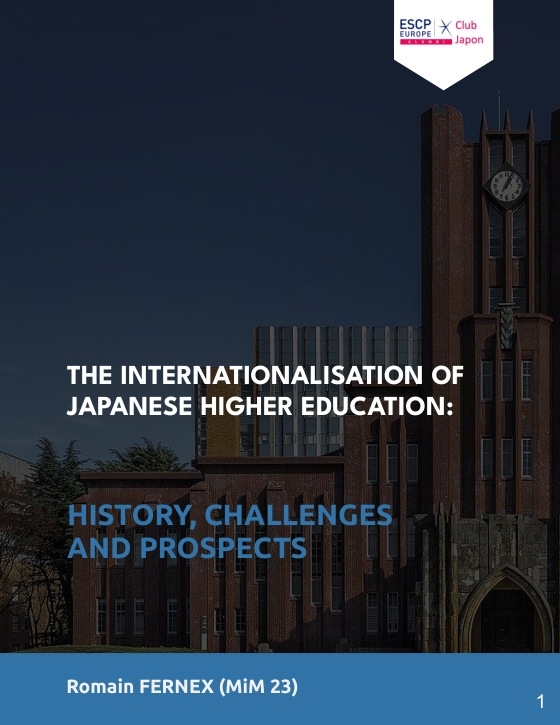
    </span>
  </a>
  <div class="featured-body">
    <p class="eyebrow">Featured dossier</p>
    <h3><a href="Resources/writing/internationalisation-enseignement-superieur-japonais-en.pdf">L’internationalisation de l’enseignement supérieur japonais : histoire, défis et perspectives</a></h3>
    <div class="meta"><span>ESCP Japon · Dossier N°1</span><span>2023</span><span>27 pages</span><span class="lang" data-document-language>In English</span></div>
    <p>A dossier on how the Japanese university system has built its relationship with the rest of the world since 1868, from alternating phases of openness and withdrawal to the effort to reaffirm Japan’s place on the international university market, and on the tension between international ambitions and national priorities.</p>
    <p class="featured-actions"><a class="btn-cta" href="Resources/writing/internationalisation-enseignement-superieur-japonais-en.pdf">Read the dossier (PDF) →</a></p>
  <noscript><p><a href="Resources/writing/internationalisation-enseignement-superieur-japonais.pdf" lang="fr" hreflang="fr">Lire le dossier en français (PDF)</a></p></noscript>
  </div>
</div>
```

## Reports and analyses

::: {.work-entry}
[Report]{.eyebrow}

### [Report on the EU–South Korea Free Trade Agreement: a discussion on the history and future of European trade policy in Asia](Resources/writing/eu-korea-fta-report.pdf)

<div class="meta"><span>French version published by Call On U, ESCP Europe</span><span>2023</span></div>

Starting from the difficulties the EU faces in signing new trade agreements in Asia, this report looks back at the EU–South Korea free trade agreement, its content and the controversies around its implementation, to understand why the EU’s insistence on social and environmental standards shapes its trade policy in the region.

[Read the report (PDF) →](Resources/writing/eu-korea-fta-report.pdf)

<noscript><p>Other language: <a href="Resources/writing/eu-korea-fta-report-fr.pdf" lang="fr" hreflang="fr">Français</a></p></noscript>
:::

::: {.work-entry}
[Article series, three parts]{.eyebrow}

### [Is an Asian NATO possible? The Quadrilateral Security Dialogue and the challenges of strategic cooperation in the Indo-Pacific](Resources/writing/quad-article-series.pdf)

<div class="meta"><span>2022</span></div>

A three-part series on the Quad, which brings together Japan, Australia, India and the United States, asking whether this dialogue could turn into a NATO-style alliance in the Indo-Pacific and what limits strategic cooperation between its members.

[Read the series (PDF) →](Resources/writing/quad-article-series.pdf)

<noscript><p>Other language: <a href="Resources/writing/quad-article-series-fr.pdf" lang="fr" hreflang="fr">Français</a></p></noscript>
:::

## History articles

::: {.work-entry}
[Article series, three parts]{.eyebrow}

### Les origines de la Corée et le royaume de Goguryeo : entre récits nationalistes et réalités historiques

<div class="meta"><span>2022</span><span class="lang" data-document-language>In English</span></div>

A three-part series on the origins of Korea and the kingdom of Goguryeo, whose legacy China and Korea both claim, contrasting nationalist narratives with what historical sources tell us about the kingdom’s emergence, its rise, and the period of the Three Kingdoms.

[Part I (PDF)](Resources/writing/goguryeo-1-en.pdf) · [Part II (PDF)](Resources/writing/goguryeo-2-en.pdf) · [Part III (PDF)](Resources/writing/goguryeo-3-en.pdf)

<noscript><p>Other language: <a href="Resources/writing/goguryeo-1.pdf" lang="fr" hreflang="fr">Français — 1</a> · <a href="Resources/writing/goguryeo-2.pdf" lang="fr" hreflang="fr">Français — 2</a> · <a href="Resources/writing/goguryeo-3.pdf" lang="fr" hreflang="fr">Français — 3</a></p></noscript>
:::

::: {.work-entry}
[Historiography]{.eyebrow}

### [Les Olmèques, pionniers ou simples acteurs d’une première « régionalisation » en Amérique du Sud ?](Resources/writing/olmeques-en.pdf)

<div class="meta"><span>Part I, brief historiography of the « problème olmèque »</span><span>2022</span><span class="lang" data-document-language>In English</span></div>

An overview of Olmec studies from the eighteenth century to the early 1980s and of their main schools of thought, on whether the Olmecs pioneered a first regionalisation or were simply one of its actors. It opens on Thomas Kuhn’s idea of paradigm shifts to explain why this debate kept changing as archaeological discoveries accumulated.

[Read the article (PDF) →](Resources/writing/olmeques-en.pdf)

<noscript><p>Other language: <a href="Resources/writing/olmeques.pdf" lang="fr" hreflang="fr">Français</a></p></noscript>
:::

::: {.work-entry}
[Article]{.eyebrow}

### [La femme japonaise dans le Japon de l’ère Meiji : des trajectoires féministes à l’épreuve du conservatisme](Resources/writing/femme-japonaise-ere-meiji-en.pdf)

<div class="meta"><span>2023</span><span class="lang" data-document-language>In English</span></div>

The Meiji transformation is often described as having left Japanese women behind. Drawing on recent historical and sociological research, this article shows instead how women’s movements emerged and fought for their rights in a society still shaped by patrilineal and Confucian values.

[Read the article (PDF) →](Resources/writing/femme-japonaise-ere-meiji-en.pdf)

<noscript><p>Other language: <a href="Resources/writing/femme-japonaise-ere-meiji.pdf" lang="fr" hreflang="fr">Français</a></p></noscript>
:::

## Portraits from Japanese history

My series of short portraits of figures from Japanese history, written for the ESCP Japon newsletter (the ESCP alumni association dedicated to japanese culture of which I am a board member) which is still ongoing. Each portrait is available in French and English.

```{=html}
<div class="pr">
  <div class="pr-shelf">
    <button class="pr-arrow pr-arrow-left" type="button" data-act="scroll-left" aria-label="Show newer portraits" hidden>‹</button>
    <ol class="pr-strip">
      <li><a class="pr-tile" href="Resources/writing/sakamoto-ryoma-en.pdf" data-slug="sakamoto-ryoma" data-name="Sakamoto Ryōma" data-kanji="坂本龍馬" data-year="2026" data-desc="A hero of Japan’s national narrative, and the debates among historians about his actual role.">
        <span class="pr-thumb">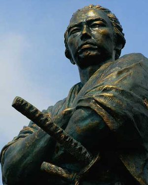</span>
        <span class="pr-label"><span class="pr-tile-year">2026</span><span class="pr-tile-name">Sakamoto Ryōma</span></span>
      </a><noscript><a href="Resources/writing/sakamoto-ryoma.pdf" lang="fr" hreflang="fr">Français (PDF)</a></noscript></li>
      <li><a class="pr-tile" href="Resources/writing/tokugawa-yoshimune-en.pdf" data-slug="tokugawa-yoshimune" data-name="Tokugawa Yoshimune" data-kanji="徳川吉宗" data-year="2026" data-desc="The eighth Tokugawa shogun, who took over an indebted regime in 1716 and reformed its administration and finances.">
        <span class="pr-thumb">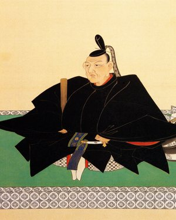</span>
        <span class="pr-label"><span class="pr-tile-year">2026</span><span class="pr-tile-name">Tokugawa Yoshimune</span></span>
      </a><noscript><a href="Resources/writing/tokugawa-yoshimune.pdf" lang="fr" hreflang="fr">Français (PDF)</a></noscript></li>
      <li><a class="pr-tile" href="Resources/writing/minamoto-no-yoritomo-en.pdf" data-slug="minamoto-no-yoritomo" data-name="Minamoto no Yoritomo" data-kanji="源頼朝" data-year="2025" data-desc="The founder of the Kamakura shogunate, the first shogunate in Japanese history.">
        <span class="pr-thumb">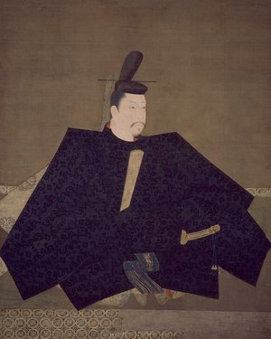</span>
        <span class="pr-label"><span class="pr-tile-year">2025</span><span class="pr-tile-name">Minamoto no Yoritomo</span></span>
      </a><noscript><a href="Resources/writing/minamoto-no-yoritomo.pdf" lang="fr" hreflang="fr">Français (PDF)</a></noscript></li>
      <li><a class="pr-tile" href="Resources/writing/prince-shotoku-en.pdf" data-slug="prince-shotoku" data-name="Prince Shōtoku" data-kanji="聖徳太子" data-year="2025" data-desc="The seventh-century prince credited with the twelve-rank court system and the renewal of relations with China.">
        <span class="pr-thumb">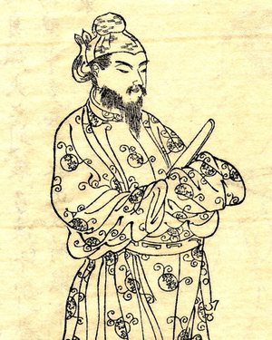</span>
        <span class="pr-label"><span class="pr-tile-year">2025</span><span class="pr-tile-name">Prince Shōtoku</span></span>
      </a><noscript><a href="Resources/writing/prince-shotoku.pdf" lang="fr" hreflang="fr">Français (PDF)</a></noscript></li>
      <li><a class="pr-tile" href="Resources/writing/gustave-boissonade-en.pdf" data-slug="gustave-boissonade" data-name="Gustave Boissonade" data-kanji="ボアソナード" data-year="2025" data-desc="The French jurist called to Japan in 1873, at the origins of the modernisation of Japanese law.">
        <span class="pr-thumb">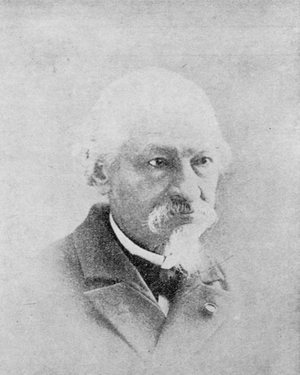</span>
        <span class="pr-label"><span class="pr-tile-year">2025</span><span class="pr-tile-name">Gustave Boissonade</span></span>
      </a><noscript><a href="Resources/writing/gustave-boissonade.pdf" lang="fr" hreflang="fr">Français (PDF)</a></noscript></li>
      <li><a class="pr-tile" href="Resources/writing/matsuo-basho-en.pdf" data-slug="matsuo-basho" data-name="Matsuo Bashō" data-kanji="松尾芭蕉" data-year="2025" data-desc="The Edo-period master of haiku, from his travels to his most famous poem.">
        <span class="pr-thumb">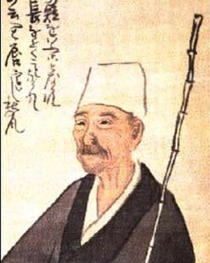</span>
        <span class="pr-label"><span class="pr-tile-year">2025</span><span class="pr-tile-name">Matsuo Bashō</span></span>
      </a><noscript><a href="Resources/writing/matsuo-basho.pdf" lang="fr" hreflang="fr">Français (PDF)</a></noscript></li>
      <li><a class="pr-tile" href="Resources/writing/kusunoki-masashige-en.pdf" data-slug="kusunoki-masashige" data-name="Kusunoki Masashige" data-kanji="楠木正成" data-year="2024" data-desc="The fourteenth-century warrior whose sacrifice in the service of the emperor made him a heroic figure.">
        <span class="pr-thumb">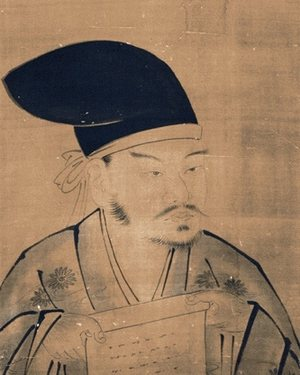</span>
        <span class="pr-label"><span class="pr-tile-year">2024</span><span class="pr-tile-name">Kusunoki Masashige</span></span>
      </a><noscript><a href="Resources/writing/kusunoki-masashige.pdf" lang="fr" hreflang="fr">Français (PDF)</a></noscript></li>
      <li><a class="pr-tile" href="Resources/writing/date-masamune-en.pdf" data-slug="date-masamune" data-name="Masamune Date" data-kanji="伊達政宗" data-year="2024" data-desc="The “one-eyed dragon” who conquered northern Japan, rallied Hideyoshi, and left a lasting mark on the Tohoku region.">
        <span class="pr-thumb">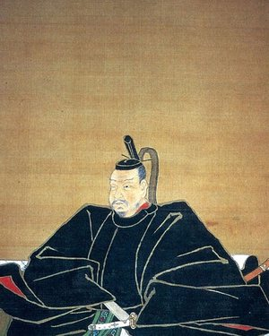</span>
        <span class="pr-label"><span class="pr-tile-year">2024</span><span class="pr-tile-name">Masamune Date</span></span>
      </a><noscript><a href="Resources/writing/date-masamune.pdf" lang="fr" hreflang="fr">Français (PDF)</a></noscript></li>
      <li><a class="pr-tile" href="Resources/writing/fukuzawa-yukichi-en.pdf" data-slug="fukuzawa-yukichi" data-name="Fukuzawa Yukichi" data-kanji="福澤諭吉" data-year="2024" data-desc="A thinker in the image of the Meiji era, who studied Western knowledge and founded the ancestor of Keio University.">
        <span class="pr-thumb">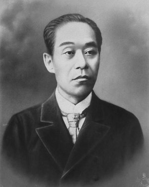</span>
        <span class="pr-label"><span class="pr-tile-year">2024</span><span class="pr-tile-name">Fukuzawa Yukichi</span></span>
      </a><noscript><a href="Resources/writing/fukuzawa-yukichi.pdf" lang="fr" hreflang="fr">Français (PDF)</a></noscript></li>
      <li><a class="pr-tile" href="Resources/writing/kishida-toshiko-en.pdf" data-slug="kishida-toshiko" data-name="Kishida Toshiko" data-kanji="岸田俊子" data-year="2024" data-desc="One of the first figures of the Japanese feminist movement, from tutor to the empress to public speaker.">
        <span class="pr-thumb">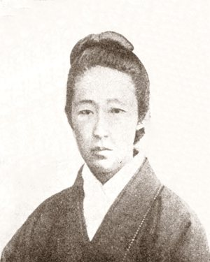</span>
        <span class="pr-label"><span class="pr-tile-year">2024</span><span class="pr-tile-name">Kishida Toshiko</span></span>
      </a><noscript><a href="Resources/writing/kishida-toshiko.pdf" lang="fr" hreflang="fr">Français (PDF)</a></noscript></li>
    </ol>
    <button class="pr-arrow pr-arrow-right" type="button" data-act="scroll-right" aria-label="Show older portraits" hidden>›</button>
  </div>
  <div class="pr-viewer">
    <div class="pr-head">
      <div class="pr-heading" aria-live="polite">
        <p class="pr-kicker"><span class="pr-count"></span><span class="pr-year"></span><span class="pr-lang" data-document-language>In English</span></p>
        <h3 class="pr-title"><span class="pr-name"></span> <span class="pr-kanji" lang="ja"></span></h3>
        <p class="pr-desc"></p>
      </div>
      <div class="pr-tools" role="toolbar" aria-label="Reader controls">
        <button type="button" data-act="prev" aria-label="Previous portrait">←</button>
        <button type="button" data-act="next" aria-label="Next portrait">→</button>
        <span class="pr-sep" aria-hidden="true"></span>
        <button type="button" data-act="zoom-out" aria-label="Zoom out">−</button>
        <button type="button" class="pr-zoom" data-act="zoom-fit" aria-label="Fit page to width">Fit</button>
        <button type="button" data-act="zoom-in" aria-label="Zoom in">+</button>
        <a class="pr-open" href="#">PDF ↗</a>
      </div>
    </div>
    <div class="pr-pages" tabindex="0" aria-label="Pages of the selected portrait"></div>
  </div>
</div>
```

## Talks

::: {.work-entry}
[Presentation]{.eyebrow}

### [EU–Korea Free Trade Agreement: history and debates around a major milestone in international trade](Resources/writing/eu-korea-fta-presentation.pdf)

<div class="meta"><span>Slides</span><span>2022</span></div>

A presentation on the same agreement, with the main figures on trade between the EU and South Korea and the debates the agreement raised.

[View the slides (PDF) →](Resources/writing/eu-korea-fta-presentation.pdf)

<noscript><p>Other language: <a href="Resources/writing/eu-korea-fta-presentation-fr.pdf" lang="fr" hreflang="fr">Français</a></p></noscript>
:::

::: {.work-entry}
[Lecture]{.eyebrow}

### [Introductory lecture on epistemology: the Cartesian cogito and the mathesis universalis](Resources/writing/descartes-epistemology-lecture.pdf)

<div class="meta"><span>Slides</span><span>2022</span></div>

An introduction to Descartes’ thought, from the Galilean-Cartesian revolution to the cogito, the *Discourse on the Method* and the *Meditations on First Philosophy*.

[View the slides (PDF) →](Resources/writing/descartes-epistemology-lecture.pdf)

<noscript><p>Other language: <a href="Resources/writing/descartes-epistemology-lecture-fr.pdf" lang="fr" hreflang="fr">Français</a></p></noscript>
:::
